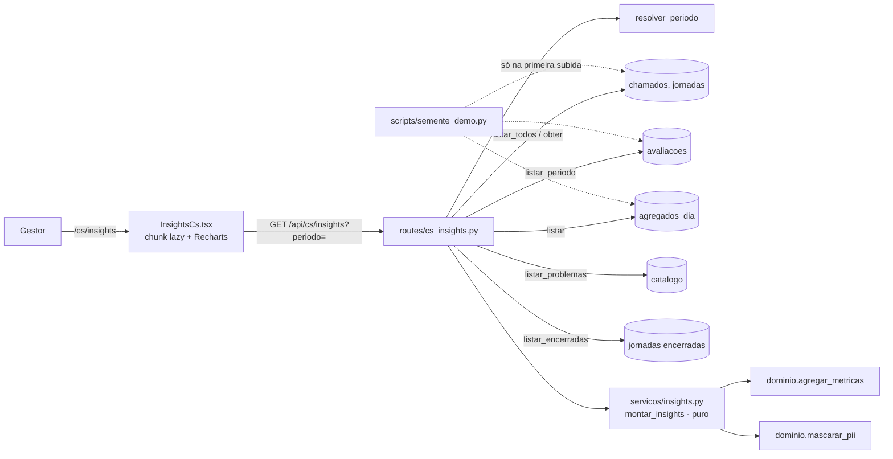
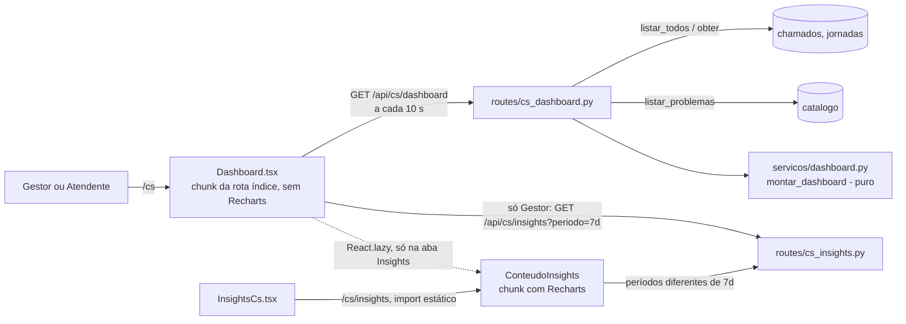

# Design Document

## Visão geral

A feature adiciona a tela `/cs/insights` (só Gestor) e a rota `GET /api/cs/insights?periodo=`. Ela responde "como está o atendimento e a satisfação?" com nota média, distribuição das notas, comentários mascarados, tempo até assumir e até encerrar, Chamados P1 de risco, falso defeito x defeito real e o ranking dos problemas. O funil da Jornada é um bloco secundário e opcional.

O desenho segue o padrão que o projeto já usa na `MetricasCs`:

- **Rota fina** (`routes/cs_insights.py`): valida o período, lê os repositórios existentes e chama uma função pura.
- **Serviço puro** (`servicos/insights.py`): recebe registros já lidos e devolve o dicionário da resposta. Sem I/O, sem relógio, sem acesso a repositório.
- **Domínio reaproveitado**: `agregar_metricas` calcula o que ele já calcula (nota por camada, precisão da escalada, deflexão por camada, seleções por problema). O que ele não calcula (nota média geral, distribuição, tempos, desfecho, P1 de risco, solução mais registrada) fica no serviço.
- **Front** (`apps/web/src/cs/insights/ConteudoInsights.tsx`, usado por `InsightsCs.tsx` em `/cs/insights` e pela aba "Insights" do Dashboard): estados carregando/erro/pronto, cards, dois gráficos com tabela equivalente, ranking, comentários e funil.
- **Semente** (`scripts/semente_demo.py`): dados fictícios para a demo, ligados só pelo ponto de entrada de linha de comando do `dev_local.py`.

**Atualização: Dashboard e navegação (Requisitos 19 a 26).** O Painel_CS passa a abrir em um **Dashboard** (`/cs`, rota índice, no lugar do redirecionamento para `/cs/fila`) e a navbar ganha "Dashboard" e "Insights". O Dashboard repete o desenho acima com uma segunda rota, aberta a Gestor e Atendente:

- **Rota fina** (`routes/cs_dashboard.py`): `GET /api/cs/dashboard`. Lê o instante uma vez, lê `listar_todos` e a Jornada de cada Chamado, lê os títulos do catálogo e chama uma função pura.
- **Serviço puro** (`servicos/dashboard.py`): `montar_dashboard(agora, ...)`. Recebe o instante por parâmetro, sem I/O e sem relógio. Calcula as seis contagens, os Motivos_De_Foco, a ordem determinística e o limite de 10 itens.
- **Front** (`apps/web/src/cs/Dashboard.tsx` e `cs/dashboard/`): Visão geral, abas WAI-ARIA ("Insights" só para o Gestor e "Chamados em foco"), `?aba=` na URL, atualização a cada 10 s. A aba "Insights" carrega o `ConteudoInsights` (e com ele o Recharts) por `React.lazy`, só quando é aberta.
- **Reuso, sem copiar código:** o conteúdo da Tela_Insights é extraído de `InsightsCs` para `ConteudoInsights`, e a resposta de 7 dias que alimenta os Cards_De_Satisfacao é a mesma que a aba usa (D12).

Nada em `infra/`, nos Protocols de `repositorios/interfaces.py`, no adaptador DynamoDB, no pacote `dominio`, em `/api/cs/metricas`, em `/api/cs/fila` ou na `MATRIZ` de autorização muda.

## Decisões de projeto

### D1. Biblioteca de gráficos: Recharts 3.10.1 (versão exata)

**Decisão:** `recharts` na versão exata `3.10.1`, mais `react-is` na versão exata `19.3.0` (peer obrigatório do Recharts), ambos em `dependencies` de `apps/web/package.json`, sem `^` nem `~`.

**O que foi verificado (npm registry e testes em diretório temporário, já removido):**

| Verificação | Resultado |
|---|---|
| `npm view recharts` | `latest` = `3.10.1`, licença MIT |
| `peerDependencies` reais de `recharts@3.10.1` | `react ^16.8 \|\| ^17 \|\| ^18 \|\| ^19`, `react-dom ^16 \|\| ^17 \|\| ^18 \|\| ^19`, `react-is ^16.8 \|\| ^17 \|\| ^18 \|\| ^19` |
| Versões do projeto | `react` e `react-dom` `19.3.0`, `@types/react` `19.3.0`, `typescript` `6.0.3`, `vite` `8.3.4`, `vitest` `5.0.4` |
| `npm install --dry-run` em `apps/web` | Sem `ERESOLVE`. Instala `recharts`, `react-redux 9.3.0`, `@reduxjs/toolkit 2.13.0`, `victory-vendor`, `es-toolkit` e mais cerca de 30 pacotes pequenos. `react-is` passa a `19.3.0` na raiz e a `17.0.2` aninhado nos pacotes que pedem a 17 |
| Instalação limpa com a mesma pilha (React 19.3.0, Vitest 5.0.4, jsdom 30.1.2, jest-axe 11.0.0) | Sem avisos de peer dependency |
| Teste `BarChart` + `LabelList` em jsdom com `jest-axe` | Passou, 0 violações, 5 barras renderizadas |
| `ResponsiveContainer` em jsdom sem `ResizeObserver` | Passou sem quebrar |
| `tsc --noEmit` com o `tsconfig` do projeto (`strict`, `skipLibCheck`) sobre um componente com `ResponsiveContainer`, `BarChart`, `Bar`, `Cell`, `LabelList`, `XAxis` e `YAxis` | Sem erros de tipo do Recharts |
| Build de biblioteca só com `BarChart` | cerca de 446 kB minificado, 114 kB gzip (inclui redux e d3) |

**Por que Recharts e não outra opção:**

- Os Requisitos 15.1 a 15.3 pedem uma Biblioteca_Graficos com peers React 19. O Recharts declara React 19 e passou nos três testes que importam aqui: instalação, tipos e `jest-axe`.
- As alternativas olhadas também declaram React 19 (`react-chartjs-2 5.3.1` com `chart.js ^4.1.1`, `@nivo/bar 0.99.0`, `@visx/xychart 4.0.0` com `@react-spring/web`, `victory 37.3.6`), mas nenhuma passa por um teste melhor aqui, e o `@visx/xychart` e o Nivo pedem mais pacotes de apoio. Chart.js desenha em `<canvas>`, que não é inspecionável em jsdom e não tem texto próprio para leitor de tela.
- SVG/CSS próprio resolveria dois gráficos simples sem dependência. Foi descartado porque o Requisito 15 pede biblioteca e porque o custo do Recharts está isolado (próximo item).

**Custo e como ele fica isolado:**

- O peso (cerca de 114 kB gzip) vai só para o chunk do `ConteudoInsights`, que é carregado quando o Gestor abre `/cs/insights` ou a aba "Insights" do Dashboard. `rotas.tsx` já usa `lazy(() => import(...))` por rota; só `GraficoDistribuicao.tsx` e `GraficoDesfecho.tsx` importam `recharts`, e só `ConteudoInsights.tsx` os importa. As rotas públicas do Consumidor, a rota índice `/cs` (Dashboard) e a aba "Chamados em foco" não o incluem (Req 15.5). A forma exata em que isso é garantido, e como se verifica, está em D11.
- Importações nomeadas (`import { BarChart, Bar, ... } from "recharts"`), para o tree-shaking descartar o resto.

**Como o Recharts convive com acessibilidade (Req 14):**

- O gráfico é reforço visual. Cada gráfico fica em `<figure>` com `<figcaption>` (nome acessível) e uma descrição curta ligada por `aria-describedby`. O SVG fica dentro de um `<div aria-hidden="true">` e usa `accessibilityLayer={false}`, para o Recharts não criar elemento focável dentro de região escondida (regra `aria-hidden-focus` do axe).
- A Alternativa_Textual é a **tabela visível** logo abaixo, com os mesmos rótulos e números. Os valores também aparecem no gráfico por `LabelList`, então nada depende só de cor.
- `isAnimationActive={false}` nas barras: evita animação em quem prefere menos movimento e deixa os testes estáveis.
- Nos testes de componente, verifica-se a tabela e o `figure`, nunca os `<rect>` do SVG. O arquivo de teste registra um `ResizeObserver` vazio com `vi.stubGlobal` por segurança.

**Instalação (tarefa de implementação):** `npm install --save-exact recharts@3.10.1 react-is@19.3.0` dentro de `apps/web`, atualizando `package-lock.json`. Depois, rodar `npm test` (as suítes existentes) para confirmar que o `react-is` aninhado na 17 manteve o `@testing-library/dom` funcionando.

### D2. Como a API sabe que está no Modo_Local

**Decisão:** `modo_local = (ctx.app.modo == MODO_LOCAL)`, onde `MODO_LOCAL = "local"` vem de `core.app`.

- `criar_app(..., modo="local")` já grava `Aplicacao.modo`. O `scripts/dev_local.py` chama `criar_app({}, modo="local")`, e produção cai em `"aws"` (padrão, ou `TRES_MODO`). Outras rotas já usam esse mesmo teste (`chamado.py`, `resolucao.py`, `cs_encerramento.py`, `saude.py`).
- Não se deduz o modo do sucesso de `listar_todos`. O campo diz em que modo a API roda, não se a consulta funcionou. Na prática, fora do Modo_Local a rota nem chega a responder 200, porque `listar_todos` levanta `ErroIndisponivelForaDoModoLocal`.
- O serviço puro recebe `modo_local: bool` como parâmetro e só o repassa. Isso mantém o serviço sem acesso a `Aplicacao`.
- Teste: app local devolve `true`. Para o `false`, chama-se o handler com uma `Aplicacao` de `modo="aws"` e repositórios em memória injetados (`criar_app(modo="aws", repos=...)` aceita `repos`), sem tocar na AWS.

### D3. Semente fictícia

**Onde mora:** `scripts/semente_demo.py` (novo). É o único lugar com código que cria dados de demonstração (Req 16.13). O `dev_local.py` o importa como já importa `estado_demo` (a pasta `scripts/` já entra no `sys.path`).

**Como é ativada só pelo ponto de entrada, sem quebrar os testes existentes.** Os testes atuais de `test_dev_local.py` chamam `main(["--porta","0"], dir_dados=...)` **sem** `--sem-demo` e esperam exatamente 3 Chamados e 3 Jornadas no Snapshot. Se `main()` criasse a semente por padrão, eles quebrariam, e o Requisito 17.2 proíbe alterá-los. Por isso:

```python
def iniciar_estado(app, senha, persistencia, *, resetar, com_demo,
                   com_semente: bool = False,                 # novo, padrão preserva o contrato
                   agora_semente: datetime | None = None,     # novo, para testes
                   log: Callable[[str], None] = print) -> str: ...

def main(argv=None, *, dir_dados=DIR_DADOS_DEMO,
         com_semente: bool = False) -> int: ...               # novo, padrão False

if __name__ == "__main__":
    raise SystemExit(main(com_semente=True))                  # a linha de comando liga a semente
```

- `popular()` não muda. `iniciar_estado()` sem o argumento novo se comporta como hoje (3 Chamados_De_Exemplo quando `com_demo` é verdadeiro).
- Dentro de `iniciar_estado`, só no ramo "sem Snapshot" (situação `novo` ou `resetado`), depois de `popular(...)` e **antes** de `persistencia.gravar(...)`: `if com_demo and com_semente: criar_semente(...)`. O ramo `carregado` nunca chama a semente (Req 16.3).
- `main()` passa `com_semente=com_semente and not args.sem_demo`. Então `--sem-demo` desliga exemplos e semente juntos (Req 16.4), e `--resetar` sem `--sem-demo` recria os dois (Req 16.2).
- O texto de ajuda de `--sem-demo` passa a dizer "não cria Chamados de exemplo nem a semente de demonstração".
- Falha ao criar a semente: `main` registra `[demo] não foi possível criar a semente: <erro>` e segue, como `_chamados_de_exemplo` já faz com os exemplos. Registros já gravados ficam (dados de demo são opcionais).

> Divergência com o texto dos requisitos: o 16.1 diz que "o Servidor_Local" cria a semente e o 16.14 diz "pelo fluxo de `main()`". Aqui isso vale para o **ponto de entrada de linha de comando** (`python scripts/dev_local.py`). Chamar `main(...)` por código, como os testes antigos fazem, não liga a semente a menos que se passe `com_semente=True`. É a única forma de cumprir 16.14 e 17.2 ao mesmo tempo.

**API do módulo:**

```python
SEMENTE_ALEATORIA: Final = 20250607   # random.Random(SEMENTE_ALEATORIA): mesmo conjunto a cada execução
PREFIXO_JORNADA: Final = "01JSEMENTE"  # exemplos usam "01JDEMO..."; ids da semente são distintos
PREFIXO_CHAMADO: Final = "TRES-SEM"    # "TRES-SEM" + 7 dígitos = 10 caracteres Crockford válidos

@dataclass(frozen=True, slots=True)
class ResumoSemente:
    jornadas: int; chamados: int; avaliacoes: int; contadores: int

def criar_semente(repos: Repositorios, *, agora: datetime,
                  log: Callable[[str], None] = print) -> ResumoSemente: ...
```

**Relógio e instantes.** `agora` entra por parâmetro e precisa ter fuso (`ValueError` se for ingênuo). A função não lê o relógio. Todo instante é `agora - deslocamento`, e todo deslocamento é `>= 0`, então nada fica no futuro. Os deslocamentos vêm de uma tabela fixa de cenários com variação sorteada por `random.Random(SEMENTE_ALEATORIA)`. O uso do gerador não depende de `agora`.

- **Registros de hoje.** O cenário "hoje" limita o fim da cadeia: `deslocamento = min(planejado, segundos desde 00:00 UTC de agora)`. Assim, mesmo às 00:00:05 UTC, existe ao menos um registro no dia corrente (Req 16.5). Como o limite só depende da hora do dia, `criar_semente(agora + k dias inteiros)` produz o mesmo conjunto deslocado em `k` dias (propriedade P17).
- **Cadeias de tempo vão de trás para frente.** Parte-se do instante final (avaliação ou encerramento) e subtrai-se: avaliação, encerramento, assumir, escalada, criação da Jornada. Assim nenhum instante passa de `agora`.
- **Fuso.** O dia de cada contador e o "hoje" usam `servicos.insights.FUSO_REFERENCIA` (UTC), a mesma constante que a API usa. Ver D4.

**Como os registros são criados** (Req 16.16: só pelos métodos dos repositórios em memória, então os invariantes continuam valendo):

| Registro | Método |
|---|---|
| Jornada | `repos.jornadas.criar(Jornada(...))` com `criada_em`, `ultima_interacao`, `origem`/`origem_inicial` (`qr` ou `busca`), `modelo_id`, `problema_id`, `problemas_selecionados`; `risco=RiscoMarcado("lista", t)` nos cenários P1; `guia_respondeu_nao=True` nos cenários P2 |
| Camada `guia` | `repos.jornadas.encerrar(jid, "guia", t_fim, problema_id=...)` |
| Camada `abandonada` | Jornada `ativa` com `ultima_interacao = t_ab - 31 min`, depois `repos.jornadas.marcar_abandono(jid, t_ab)` |
| Chamado | `ServicoEscalada(repos, relogio=cursor, gerar_numero=contador).escalar(jid, gatilho)`, com `cursor` sendo um relógio mutável ajustado antes de cada chamada e `contador` devolvendo `TRES-SEM0000001`, `TRES-SEM0000002`... Usa a decisão real do Motor_Escalada (P1 por risco, P2 por `guia_respondeu_nao`, P3 nos demais) e cria o rascunho de OS dos P2 |
| Em atendimento / encerrado | `repos.chamados.assumir(numero, "atendente", "Atendente", t_assumir)` e `repos.chamados.encerrar(numero, EncerramentoChamado(...))` |
| Camada `humano` | `repos.jornadas.encerrar(jid, "humano", t_enc, problema_id=..., desfecho=...)` |
| Avaliação | `repos.avaliacoes.registrar(Avaliacao(jid, nota, camada, em, comentario))` |
| Contador de seleção | `repos.agregados.incrementar(dia, f"problema_sel#{pid}", delta)` por (dia, problema), com o dia do instante de seleção (criação + 20 a 60 s, limitado a `agora`) |

**Volumes (todos acima dos mínimos do Req 16.5):**

| Coorte | Jornadas | Chamados | Observações |
|---|---|---|---|
| Resolvidas no guia (`guia`) | 26 | 0 | 15 `qr` e 11 `busca`; `tempo_s` de 90 a 900; 15 com avaliação (camada `guia`) |
| Abandonadas (`abandonada`) | 8 | 0 | 3 `qr` e 5 `busca`; sem avaliação |
| Encerradas com atendimento (`humano`) | 16 | 16 | P1 x3 (com risco), P2 x8, P3 x5; `falso_defeito` x7 e `defeito_real` x9; até assumir de 1 min a 6 h; até encerrar de 5 min a 48 h; 12 com avaliação (camada `humano`) |
| Abertos | 4 | 4 | inclui 1 P1 de risco criado hoje |
| Em atendimento | 3 | 3 | P2 e P3, com responsável |
| **Total** | **57** (50 encerradas) | **23** | 27 avaliações, 4 Chamados P1 de risco |

- **Espalhamento:** os instantes finais vão de hoje a cerca de 29 dias atrás, mais densos nos últimos 7 dias, para os períodos `hoje`, `7d` e `30d` terem conteúdo diferente.
- **Hoje:** pelo menos 2 Jornadas `guia` encerradas, 1 avaliação, o Chamado aberto P1 e 1 Chamado em atendimento.
- **Notas:** cada nota de 1 a 5 aparece ao menos uma vez (cobertura garantida pela tabela de cenários, o sorteio só completa); 8 ou mais avaliações com comentário, escolhidos de uma lista fixa de frases em português **sem dígitos nem e-mail** (por exemplo "Resolveu rápido, obrigado." e "Demorou mais do que eu esperava.").
- **Problemas:** os ids vêm de `repos.catalogo.listar_problemas()` (os 6 primeiros por `problema_id`), com pesos 14, 10, 8, 6, 4 e 3 sobre as 57 Jornadas. Os Chamados encerrados ficam nos 4 primeiros problemas, para `falso_defeito_pct` variar por linha do ranking. Cada Jornada com problema soma 1 no contador do seu dia, então a soma dos contadores de um problema é igual ao número de Jornadas da semente com aquele problema.
- **Textos de solução** (`EncerramentoChamado.solucao`): 6 frases fixas, tipos `instrução do manual` e `outra`, sem dígitos.
- **Modelos:** `repos.catalogo.listar_modelos()` (3 primeiros), por rotação.

**Idempotência com o Snapshot.**

1. Ramo `carregado` (Snapshot existe): `criar_semente` não é chamada, e os registros do Snapshot são os únicos que existem.
2. Ramo `novo`/`resetado`: a semente roda uma vez e o Snapshot inicial é gravado logo depois, já com ela.
3. Defesa extra: se `repos.jornadas.obter(<primeiro id da semente>)` já existe, `criar_semente` devolve `ResumoSemente(0, 0, 0, 0)` sem criar nada. Chamar duas vezes seguidas não duplica.

**Mensagem no console (Req 16.12):** `[demo] Semente de dados FICTÍCIOS criada: 57 jornadas, 23 chamados, 27 avaliações.`

### D4. Contrato da resposta, período e fuso

**Fuso_Referencia = UTC**, definido em `servicos/insights.py` como `FUSO_REFERENCIA = UTC` e importado pela semente. Motivo: os contadores `problema_sel#<id>` já são gravados pelo dia **UTC** (`routes/guia.py`: `agora.astimezone(UTC).date()`), e `agregar_metricas.contem_dia` usa o fuso do `inicio` do período. Com UTC, o dia do contador e o dia do período coincidem sem mudar `guia.py`. A troca por outro fuso exigiria mudar a gravação dos contadores (fora do escopo). Efeito conhecido: "Hoje" vira o dia às 21:00 em Brasília; a tela mostra "datas em UTC".

**Resolução do período** (`resolver_periodo(agora, periodo, inicio, fim)`, pura). O intervalo é semiaberto `[inicio, fim)`, o mesmo que `PeriodoMetricas` usa:

| `periodo` | `inicio` | `fim` |
|---|---|---|
| ausente ou `7d` | `fim - 7 dias` | próximo segundo inteiro depois de `agora` |
| `30d` | `fim - 30 dias` | idem |
| `hoje` | 00:00 UTC do dia de `agora` | 00:00 UTC do dia seguinte |
| `personalizado` | 00:00 UTC do dia `inicio` | 00:00 UTC do dia seguinte a `fim` |

- O "próximo segundo inteiro" faz um registro gravado no mesmo instante da requisição entrar no período (um `fim` igual a `agora` o excluiria).
- `inicio` e `fim` do personalizado só valem no formato `AAAA-MM-DD` (regex `\d{4}-\d{2}-\d{2}` antes de `date.fromisoformat`, que sozinho aceita `20250101`). Intervalo de `n` dias inclusivos: `n = (fim - inicio).days + 1`, e `n > 90` é erro. Isso casa com a regra de `PeriodoMetricas` (`fim - inicio <= 90 dias` em instantes semiabertos).
- Erros viram `ErroPeriodoInsights(campo, motivo)`; a rota converte em **400** com o envelope padrão (`ErroApi(400, VALIDACAO, ...)`). Não se usa `erros.validacao(...)`, que devolve 422.
- `inicio`/`fim` enviados com `periodo` diferente de `personalizado` são ignorados.

**Limitação conhecida:** os contadores diários cobrem dias inteiros do calendário. No período `7d`, `selecoes` inclui o dia inteiro em que a janela móvel começa, enquanto `chamados` e as demais contagens usam o instante exato. O ranking é, portanto, por dia de calendário. A tela diz isso numa nota curta sob o ranking.

**Formato da resposta** (conjunto fechado de 9 chaves). Decimais saem como **texto** (`"4.2"`), porque `core.http.serializar` serializa `Decimal` como `str`. `"sem dados"` (`SEM_DADOS`) ocupa o lugar do número quando o denominador é zero. Contagens são inteiros.

```json
{
  "periodo": { "id": "7d", "inicio": "2025-06-01T12:00:00+00:00", "fim": "2025-06-08T12:00:01+00:00" },
  "modo_local": true,
  "satisfacao": {
    "nota_media": "4.1",
    "total": 27,
    "distribuicao": [
      { "nota": 1, "quantidade": 1, "percentual": "3.7" },
      { "nota": 2, "quantidade": 2, "percentual": "7.4" },
      { "nota": 3, "quantidade": 3, "percentual": "11.1" },
      { "nota": 4, "quantidade": 9, "percentual": "33.3" },
      { "nota": 5, "quantidade": 12, "percentual": "44.4" }
    ],
    "por_camada": [
      { "camada": "guia",   "nota_media": "4.3", "avaliacoes": 15 },
      { "camada": "humano", "nota_media": "3.8", "avaliacoes": 12 }
    ]
  },
  "comentarios": [ { "nota": 5, "em": "2025-06-08T10:41:00+00:00", "texto": "Resolveu rápido, obrigado." } ],
  "atendimento": {
    "ate_assumir":  { "media": "42:10", "mediana": "18:30", "quantidade": 16 },
    "ate_encerrar": { "media": "612:05", "mediana": "301:40", "quantidade": 16 }
  },
  "desfecho": {
    "total": 16,
    "itens": [
      { "desfecho": "falso_defeito", "quantidade": 7, "percentual": "43.8" },
      { "desfecho": "defeito_real",  "quantidade": 9, "percentual": "56.3" },
      { "desfecho": "nao_informado", "quantidade": 0, "percentual": "0.0" }
    ],
    "precisao_escalada_pct": "56.3"
  },
  "p1_risco": { "total": 4, "nao_encerrados": 1 },
  "ranking_problemas": [
    {
      "problema_id": 3, "titulo": "Máquina não liga", "selecoes": 14, "chamados": 5,
      "falso_defeito_pct": "40.0",
      "solucao_mais_registrada": { "solucao_tipo": "instrução do manual", "solucao": "Reencaixar o reservatório e religar.", "quantidade": 3 }
    }
  ],
  "funil": {
    "total_encerradas": 50,
    "por_origem": [ { "origem": "qr", "quantidade": 28, "percentual": "56.0" }, { "origem": "busca", "quantidade": 22, "percentual": "44.0" } ],
    "abandono_pct": "16.0",
    "deflexao": [
      { "camada": "guia",       "quantidade": 26, "percentual": "52.0" },
      { "camada": "humano",     "quantidade": 16, "percentual": "32.0" },
      { "camada": "abandonada", "quantidade": 8,  "percentual": "16.0" }
    ]
  }
}
```

Regras do formato:

- `distribuicao` sempre tem 5 linhas (notas 1 a 5, zeros incluídos). Sem avaliações: `nota_media` e `percentual` são `"sem dados"` e as quantidades são 0.
- `desfecho.itens` sempre tem as 3 linhas (`falso_defeito`, `defeito_real`, `nao_informado`); a tela esconde `nao_informado` quando a quantidade é 0. A soma das quantidades é igual a `desfecho.total`.
- `por_camada` traz só `guia` e `humano`. A camada `ia` nunca aparece (Req 9), e `abandonada` não tem avaliação.
- Cada tempo usa `formatar_min_seg` (`"5:12"`; minutos passam de 59, como em `"75:03"`).
- `solucao_mais_registrada` e `falso_defeito_pct` valem `"sem dados"` quando o problema não tem Chamado_Encerrado no período.
- `funil` é `null` quando a leitura das Jornadas encerradas falha.
- `comentarios[].em` é o instante da avaliação em ISO 8601; a tela mostra só a data, em UTC.
- Nunca saem: `jornada_id`, número de Chamado, telefone, CEP, e-mail, CPF, texto de mensagem, resumo do Pacote, passos do manual, `ia_cache`, `ia_modelo`, custo.

### D5. Autorização: `Rota.perfis`, não a MATRIZ

O Requisito 1.4 pede que a rota seja "classificada na matriz" como exclusiva do Gestor. Mas `test_autorizacao_cs.py::test_matriz_cobre_exatamente_as_rotas_do_design` exige que `MATRIZ` tenha **exatamente** as rotas atuais, e o Requisito 17.2 proíbe alterar esse teste. Acrescentar `("GET","/insights")` em `MATRIZ` o quebraria.

**Decisão:** a rota declara `perfis=frozenset({"gestor"})` em `Rota(...)` e usa `@exigir_perfil("gestor")`. `servicos/autenticacao.py` já passa `rota.perfis` para `decidir_acesso`, que dá a ele precedência sobre a matriz. O resultado é o mesmo (401 sem sessão, 403 para Atendente, 200 para Gestor), a falha continua fechada, e nenhum teste existente muda. Um teste novo confere `decidir_acesso(True, "atendente", "GET", "/insights", ROTA.perfis) is Acesso.SEM_PERMISSAO` e que o Gestor é permitido.

A mesma decisão vale para a `GET /api/cs/dashboard` (D9), com `perfis={"gestor","atendente"}`.

### D6. Códigos HTTP reais

- `ErroRepositorio` (inclusive `ErroIndisponivelForaDoModoLocal`) que sobe da rota vira **502** `dependencia_indisponivel` em `core.processamento`. É assim que `/api/cs/metricas` se comporta de fato (o docstring dela diz 500, mas o código e o pipeline dão 502). Exceção inesperada vira **500** `erro_interno`. A rota nova **não captura** esses erros: segue o mesmo comportamento da `/metricas`, sem indicadores parciais.
- Os Requisitos 1.8 e 11.3 dizem "500". Os testes verificam "resposta 5xx com envelope de erro e sem nenhuma chave de indicador", e um teste fixa o par atual (`ErroRepositorio` -> 502, exceção genérica -> 500). A tela trata qualquer não-2xx do mesmo jeito.
- Período inválido: **400** (Req 2.5 a 2.7), com `erro.campos` indicando `periodo`, `inicio` ou `fim`.

### D7. Privacidade por construção

O serviço não recebe `Chamado` nem `Jornada` completos. Recebe projeções com só os campos necessários, montadas por funções puras:

- `ChamadoInsights`: `prioridade`, `status`, `criado_em`, `assumido_em`, `encerrado_em`, `desfecho`, `solucao_tipo`, `solucao`, `problema_id`, `jornada_risco`. Fica de fora `pacote` (resumo, modelo, série), número e `jornada_id`.
- `JornadaInsights`: `origem_inicial` e o `JornadaEncerrada` do domínio.
- `Avaliacao` (do repositório) entra como está; o `jornada_id` dela só serve para converter para `dominio.metricas.Avaliacao` e nunca sai.

A rota não lê `dados_pessoais`, `mensagens` nem `acessos_pii`.

### D8. Nota média geral e percentuais

`agregar_metricas` só devolve nota média **por camada**; a média geral não existe no domínio, e as funções de arredondamento dele são privadas. O serviço calcula a média geral e os percentuais com um auxiliar local (`Decimal`, `ROUND_HALF_UP`, 1 casa), idêntico em semântica ao do domínio. Os testes comparam com um cálculo de referência feito com `Fraction`, como `test_propriedade_metricas_formulas.py` já faz. Não se acrescenta função pública ao `dominio` (isso mudaria o contrato do pacote, Req 11.5).

### D9. `GET /api/cs/dashboard`: autorização e contrato (Req 21 a 23)

**Rota separada da API_Insights, aberta aos dois perfis.** O Atendente precisa dos Chamados em foco, mas a `/insights` é exclusiva do Gestor (Req 21.4). Reabrir a `/insights` ao Atendente quebraria o 403 do Req 1.3, e uma rota que muda de forma por perfil esconderia a regra de acesso. Por isso são duas rotas, cada uma com os perfis na própria declaração.

**Autorização sem tocar a MATRIZ.** A rota declara `perfis=frozenset({"gestor", "atendente"})` em `Rota(...)` e usa `@exigir_perfil("gestor", "atendente")` como defesa em profundidade. É o mesmo mecanismo da D5: `criar_autenticador` passa `rota.perfis` para `decidir_acesso`, que dá a ele precedência sobre a matriz. A rota não entra em `_MATRIZ_BRUTA`.

**Confirmado, não só deduzido.** Foi feito um experimento descartável (já removido): um módulo `routes/cs_zz_prova_tmp.py` com `Rota("GET", "/dashboard", ..., perfis={"gestor","atendente"})` e um teste que chamou a rota pela API real. Resultado: Atendente 200, Gestor 200, sem sessão 401, e `GET /api/cs/metricas` continuou 403 para o Atendente. Os arquivos `test_autorizacao_cs.py`, `test_core_roteador.py`, `test_rotas_cs_metricas.py`, `test_autenticacao_cs.py` e `test_metricas_chamados.py` rodaram juntos com a rota presente: 178 passaram. O motivo é estrutural: `test_matriz_cobre_exatamente_as_rotas_do_design` compara `MATRIZ` com uma lista fixa de rotas (e `MATRIZ` é calculada só de `_MATRIZ_BRUTA`), e nenhum teste do repositório percorre `descobrir_rotas()` para exigir que cada rota conste da matriz (o único uso é `test_core_roteador`, que procura `GET /api/pub/saude`).

**Contrato JSON (conjunto fechado).** Contagens são inteiros; não há decimais nem `"sem dados"` (Req 22.15: repositório vazio dá zeros).

```json
{
  "modo_local": true,
  "gerado_em": "2025-06-08T12:00:00+00:00",
  "visao_geral": {
    "abertos": 4, "em_atendimento": 3, "encerrados": 16,
    "p1_risco_abertos": 1, "sem_responsavel": 4, "respostas_nao_lidas": 2
  },
  "em_foco": {
    "total": 6,
    "limite": 10,
    "itens": [
      {
        "numero": "TRES-SEM0000021", "prioridade": "P1", "status": "aberto",
        "modelo": "tres-passione", "problema": "Máquina não liga", "idade_min": 12,
        "risco": true, "sem_responsavel": true, "resposta_nao_lida": false, "parado": false,
        "motivos": ["p1_ou_risco", "sem_responsavel"]
      }
    ]
  }
}
```

- **Primeiro nível:** `modo_local`, `gerado_em`, `visao_geral`, `em_foco`. **`visao_geral`:** as seis chaves acima. **`em_foco`:** `total`, `limite`, `itens`. **Cada item:** as onze chaves do Req 22.7. A lista pedida na tarefa (`numero`, `prioridade`, `status`, `modelo`, `problema`, `idade_min`, `motivos`) está contida nessas onze. As quatro booleanas extras ficam porque o Req 22.7 as exige, e `risco` leva informação que `motivos` perde (`p1_ou_risco` não diz se foi a prioridade ou o risco).
- `gerado_em` é o `agora` lido **uma vez** pela rota (`ctx.app.agora().isoformat()`), o mesmo instante que o serviço usa para a idade e para o Limite_Parado. A tela o mostra como "Atualizado às HH:MM:SS".
- `limite` é sempre `10` (Limite_Em_Foco). Serve para a tela dizer "Mostrando N de M"; a tela decide por `total > itens.length`.
- `modo_local = (ctx.app.modo == MODO_LOCAL)`, o mesmo critério da D2.
- `modelo` é o `modelo_id` da Jornada, como pede o Req 22.10 e como a `/api/cs/metricas` já rotula (`por_modelo`). Trocar pelo nome do catálogo (`TRES Passione`) exigiria ler `listar_modelos()`, uma segunda leitura de catálogo com falha própria que os Requisitos 21 e 22 não pedem. Fica como evolução possível, só na rota (o serviço já recebe um mapa de rótulos para o problema).
- **Nunca saem:** `jornada_id`, nome e usuário do responsável, telefone, CEP, e-mail, CPF, texto de mensagens, resumo do Pacote, comentários e anexos. O número do Chamado sai (Req 23.2).

**Erros (mesmo comportamento da D6).** Sem sessão: 401 com o corpo da `/fila`. `ErroRepositorio` (inclusive `ErroIndisponivelForaDoModoLocal`) em `listar_todos` ou em `obter`: 502 `dependencia_indisponivel`, sem nenhuma chave de dado. Exceção inesperada: 500 `erro_interno`. Catálogo indisponível: 200, rótulos `Problema <id>` e o aviso `catalogo_indisponivel_dashboard` no log. A rota não captura os erros obrigatórios, para nunca devolver dados parciais.

**Leitura dos repositórios (Req 21.8).** `listar_todos()` uma vez; para cada Chamado, `jornadas.obter(jornada_id)` com cache por requisição (um dict `jornada_id -> Jornada | None`, como a `/metricas`), de modo que cada Jornada é lida no máximo uma vez. Lê-se a Jornada também dos Chamados encerrados, como a `/metricas` faz: são leituras em memória (a rota só existe no Modo_Local), e restringir aos ativos só reduziria o custo de uma consulta que já é barata, ao preço de afastar o texto do Req 21.8. Nenhum método novo de repositório; `servicos/dashboard.py` não importa repositórios.

### D10. `servicos/dashboard.py`: regras de foco e ordem determinística (Req 22)

**Função pura, com `agora` por parâmetro.** `montar_dashboard(agora, *, modo_local, chamados, titulos)` não lê relógio nem I/O. Não recebe o `Chamado` completo: recebe a projeção `ChamadoDashboard`, montada por `ChamadoDashboard.de(chamado, jornada)` (privacidade por construção, como a D7):

```python
@dataclass(frozen=True, slots=True)
class ChamadoDashboard:
    numero: str
    prioridade: Prioridade
    status: StatusChamado
    criado_em: datetime
    responsavel_desde: datetime | None   # só o instante (Responsavel.inicio); nunca nome nem usuário
    resposta_nao_lida: bool
    risco: bool                          # Jornada.risco is not None
    modelo_id: str | None
    problema_id: int | None
```

Ficam de fora `jornada_id`, `pacote`, `responsavel.usuario/nome`, `anexos`, `encerramento` e `canal`. Jornada ausente vira `risco=False`, `modelo_id=None`, `problema_id=None` (Req 22.11).

**Constantes:** `LIMITE_PARADO = timedelta(minutes=60)`, `LIMITE_EM_FOCO = 10`, `MOTIVOS = ("p1_ou_risco", "resposta_nao_lida", "sem_responsavel", "parado")` (a ordem é a de urgência). Os limites são constantes do módulo e não parâmetros: o Requisito os fixa, e um parâmetro a mais só abriria espaço para a rota e o teste divergirem.

**Regras (todas só para Chamado_Ativo, isto é, status `aberto` ou `em_atendimento`; Chamado encerrado nunca tem motivo):**

| Motivo | Condição |
|---|---|
| `p1_ou_risco` | `prioridade == "P1"` **ou** `risco` |
| `resposta_nao_lida` | `resposta_nao_lida` verdadeiro |
| `sem_responsavel` | `responsavel_desde is None` |
| `parado` | `status == "em_atendimento"`, `responsavel_desde` presente e `agora - responsavel_desde >= LIMITE_PARADO` |

- **Fronteira do `parado`:** 59 min 59 s não é parado; 60 min 00 s é (`>=`). Um `responsavel_desde` no futuro (relógio desencontrado) dá diferença negativa e não é parado.
- `motivos` do item é o subconjunto de `MOTIVOS` que vale, **na ordem de `MOTIVOS`**. `risco`, `sem_responsavel`, `resposta_nao_lida` e `parado` do item são as booleanas de cada condição acima (`risco` é o risco bruto da Jornada, não o OR com P1).
- `idade_min = max(0, int((agora - criado_em).total_seconds() // 60))`.
- `modelo`: `modelo_id` ou `"nao_informado"` (constante `ROTULO_NAO_INFORMADO` já definida em `servicos/metricas_chamados.py`, importada para não duplicar o texto). `problema`: `titulos[problema_id]` se existir e não for vazio, senão `f"Problema {problema_id}"`; sem `problema_id`, `"nao_informado"`.

**Contagens da `visao_geral` (sem restrição de data, portanto independentes de `agora`):**

| Chave | Cálculo |
|---|---|
| `abertos`, `em_atendimento`, `encerrados` | quantidade de Chamados com cada status (soma = total lido, Req 22.5) |
| `p1_risco_abertos` | Chamados_Ativos com `prioridade == "P1"` **e** `risco` |
| `sem_responsavel` | Chamados_Ativos com `responsavel_desde is None` |
| `respostas_nao_lidas` | Chamados_Ativos com `resposta_nao_lida` |

Atenção ao nome: `p1_risco_abertos` é **E** (é o Chamado_P1_De_Risco do Req 6, ainda não encerrado), enquanto o motivo `p1_ou_risco` é **OU** (Glossário). Os dois estão certos; o card diz "P1 de risco abertos" e o rótulo do motivo diz "P1 ou risco". A tela não deve tentar fazer um bater com o outro.

**Ordenação (total e determinística).** Cada Chamado_Em_Foco (ativo com ao menos um motivo) recebe a chave

```python
(MOTIVOS.index(motivos[0]), RANKING_PRIORIDADE[prioridade], -idade_min, numero)
```

Isto é: motivo mais urgente, depois P1 antes de P2 antes de P3, depois o mais antigo primeiro (idade em minutos inteiros, decrescente) e, no empate, o número em ordem crescente. `numero` é a chave primária de `chamados`, então a ordem é **total**: a lista não depende da ordem em que `listar_todos` devolveu os Chamados (Req 22.13). `total` é o tamanho da lista completa e `itens` é `ordenada[:LIMITE_EM_FOCO]`. `RANKING_PRIORIDADE` já existe em `repositorios/modelos.py`; o serviço o importa em vez de repetir a tabela.

**Desenho do corte:** ordenar tudo e depois fatiar é O(n log n) em memória sobre os Chamados do Modo_Local. Não vale `heapq.nsmallest` aqui: o serviço já precisa de `total`, que exige percorrer todos.

### D11. Front: estrutura de componentes e carregamento tardio do Recharts (Req 15.5, 20 a 25)

**Módulos novos** (CSS na convenção de `fila.css`/`metricas.css`):

| Arquivo | Papel | Importa `recharts`? |
|---|---|---|
| `src/cs/Dashboard.tsx` | Rota índice de `/cs`. `Component` lê o perfil da sessão e renderiza `TelaDashboard`; `TelaDashboard({ perfil })` monta a tela. Define o `React.lazy` do painel de Insights | não |
| `src/cs/dashboard/tipos.ts` | `RespostaDashboard`, `ItemEmFoco`, `MotivoDeFoco` e `lerRespostaDashboard(corpo)` (validação mínima; resposta fora do formato vira erro) | não |
| `src/cs/dashboard/useDashboard.ts` | Hook de carga e atualização de 10 s (D13) | não |
| `src/cs/dashboard/VisaoGeral.tsx` | Os seis cards de contagem em `<dl>` | não |
| `src/cs/dashboard/CartoesSatisfacao.tsx` | "Nota média" e "Tempo médio até assumir" a partir da fonte de 7 dias (só Gestor) | não |
| `src/cs/dashboard/ListaEmFoco.tsx` | Cabeçalho "Chamados em foco", lista, "Mostrando N de M", vazio e "Ver fila completa" | não |
| `src/cs/dashboard/SeletorDeAbas.tsx` | Abas WAI-ARIA; exporta também `proximaAba(...)`, função pura do teclado | não |
| `src/cs/dashboard/formatar.ts` | `formatarIdade`, rótulos de prioridade, status e motivo, `abaEfetiva(parametro, perfil)` | não |
| `src/cs/dashboard.css` | Grade dos cards, lista, abas | n/a |
| `src/cs/insights/ConteudoInsights.tsx` | Extraído de `InsightsCs`: seletor de Período, estados, cards, gráficos, ranking, comentários, funil | **sim** (via `GraficoDistribuicao` e `GraficoDesfecho`) |
| `src/cs/insights/useInsights.ts` | `useBuscaInsights(consulta, ativo)` e `CONSULTA_7D` (D12) | não |
| `src/cs/insights/tipos.ts`, `formatar.ts` | Já previstos (`RespostaInsights`, `SEM_DADOS`, `montarConsulta`, `formatarDecimal`...) | não |
| `src/cs/InsightsCs.tsx` | Agora fina: `<h1>Insights</h1>` + `<ConteudoInsights />`. É a rota `/cs/insights` | só por `ConteudoInsights` |

**Como o Dashboard reaproveita o Conteudo_Insights sem duplicar código.** Há um único `ConteudoInsights`. A rota `/cs/insights` o importa de forma estática (o chunk dela já nasce com o Recharts, Req 15.5 permite). O Dashboard o importa **só de forma dinâmica**:

```tsx
// Dashboard.tsx (escopo do módulo, fora do componente)
const ConteudoInsights = lazy(() =>
  import("./insights/ConteudoInsights").then((m) => ({ default: m.ConteudoInsights })),
);
```

```tsx
<Suspense fallback={<p role="status">Carregando os insights…</p>}>
  <ConteudoInsights fonte7d={insights7d} semAvisoDemo />
</Suspense>
```

**Regra de importação (a que mantém o Recharts fora do Dashboard):** `Dashboard.tsx` e tudo em `cs/dashboard/` podem importar de `cs/insights/` apenas `tipos.ts`, `formatar.ts` e `useInsights.ts`. Nunca `ConteudoInsights`, `Grafico*` ou `recharts`, a não ser pelo `import()` acima.

**Confirmação por experimento (build real, descartável, já removido).** Reproduzi a mesma topologia num projeto mínimo com o Vite 8.3.4 do repositório: rota índice `Dashboard` (import estático de um módulo de formatação + `lazy(() => import("./ConteudoInsights"))`), rota `InsightsCs` (import estático de `ConteudoInsights`), `ConteudoInsights` → `Grafico` → módulo "biblioteca" com a marca `recharts-wrapper`. O `manifest.json` do build mostrou:

| Chunk | `imports` (estáticos) | `dynamicImports` |
|---|---|---|
| `index.html` (entrada) | n/a | `Dashboard`, `InsightsCs` |
| `Dashboard` | `index.html`, `formatar` | `ConteudoInsights` |
| `InsightsCs` | `index.html`, `ConteudoInsights` | n/a |
| `ConteudoInsights` | `index.html`, `formatar` | n/a |

A marca `recharts-wrapper` apareceu **só** no chunk `ConteudoInsights`. Logo: o chunk de `/cs` (Dashboard, que inclui a aba "Chamados em foco") e a entrada do site não contêm nem importam de forma estática a biblioteca; ela só é baixada quando o `import()` roda, isto é, quando o painel da aba "Insights" é desenhado pela primeira vez. O Rollup compartilha o mesmo chunk entre a rota `/cs/insights` e a aba, sem duplicar o código.

**Duas travas permanentes contra regressão** (a segunda precisa do build, então não roda em `npm test`):

1. `src/cs/isolamentoGraficos.test.ts` (Vitest): parte de `Dashboard.tsx`, segue só os imports **estáticos** relativos (regex em `import ... from "./x"` e `export ... from "./x"`, resolvendo `.ts` e `.tsx`) e falha se algum arquivo alcançado tem `from "recharts"` ou importa `ConteudoInsights`/`Grafico*`. Também confere que `Dashboard.tsx` contém `import("./insights/ConteudoInsights")` e que `rotas.tsx` não importa o Dashboard nem a Tela_Insights de forma estática.
2. `apps/web/scripts/verificar-chunks.mjs` (só verificação, não entra no bundle): depois de `npm run build -- --manifest` lê `dist/.vite/manifest.json`, acha os arquivos de `dist/assets` que contêm `recharts-wrapper` e falha se algum deles estiver no fecho dos `imports` estáticos de `index.html` ou de `src/cs/Dashboard.tsx`. O `--manifest` é flag da linha de comando, então `vite.config.ts` não muda.

**Visibilidade das abas e o carregamento (Req 25.16 e 25.17).** O `SeletorDeAbas` sempre renderiza os dois contêineres `role="tabpanel"` (para `aria-controls` apontar para um elemento que existe, o que o `jest-axe` exige), mas só o painel selecionado recebe conteúdo; o outro fica com `hidden` e vazio. Assim existe no máximo um `tabpanel` visível, e o `lazy` só dispara quando o painel "Insights" renderiza pela primeira vez. O Atendente nunca renderiza esse painel, então nunca baixa o Recharts. Quem abre `?aba=chamados` também não baixa, até clicar em "Insights".

**Falha ao baixar o chunk.** Não há `ErrorBoundary` local: o erro sobe para o `ErrorBoundary` do `/cs` (`PaginaErro`, que já tem "Tentar novamente", como diz o comentário de `rotas.tsx` sobre a spec `tres-autoatendimento`). Um limite local exigiria recriar o `lazy` a cada tentativa (o React guarda a promessa rejeitada), e o ganho é pequeno.

**Abas (Req 25.1 a 25.13).** `SeletorDeAbas` é um componente genérico em `Id extends string`:

- `tablist` com `aria-label="Seções do Dashboard"`; cada aba é um `<button type="button" role="tab">` com `id`, `aria-selected`, `aria-controls` e `tabIndex` 0 só na selecionada e -1 nas demais; os ids vêm de `useId()`.
- Ativação automática (a seta move foco **e** seleção, como pede o Req 25.11). `onKeyDown` chama `proximaAba(abas, atual, tecla)`, que devolve a aba de destino (`ArrowRight`/`ArrowLeft` com volta circular, `Home`, `End`) ou `null` para outras teclas; se houver destino, `preventDefault()`, chama `aoSelecionar(destino)` e `refs[destino].focus()`.
- A aba selecionada se distingue por `aria-selected` e por estilo que não é só cor (peso 700 e borda inferior de 3 px), no mesmo espírito do `[aria-current="page"]` do menu.

**Parametro_Aba (Req 25.3 a 25.8).** `useSearchParams()` do `react-router`. A função pura `abaEfetiva(parametro, perfil)` decide:

| Perfil | `?aba=` | Aba exibida |
|---|---|---|
| gestor | ausente, `insights` ou qualquer valor inválido | `insights` (padrão) |
| gestor | `chamados` | `chamados` |
| atendente | qualquer valor (inclusive `insights`) | só o painel "Chamados em foco", sem `tablist`, sem chamar a API_Insights, sem erro |

Ao selecionar uma aba: `setSearchParams((prev) => { const n = new URLSearchParams(prev); n.set("aba", id); return n; }, { replace: true })`. **`replace` e não `push`:** trocar de aba com as setas geraria uma entrada de histórico por tecla e o "Voltar" do navegador deixaria de levar à tela anterior. O link continua compartilhável (a URL tem `?aba=`). Mudar só a query string não remonta a rota, então o estado e a atualização de 10 s do Dashboard continuam rodando. Um valor inválido na URL não é reescrito; só deixa de ter efeito.

**Perfil como propriedade, não como hook dentro da tela.** `TelaDashboard({ perfil })` recebe o perfil, o que permite testá-la com `MemoryRouter` sem montar a sessão, no mesmo estilo de `FilaCs.test.tsx`. `Component` só converte `useSessaoCs().perfil` (`gestor` ou, em qualquer outro caso, `atendente`, a opção que expõe menos).

### D12. Uma só resposta de 7 dias para os cards e para a aba (Req 25.15)

**Decisão: estado levantado no Dashboard, passado por props, produzido pelo mesmo hook que a Tela_Insights usa.** Em `insights/useInsights.ts`:

```ts
export const CONSULTA_7D = montarConsulta({ id: "7d" });          // "periodo=7d"
export interface FonteInsights { estado: EstadoInsights; recarregar(): void }

/** Busca GET /insights?<consulta>. Com `ativo` falso não faz nada (o Atendente nunca busca). */
export function useBuscaInsights(consulta: string, ativo = true): FonteInsights {
  const [tentativa, setTentativa] = useState(0);
  const chave = `${consulta}#${tentativa}`;
  const [resultado, setResultado] = useState<Resultado | null>(null);   // { chave, fase: "erro" } | { chave, fase: "pronto", dados }
  const estado: EstadoInsights =
    resultado && resultado.chave === chave ? resultado : { fase: "carregando" };

  useEffect(() => {
    if (!ativo) return;
    const controle = new AbortController();
    apiCs
      .get<RespostaInsights>(`/insights?${consulta}`, { sinal: controle.signal })
      .then((dados) => { if (!controle.signal.aborted) setResultado({ chave, fase: "pronto", dados }); })
      .catch(() => { if (!controle.signal.aborted) setResultado({ chave, fase: "erro" }); });
    return () => controle.abort();
  }, [chave, consulta, ativo]);

  const recarregar = useCallback(() => setTentativa((n) => n + 1), []);
  return { estado, recarregar };
}
```

- **Estado derivado da chave.** `estado` só vale se a `chave` do resultado é a da consulta atual; senão é `carregando`. Isso cumpre o Req 13.5 (nunca mostrar valores de outro Período ou de antes de "Tentar novamente") sem `setState` síncrono dentro do efeito, e uma resposta atrasada não sobrescreve a nova (o `abort` a descarta).
- **No Dashboard:** `const insights7d = useBuscaInsights(CONSULTA_7D, perfil === "gestor");`. Os `CartoesSatisfacao` leem `insights7d`. Para o Atendente `ativo` é falso e **nenhuma** requisição à API_Insights sai (Req 24.4 e 25.7).
- **No `ConteudoInsights`:** recebe `fonte7d?: FonteInsights` e `semAvisoDemo?: boolean`.

  ```ts
  const consulta = montarConsulta(selecao);
  const usaFonteDoPai = fonte7d !== undefined && consulta === CONSULTA_7D;
  const propria = useBuscaInsights(consulta, !usaFonteDoPai);
  const { estado, recarregar } = usaFonteDoPai ? fonte7d : propria;
  ```

  Em `/cs/insights` não há `fonte7d`, então a tela busca por conta própria (inclusive 7 dias). Na aba, o 7 dias vem do pai: **abrir a aba não envia nova requisição** (o `ativo` falso mantém o hook próprio parado). Escolher 30 dias dispara uma busca própria; voltar a 7 dias volta a usar a resposta do pai, sem nova busca. "Tentar novamente" em 7 dias chama `fonte7d.recarregar()`, e os cards e a aba mudam juntos.
- **Por que props e não Context ou biblioteca de cache.** A distância é de um nível (`TelaDashboard` -> `ConteudoInsights`), o projeto não usa biblioteca de dados e um Context esconderia o fluxo. Se um dia houver outro consumidor, o hook já está isolado em `useInsights.ts`.
- **Ao trocar de aba o painel desmonta** e o Período do `ConteudoInsights` volta a 7 dias (o Req 25.14 diz "inicialmente 7d"). O dado de 7 dias continua no pai.
- **Aviso de demonstração.** O Dashboard já mostra "Dados de demonstração" no topo quando `modo_local` da API_Dashboard é verdadeiro (Req 24.12). Dentro da aba passa-se `semAvisoDemo` para a mesma frase não aparecer duas vezes na mesma tela. Em `/cs/insights` o aviso sai normalmente (Req 13.12).
- **Os 7 dias não são atualizados a cada 10 s.** O Req 26.5 pede isso só para a API_Dashboard, e a `/insights` é a rota mais cara (lê Chamados, Jornadas, Avaliações e contadores). Os cards refletem o momento da carga da página; um novo carregamento, "Tentar novamente" ou uma troca de Período na aba atualizam. Nota média e tempos de 7 dias mudam devagar, então isso é suficiente para a demo.

### D13. Atualização periódica de 10 s do Dashboard (Req 26.5, 26.6)

O padrão é o da `FilaCs` (intervalo enquanto a página está visível, pausa quando oculta, mantém os últimos dados se uma atualização falha), com quatro diferenças deliberadas, em `dashboard/useDashboard.ts`:

```ts
export const INTERVALO_DASHBOARD_MS = 10_000;     // teste confere: === INTERVALO_FILA_MS
export type EstadoDashboard =
  | { fase: "carregando" } | { fase: "erro" }
  | { fase: "pronto"; dados: RespostaDashboard; falhaAtualizacao: boolean };

export function useDashboard(): { estado: EstadoDashboard; tentarDeNovo(): void } {
  const [estado, setEstado] = useState<EstadoDashboard>({ fase: "carregando" });
  const emVoo = useRef<AbortController | null>(null);

  const carregar = useCallback(async (substituir: boolean) => {
    if (emVoo.current && !substituir) return;            // um tick não empilha pedido
    emVoo.current?.abort();
    const controle = new AbortController();
    emVoo.current = controle;
    try {
      const corpo = await apiCs.get<unknown>("/dashboard", { sinal: controle.signal });
      const dados = lerRespostaDashboard(corpo);          // null => formato inesperado => erro
      if (controle.signal.aborted) return;
      if (dados === null) throw new Error("formato");
      setEstado({ fase: "pronto", dados, falhaAtualizacao: false });
    } catch {
      if (controle.signal.aborted) return;
      setEstado((a) => (a.fase === "pronto" ? { ...a, falhaAtualizacao: true } : { fase: "erro" }));
    } finally {
      if (emVoo.current === controle) emVoo.current = null;
    }
  }, []);
  // efeito: carga inicial, setInterval enquanto visível, visibilitychange (carrega e reinicia ao voltar)
  // cleanup: clearInterval, removeEventListener e emVoo.current?.abort()
}
```

| Ponto | Decisão e motivo |
|---|---|
| **Sem piscar** | A atualização automática **nunca** passa por `carregando`: só troca `dados` quando a resposta chega. O estado `carregando` existe na primeira carga e no "Tentar novamente" manual. Os itens usam `key={numero}`, então o React reaproveita os nós, o foco num link da lista sobrevive à atualização, e a lista **não** é região `aria-live` (um leitor de tela não deve narrar a lista a cada 10 s). |
| **Sem pedidos empilhados** | O prazo do `apiCs` (10 s) é igual ao intervalo. Sem trava, uma API lenta acumularia pedidos. O `emVoo` faz o tick esperar o pedido em andamento; o "Tentar novamente" manual o substitui (`abort` do anterior). A `FilaCs` não tem essa trava; ela não muda (Req 20.5). |
| **Cancelamento ao desmontar** | O cleanup do efeito faz `clearInterval`, remove o ouvinte de `visibilitychange` e `abort()` do pedido em voo; o `signal.aborted` impede `setEstado` depois disso. Isso substitui o `montado` ref da `FilaCs` e também cobre o `StrictMode` (que monta, desmonta e monta). |
| **Falha depois de sucesso** | Mantém `dados` e liga `falhaAtualizacao`, que mostra `<p role="status">` "Não foi possível atualizar o Dashboard. Mostrando os últimos dados recebidos; nova tentativa em instantes." A próxima resposta boa desliga o aviso. |
| **Falha sem dados** | `erro`, com `role="alert"` e "Tentar novamente". O intervalo continua; se o servidor voltar, o Dashboard se recupera sozinho. |
| **Página oculta** | Para o intervalo; ao voltar, carrega na hora e reinicia. |
| **Mesmo intervalo da Fila** | Importar `INTERVALO_FILA_MS` de `FilaCs.tsx` arrastaria a tela da Fila e `fila.css` para o chunk do Dashboard. Em vez disso, `INTERVALO_DASHBOARD_MS = 10_000` é definido ao lado do hook e um teste afirma `INTERVALO_DASHBOARD_MS === INTERVALO_FILA_MS` (o teste pode importar a `FilaCs`). `FilaCs.tsx` fica intocada. |
| **401** | O `apiCs` já avisa os ouvintes de expiração; o `SessaoCsProvider` volta ao login e o Dashboard desmonta, e o `abort` cuida do resto. |
| **"Atualizado às"** | `gerado_em` aparece como texto simples ("Atualizado às 14:32:10", hora local do navegador), fora de região `aria-live`. |

Os `CartoesSatisfacao` têm estado próprio (D12), então uma falha da API_Insights só afeta os dois cards (Req 26.4) e uma falha da API_Dashboard não derruba os cards de satisfação.

### D14. Navbar, rotas e destino do login (Req 19, 20)

**`LayoutPainel.tsx`** (único ponto de mudança do menu):

```tsx
<nav aria-label="Painel" className="painel__menu">
  <NavLink to="/cs" end>Dashboard</NavLink>
  <NavLink to="/cs/fila">Fila de chamados</NavLink>
  {perfil === "gestor" ? (
    <>
      <NavLink to="/cs/metricas">Métricas</NavLink>
      <NavLink to="/cs/insights">Insights</NavLink>
    </>
  ) : null}
</nav>
```

- **`end` no Dashboard.** Sem `end`, `/cs` casaria com toda subrota (`/cs/fila`, `/cs/insights`...) e o link "Dashboard" ficaria sempre marcado (viola o Req 19.5). Com `end`, só a rota exata `/cs` (e `/cs/`) marca o link. A query string (`?aba=chamados`) não conta, pois o `NavLink` compara só o caminho.
- **`aria-current`.** O `NavLink` já escreve `aria-current="page"` no link ativo e nada nos demais (Req 19.4). Em `/cs/chamados/:numero` nenhum link fica marcado, como hoje.
- **Estilo que não depende só de cor (Req 19.6).** `painel.css` já tem `.painel__menu a[aria-current="page"] { font-weight: 700; text-decoration: none; border: 2px solid var(--cor-primaria); }`: peso e contorno. Não há mudança de CSS para isso.
- A ordem do menu é Dashboard, Fila de chamados, Métricas, Insights, como pedem os Req 19.1 e 19.2.

**`rotas.tsx`:**

```tsx
children: [
  { index: true, lazy: () => import("../cs/Dashboard") },      // era <Navigate to="/cs/fila" replace />
  { path: "fila", lazy: () => import("../cs/FilaCs") },
  { path: "chamados/:numero", lazy: () => import("../cs/ChamadoCs") },
  {
    lazy: () => import("../cs/GuardaGestor"),
    children: [
      { path: "metricas", lazy: () => import("../cs/MetricasCs") },
      { path: "insights", lazy: () => import("../cs/InsightsCs") },
    ],
  },
  { path: "*", lazy: () => import("../paginas/NaoEncontrada") },
],
```

- O `import { Navigate, type RouteObject }` vira `import { type RouteObject }`: o `tsconfig` tem `noUnusedLocals`, então manter o `Navigate` quebraria o `tsc`.
- A rota `insights` fica dentro da `GuardaGestor`, como `metricas`: o Atendente recebe a tela "Acesso negado" sem nenhuma requisição à API_Insights (Req 12.3). A guarda é só a camada de apresentação; o servidor responde 403.
- **404 dentro do layout (Req 19.8).** O `path: "*"` já é filho do `LayoutPainel`, então `/cs/inshigts` mostra "Página não encontrada" com o menu à vista. Nada é redirecionado e não se cria rota para o erro de digitação. Como o Dashboard é a rota índice, `/cs/` e `/cs` o abrem, e `/cs/fila` não é interceptado.
- A rota `lazy` do Dashboard é carregada pelo roteador ao casar `/cs`, antes da guarda de sessão (igual às demais telas do Painel). Por isso o Dashboard não pode importar o Recharts de forma estática, pois o carregaria até para quem vai ser mandado ao login (D11).
- `NaoEncontrada` tem o link "Voltar ao início" para `/` (o portal público). Não muda neste trabalho; o menu do Painel está à vista na mesma tela.

**`LoginCs.tsx`:** o destino padrão vira `/cs`:

```tsx
const DESTINO_PADRAO = "/cs";

function destinoSeguro(estado: unknown): string {
  const de = (estado as { de?: unknown } | null)?.de;
  if (typeof de !== "string") return DESTINO_PADRAO;
  const dentroDoPainel = de === "/cs" || de.startsWith("/cs/") || de.startsWith("/cs?");
  return dentroDoPainel && !de.startsWith("/cs/login") ? de : DESTINO_PADRAO;
}
```

O `GuardaSessao` guarda `pathname + search` em `state.de`. A versão antiga só aceitava `/cs/...`; com o Dashboard em `/cs`, quem abriu `/cs?aba=chamados` sem sessão cairia em `/cs` e perderia a aba. Por isso a função agora também aceita `/cs` e `/cs?...`. É um passo além do texto do Req 20.4 ("destino anterior válido sob `/cs/`"), no mesmo critério: só caminhos internos do Painel, e `/cs/login` continua excluído, então não abre redirecionamento aberto. Um teste cobre `/cs?aba=chamados`, `/cs/fila`, um destino externo (`//evil.com`, `https://x`) e `/cs/login`.

### D15. Testes existentes que mudam, e o que muda neles (Req 17.3, 26.10, 26.11)

Só `PainelCs.test.tsx` e `rotas.test.tsx` mudam, **só com expectativas acrescentadas**; nenhuma existente é removida ou enfraquecida (Req 17.3 e 26.11). Antes do Dashboard bastava o link "Insights" não atrapalhar as expectativas atuais; agora o menu muda para todos os perfis e a rota `/cs` deixa de redirecionar, e os dois arquivos passam a registrar isso.

| Arquivo | Teste existente | Acréscimo |
|---|---|---|
| `PainelCs.test.tsx` | "entra como Atendente: mostra usuário e perfil, esconde Métricas..." (login em `/cs/fila`, o destino anterior continua `/cs/fila`) | `getByRole("link", { name: "Dashboard" })` presente; `queryByRole("link", { name: "Insights" })` ausente (junto da ausência de "Métricas" que já existe) |
| `PainelCs.test.tsx` | "Atendente que digita /cs/metricas vê acesso negado..." | `queryByRole("link", { name: "Insights" })` ausente |
| `PainelCs.test.tsx` | "Gestor vê o link e a página de Métricas..." | Links "Dashboard", "Fila de chamados", "Métricas" e "Insights" presentes, na ordem do menu (`within(nav).getAllByRole("link")`) |
| `rotas.test.tsx` | tabela `it.each` de rotas | linha `["/cs", "Entrar no painel de atendimento"]` (sem sessão, `/cs` leva ao login), ao lado de `["/cs/fila", ...]` |

Os demais testes desses arquivos continuam válidos sem edição, porque: os acessos a `/cs/fila`, `/cs/metricas` e `/cs/chamados/...` não passam pelo Dashboard; o `getByRole("link", { name: "Métricas" })` continua único (o nome é comparado por inteiro, e o novo link se chama "Insights"); e nenhum teste atual usa o destino padrão do login (todos entram com um destino anterior). Os testes do item 26.13 (navegação para `/cs` sem redirecionar, login sem destino levando a `/cs`, `/cs/inshigts` dentro do `LayoutPainel`) ficam em arquivo novo (`DashboardRota.test.tsx`).

## Arquitetura



Sequência de uma requisição:

1. A autenticação do Painel_CS e a regra de perfil rodam antes do handler (401 e 403).
2. `agora = ctx.app.agora()`; `resolver_periodo` valida e calcula `[inicio, fim)`.
3. Leituras obrigatórias (qualquer `ErroRepositorio` sobe e vira 5xx): `chamados.listar_todos()`, `jornadas.obter` só dos Chamados que interessam ao período, `avaliacoes.listar_periodo(inicio, fim)`, `agregados.listar(dia_inicio, dia_fim)`.
4. Leituras opcionais: `catalogo.listar_problemas()` (falha: títulos vazios e aviso `catalogo_indisponivel_insights`) e `jornadas.listar_encerradas(inicio, fim)` (falha: `funil = None` e aviso `funil_indisponivel_insights`).
5. `montar_insights(...)` devolve o dicionário; a rota o devolve com `Resposta.ok`.

### Dashboard (Requisitos 19 a 26)



Sequência de uma requisição ao Dashboard:

1. A autenticação e `decidir_acesso(..., rota.perfis)` rodam antes do handler: 401 sem sessão, os dois perfis passam.
2. `agora = ctx.app.agora()`, lido **uma vez** e usado para `gerado_em`, idade e Limite_Parado.
3. Leituras obrigatórias (qualquer `ErroRepositorio` sobe e vira 5xx, sem dado parcial): `chamados.listar_todos()` e `jornadas.obter(jornada_id)` com cache por requisição.
4. Leitura opcional: `catalogo.listar_problemas()` (falha: títulos vazios e aviso `catalogo_indisponivel_dashboard`).
5. `montar_dashboard(agora, ...)` devolve o dicionário de 4 chaves; a rota o devolve.

## Componentes e interfaces

### `services/api/servicos/insights.py` (novo, puro)

```python
FUSO_REFERENCIA: Final = UTC
PERIODOS: Final = ("hoje", "7d", "30d", "personalizado")
PERIODO_PADRAO: Final = "7d"
MAX_DIAS_PERSONALIZADO: Final = 90
MAX_COMENTARIOS: Final = 10
MAX_CARACTERES_SOLUCAO: Final = 120
CHAVES_PRIMEIRO_NIVEL: Final = (
    "periodo", "modo_local", "satisfacao", "comentarios", "atendimento",
    "desfecho", "p1_risco", "ranking_problemas", "funil",
)

class ErroPeriodoInsights(ValueError):
    campo: str; motivo: str

@dataclass(frozen=True, slots=True)
class PeriodoInsights:
    id: str; inicio: datetime; fim: datetime      # [inicio, fim)

def resolver_periodo(agora: datetime, periodo: str | None,
                     inicio: str | None, fim: str | None) -> PeriodoInsights: ...

@dataclass(frozen=True, slots=True)
class ChamadoInsights: ...        # ver D7
    @classmethod
    def de(cls, chamado: Chamado, jornada: Jornada | None) -> ChamadoInsights: ...

@dataclass(frozen=True, slots=True)
class JornadaInsights:
    origem_inicial: OrigemJornada; encerramento: JornadaEncerrada
    @classmethod
    def de(cls, jornada: Jornada) -> JornadaInsights | None: ...   # None se não encerrada

def montar_insights(
    periodo: PeriodoInsights, *, modo_local: bool,
    chamados: Sequence[ChamadoInsights],
    avaliacoes: Sequence[Avaliacao],
    agregados: Sequence[AgregadoDia],             # modelo do repositório (dia em texto ISO)
    titulos: Mapping[int, str],
    jornadas_encerradas: Sequence[JornadaInsights] | None,
) -> dict[str, Any]: ...
```

Como `montar_insights` usa o domínio e o que calcula por conta própria:

- **Domínio (uma chamada de `agregar_metricas`):** monta `PeriodoMetricas(inicio, fim)`, `ConfigMetricas(Decimal("0.00"), titulos)` (sem custo, Req 9.3), as Jornadas encerradas **sem a camada `ia`** (Req 9.4), os `ChamadoEncerrado` do período (`desfecho` normalizado), as `Avaliacao` convertidas e os `AgregadoDia` com `dia` convertido por `date.fromisoformat`. Usa do resultado: `camada(c).nota_media` e `.avaliacoes` (`por_camada`), `.precisao_escalada_pct` (`desfecho`), `.camada(c).jornadas` e `.deflexao_pct` (`funil`) e `.ranking` (ordem, título e `selecoes`).
- **Próprio do serviço:** nota média geral e distribuição; amostra de comentários (`mascarar_pii`); tempos; contagem e percentual de desfecho; P1 de risco; `chamados`, `falso_defeito_pct` e `solucao_mais_registrada` por problema; contagem por origem do funil.
- **Filtro de período dentro do serviço.** Os repositórios usam intervalo fechado (`inicio <= x <= fim`); o serviço filtra de novo com `inicio <= x < fim`, então a fronteira final nunca conta duas vezes.

Regras de cálculo próprias:

- **Média de tempo:** `(2 * soma + n) // (2 * n)` (meio para cima, só inteiros). **Mediana:** valor central se `n` é ímpar; se par, `(a + b + 1) // 2`. Tempo negativo vira `0` antes de tudo (Req 5.6). Texto por `formatar_min_seg`.
- **Tempo até assumir:** Chamados_Encerrados do período com `assumido_em`, `max(0, assumido_em - criado_em)`. **Até encerrar:** todos os Chamados_Encerrados do período, `max(0, encerrado_em - criado_em)`.
- **Desfecho:** só `falso_defeito` e `defeito_real` são reconhecidos; qualquer outro valor (inclusive `None`) conta como `nao_informado`.
- **P1 de risco:** Chamados com `prioridade == "P1"`, `jornada_risco` verdadeiro e `criado_em` no período; `nao_encerrados` são os que têm `status != "encerrado"`.
- **Comentários:** avaliações do período com `comentario.strip()` não vazio, em ordem de `em` decrescente (desempate por `jornada_id` decrescente, só para ordem estável). Aplica `mascarar_pii`; se `ErroMascaramento` (ou qualquer exceção do mascaramento), pula esse comentário e segue para o próximo. Para ao chegar a 10.
- **Solução mais registrada do problema:** entre os Chamados_Encerrados do período do problema com `solucao` não vazia, mascara cada texto (falha: o Chamado fica fora só desta contagem), agrupa por `(solucao_tipo, texto_mascarado)` e escolhe o grupo de maior quantidade; empate: menor `texto_mascarado`, depois menor `solucao_tipo`. O texto exibido é cortado **depois** de mascarar: se passar de 120, `texto[:119] + "…"`. Cortar depois evita expor um pedaço de dado pessoal.
- **Ordenação do ranking** vem do domínio (quantidade decrescente, depois título sem acento e sem diferença de caixa, depois título e `problema_id`); o serviço não reordena.

### `services/api/routes/cs_insights.py` (novo)

```python
@exigir_perfil("gestor")
def insights(ctx: Contexto) -> dict[str, Any]:
    agora = ctx.app.agora()
    try:
        periodo = resolver_periodo(agora, ctx.req.consulta.get("periodo"),
                                   ctx.req.consulta.get("inicio"), ctx.req.consulta.get("fim"))
    except ErroPeriodoInsights as exc:
        raise ErroApi(400, VALIDACAO, "Período inválido.",
                      [ErroCampo(exc.campo, exc.motivo)]) from exc
    ...  # leituras (passos 3 e 4) e montar_insights(...)

ROTAS = [Rota("GET", "/insights", insights, escopo="cs", nome="cs_insights",
              perfis=frozenset({"gestor"}))]
```

`descobrir_rotas` encontra o módulo sozinho (varre `routes/`). O docstring do módulo descreve o contrato, como o de `cs_metricas.py`.

### `services/api/servicos/dashboard.py` (novo, puro)

```python
LIMITE_PARADO: Final = timedelta(minutes=60)
LIMITE_EM_FOCO: Final = 10
MOTIVOS: Final = ("p1_ou_risco", "resposta_nao_lida", "sem_responsavel", "parado")  # do mais ao menos urgente
CHAVES_PRIMEIRO_NIVEL: Final = ("modo_local", "gerado_em", "visao_geral", "em_foco")
CHAVES_VISAO_GERAL: Final = ("abertos", "em_atendimento", "encerrados",
                             "p1_risco_abertos", "sem_responsavel", "respostas_nao_lidas")
CHAVES_EM_FOCO: Final = ("total", "limite", "itens")
CHAVES_ITEM: Final = ("numero", "prioridade", "status", "modelo", "problema", "idade_min",
                      "risco", "sem_responsavel", "resposta_nao_lida", "parado", "motivos")

@dataclass(frozen=True, slots=True)
class ChamadoDashboard:               # ver D10
    numero: str; prioridade: Prioridade; status: StatusChamado; criado_em: datetime
    responsavel_desde: datetime | None; resposta_nao_lida: bool
    risco: bool; modelo_id: str | None; problema_id: int | None

    @classmethod
    def de(cls, chamado: Chamado, jornada: Jornada | None) -> ChamadoDashboard: ...

def motivos_de(chamado: ChamadoDashboard, agora: datetime) -> tuple[str, ...]: ...   # () se encerrado
def idade_em_minutos(chamado: ChamadoDashboard, agora: datetime) -> int: ...
def chave_de_ordem(chamado: ChamadoDashboard, agora: datetime) -> tuple[int, int, int, str]: ...

def montar_dashboard(
    agora: datetime, *, modo_local: bool,
    chamados: Sequence[ChamadoDashboard],
    titulos: Mapping[int, str],
) -> dict[str, Any]: ...
```

`motivos_de`, `idade_em_minutos` e `chave_de_ordem` são públicas para os testes de exemplo as chamarem direto nas fronteiras (59 min 59 s e 60 min 00 s, idade negativa). Os testes de propriedade não as usam como oráculo: comparam a resposta com uma implementação de referência escrita à parte, direto da especificação. O serviço não importa `repositorios.interfaces` nem `core`; importa só os modelos (`Chamado`, `Jornada`, `RANKING_PRIORIDADE`) e `ROTULO_NAO_INFORMADO`.

### `services/api/routes/cs_dashboard.py` (novo)

```python
@exigir_perfil("gestor", "atendente")
def dashboard(ctx: Contexto) -> dict[str, Any]:
    agora = ctx.app.agora()                       # uma única leitura do relógio
    chamados = ctx.repos.chamados.listar_todos()  # ErroRepositorio sobe: 502, sem dados parciais
    jornadas: dict[str, Jornada | None] = {}

    def jornada(jornada_id: str) -> Jornada | None:
        if jornada_id not in jornadas:
            jornadas[jornada_id] = ctx.repos.jornadas.obter(jornada_id)
        return jornadas[jornada_id]

    try:
        titulos = {p.problema_id: p.titulo for p in ctx.repos.catalogo.listar_problemas()}
    except ErroRepositorio as exc:
        ctx.log.aviso("catalogo_indisponivel_dashboard", erro=exc)
        titulos = {}
    return montar_dashboard(
        agora, modo_local=ctx.app.modo == MODO_LOCAL, titulos=titulos,
        chamados=[ChamadoDashboard.de(c, jornada(c.jornada_id)) for c in chamados],
    )

ROTAS = [Rota("GET", "/dashboard", dashboard, escopo="cs", nome="cs_dashboard",
              perfis=frozenset({"gestor", "atendente"}))]
```

O docstring do módulo traz o contrato da D9, como o de `cs_metricas.py`. A função `jornada` repete o cache de 5 linhas da `/metricas` em vez de extraí-lo: extrair exigiria editar `cs_metricas.py`, e o Req 17.1 manda a `/metricas` ficar sem alteração.

### `scripts/semente_demo.py` e `scripts/dev_local.py`

Ver D3. Mudanças em `dev_local.py`: `import` do módulo da semente, os parâmetros novos de `iniciar_estado` e `main`, o `if __name__ == "__main__"` e o texto de ajuda de `--sem-demo`. O texto de saída de `main` ganha a linha da semente.

### Front-end

Arquivos novos (CSS na convenção `metricas.css`/`painel.css`):

| Arquivo | Papel |
|---|---|
| `src/cs/InsightsCs.tsx` | Componente da rota `/cs/insights` (`export function Component`): `<h1>Insights</h1>` e `<ConteudoInsights />`. Fino de propósito |
| `src/cs/insights/ConteudoInsights.tsx` | Conteudo_Insights: estado do período, seletor, estados carregando/erro/pronto e todas as seções. Props: `fonte7d?` e `semAvisoDemo?` (D12). Importa os gráficos; é o único ponto de entrada do Recharts |
| `src/cs/insights/useInsights.ts` | `useBuscaInsights(consulta, ativo)` e `CONSULTA_7D` (D12) |
| `src/cs/insights/tipos.ts` | Tipos da resposta (`RespostaInsights`, `EstadoInsights`, `FonteInsights`) e `SEM_DADOS = "sem dados"` |
| `src/cs/insights/formatar.ts` | `montarConsulta(selecao)` (`periodo=7d` ou `periodo=personalizado&inicio=...&fim=...`), `formatarDecimal("4.2") -> "4,2"`, `formatarPercentual`, `formatarData` (pt-BR, `timeZone: "UTC"`), `rotuloDesfecho`, `validarIntervalo` |
| `src/cs/insights/SeletorPeriodo.tsx` | `<select>` com Hoje, 7 dias, 30 dias, Personalizado; campos `type="date"` e botão "Aplicar" no personalizado |
| `src/cs/insights/Cartoes.tsx` | Cards em `<dl>`: nota média, avaliações, até assumir (média e mediana), até encerrar (média e mediana), P1 de risco, % falso defeito |
| `src/cs/insights/GraficoDistribuicao.tsx`, `GraficoDesfecho.tsx` | `figure` + gráfico (Recharts) + tabela equivalente |
| `src/cs/insights/Ranking.tsx`, `Comentarios.tsx`, `Funil.tsx` | Tabela do ranking, lista de comentários, bloco do funil |
| `src/cs/insights.css` | Grid dos cards, gráficos, tabelas, aviso |

Alterações em arquivos existentes: `rotas.tsx` (índice de `/cs` passa a ser o Dashboard, e a rota `insights` entra nos filhos de `GuardaGestor`; D14), `LayoutPainel.tsx` (links "Dashboard" e "Insights"; D14) e `LoginCs.tsx` (destino padrão `/cs`; D14). `MetricasCs`, `FilaCs`, `ChamadoCs`, `GuardaGestor`, `GuardaSessao` e `clienteCs` não mudam.

Estado e busca da Tela_Insights (evita resposta velha sobrescrever a nova): o hook `useBuscaInsights` da D12. O `ConteudoInsights` guarda só a seleção de Período (`{ id: "hoje" | "7d" | "30d" | "personalizado", inicio?, fim? }`) e deriva `consulta = montarConsulta(selecao)`. O personalizado só muda `consulta` quando "Aplicar" passa em `validarIntervalo` (data final não anterior à inicial, no máximo 90 dias inclusivos); se não passa, mostra a mensagem ligada ao campo por `aria-describedby` e não envia nada.

Ordem das seções do `ConteudoInsights`: aviso "Dados de demonstração" (se `modo_local` e não for `semAvisoDemo`) → seletor → cards → distribuição das notas → falso defeito x defeito real → ranking → comentários → funil (só se `funil !== null`). Cada título é um `<h2>`; cada tabela tem `aria-labelledby` e `<th scope="col">`. Seções sem dados mostram "Não há dados para esta seção no período." Valores `"sem dados"` aparecem como o texto "sem dados". Comentários entram como `{texto}` do React, em `white-space: pre-wrap`, sem `dangerouslySetInnerHTML`. Os títulos são `h2` porque, na aba, o `h1` é o do Dashboard; em `/cs/insights` o `h1` é o da `InsightsCs`.

#### Tela_Dashboard (módulos e árvore na D11; fluxo de dados nas D12 e D13)

```
TelaDashboard({ perfil })
├─ <h1>Dashboard</h1>
├─ aviso "Dados de demonstração"          (dashboard.modo_local) + "Atualizado às HH:MM:SS"
├─ aviso role="status" de falha de atualização   (pronto && falhaAtualizacao)
├─ <section aria-labelledby> <h2>Visão geral</h2>
│    ├─ VisaoGeral: carregando | erro | 6 cards          (estado do useDashboard)
│    └─ só Gestor: <h3>Satisfação</h3> + CartoesSatisfacao: carregando | erro | 2 cards  (insights7d)
├─ Gestor:    SeletorDeAbas [Insights | Chamados em foco]
│               ├─ tabpanel "Insights":          <Suspense><ConteudoInsights fonte7d semAvisoDemo/></Suspense>
│               └─ tabpanel "Chamados em foco":  ListaEmFoco
└─ Atendente: ListaEmFoco  (sem tablist, sem painel de Insights)
```

- **Cards da Visão geral** (`<dl>`, valor numérico de `visao_geral`): "Chamados abertos", "Em atendimento", "Encerrados", "P1 de risco abertos", "Sem responsável", "Respostas não lidas".
- **Cards de satisfação** (só Gestor, cada um com `<dd>` "últimos 7 dias"): "Nota média" (`satisfacao.nota_media`, `4,1` via `formatarDecimal`) e "Tempo médio até assumir" (`atendimento.ate_assumir.media`, no formato `min:seg`). `"sem dados"` aparece como o texto "sem dados" (Req 24.5). Carregando: `role="status"`; erro da API_Insights: `role="alert"` com "Tentar novamente" **só nessa faixa** (Req 26.4), que chama `insights7d.recarregar`.
- **Carregando e erro do Dashboard** (Req 26.1 a 26.3): no lugar dos seis cards e no lugar da lista, `role="status"` ("Carregando o Dashboard…") ou `role="alert"` com "Tentar novamente", que chama `tentarDeNovo`. Quando as duas regiões estão visíveis (Atendente, ou Gestor na aba "Chamados em foco") aparecem os dois blocos, como o requisito descreve; o `alert` e o botão ficam dentro do próprio bloco, e os testes consultam com `within`.
- **`ListaEmFoco`:** `<section aria-labelledby>` com `<h2>Chamados em foco</h2>` e `<ul aria-labelledby>` (o mesmo título dá nome à lista, Req 26.8). Cada `<li key={numero}>` traz: prioridade em texto (`P1 · Urgente`, `P2 · Alta`, `P3 · Normal`, igual à Fila), o número como link para `/cs/chamados/` + `encodeURIComponent(numero)`, o status (`Aberto`, `Em atendimento`), modelo e problema (`nao_informado` vira "Não informado"), a idade (`formatarIdade`: `menos de 1 min`, `5 min`, `2 h 05 min`) e uma sublista `aria-label="Motivos do chamado <numero>"` com o texto de cada motivo (`P1 ou risco`, `Resposta não lida`, `Sem responsável`, `Parado há mais de 60 min`). A ordem é a da API; a lista não reordena. Quando `total > itens.length`: "Mostrando N de M chamados em foco". Vazia: "Nenhum chamado pede atenção agora". O link "Ver fila completa" (`/cs/fila`) aparece nos dois casos. Prioridade e motivos são texto, nunca só cor (Req 24.13); o CSS acrescenta a borda lateral por prioridade como reforço.
- **Segurança de renderização:** todo texto da API entra como `{valor}` do React. Não há `dangerouslySetInnerHTML` (um teste lê o código-fonte de `Dashboard.tsx` e de `cs/dashboard/`). Um valor desconhecido de `motivos` aparece como veio.
- **Foco e teclado:** nada rouba o foco na atualização de 10 s; as abas, os links, o seletor de Período e os botões são elementos nativos (`button`, `a`, `select`, `input`) com o contorno de foco global.

## Modelos de dados

Sem tabela nova, sem índice novo, sem mudança nos modelos de `repositorios/modelos.py`. Os modelos lidos são `Chamado`, `Jornada`, `Avaliacao`, `AgregadoDia` (do repositório, `dia` em texto ISO) e `ProblemaCatalogo`. O serviço converte para os tipos do domínio (`ChamadoEncerrado`, `Avaliacao`, `AgregadoDia` com `date`, `JornadaEncerrada`) só dentro de `montar_insights`.

O Snapshot não muda de formato: a semente só grava pelos repositórios, e o Serializador (`estado_demo.py`) já cobre `Jornada`, `Chamado`, `Avaliacao`, `AgregadoDia`, `OrdemServico` e `Evento`.

O Dashboard também não cria tabela, índice nem campo. Lê `Chamado` (`numero`, `prioridade`, `status`, `criado_em`, `resposta_nao_lida`, `responsavel.inicio`) e, da `Jornada`, só `risco`, `modelo_id` e `problema_id`. No front, os tipos novos são `RespostaDashboard`, `ItemEmFoco` e `MotivoDeFoco` (`"p1_ou_risco" | "resposta_nao_lida" | "sem_responsavel" | "parado"`) em `cs/dashboard/tipos.ts`; `lerRespostaDashboard` confere as seis contagens numéricas, `em_foco.total`, `em_foco.limite` e que `itens` é uma lista, e devolve `null` se algo falta, o que a tela trata como erro em vez de quebrar na renderização.

## Tratamento de erros

| Situação | Resposta | Observação |
|---|---|---|
| Sem sessão válida | 401 `nao_autenticado` | mesmo corpo da `/metricas` |
| Atendente | 403 `sem_permissao` | mesmo corpo da `/metricas` |
| `periodo` fora de `hoje`/`7d`/`30d`/`personalizado` | 400 `validacao`, campo `periodo` | sem indicadores |
| Personalizado sem `inicio`/`fim`, data inválida, `fim < inicio` | 400 `validacao`, campo `inicio` ou `fim` | sem indicadores |
| Personalizado com mais de 90 dias | 400 `validacao`, campo `fim` | sem indicadores |
| `ErroRepositorio` em `listar_todos`, `obter`, `listar_periodo` ou `listar` | 502 `dependencia_indisponivel` | sem indicadores parciais; ver D6 |
| `ErroIndisponivelForaDoModoLocal` (`listar_todos` no DynamoDB) | 502 `dependencia_indisponivel` | subclasse de `ErroRepositorio` |
| Catálogo indisponível | 200 | títulos `Problema <id>`, aviso no log |
| Leitura das Jornadas encerradas falha | 200 com `funil: null` | aviso no log; tela omite o bloco |
| `mascarar_pii` falha num comentário | 200 | comentário omitido |
| `mascarar_pii` falha numa solução | 200 | solução fora da contagem da "mais registrada" |
| Dashboard: sem sessão válida | 401 `nao_autenticado` | mesmo corpo da `/fila`; sem dado de Chamado |
| Dashboard: `ErroRepositorio` em `listar_todos` ou `obter` (inclusive `ErroIndisponivelForaDoModoLocal`) | 502 `dependencia_indisponivel` | sem nenhuma chave de dado; ver D9 |
| Dashboard: exceção inesperada | 500 `erro_interno` | log só com o nome da classe |
| Dashboard: catálogo indisponível | 200 | `Problema <id>` e aviso `catalogo_indisponivel_dashboard` |
| Dashboard: Jornada do Chamado ausente ou sem modelo/problema | 200 | `nao_informado` e `risco: false` |
| Front, Dashboard: primeira carga ou "Tentar novamente" com erro | `role="alert"` + "Tentar novamente" no lugar da Visão geral e da lista | sem valores antigos |
| Front, Dashboard: atualização automática falha depois de sucesso | `role="status"` "Não foi possível atualizar..." | mantém os últimos dados; nova tentativa em 10 s |
| Front, Dashboard: formato de resposta inesperado | tratado como erro | `lerRespostaDashboard` devolve `null` |
| Front, Dashboard: API_Insights (7 dias) falha | `role="alert"` + "Tentar novamente" só nos Cards_De_Satisfacao | Visão geral e lista continuam |
| Front: `?aba=` inválido, ou `insights` para o Atendente | aba padrão do perfil | sem erro e sem acesso negado |
| Front: falha ao baixar o chunk do `ConteudoInsights` | `PaginaErro` do `/cs` com "Tentar novamente" | ver D11 |
| Exceção inesperada | 500 `erro_interno` | log só com o nome da classe |
| Front: qualquer não-2xx, timeout ou rede | mensagem de erro + "Tentar novamente" | sem valores antigos |

## Propriedades de corretude

*Uma propriedade é uma característica que deve valer em todas as execuções válidas do sistema. É uma afirmação formal sobre o que o sistema deve fazer, e faz a ponte entre a especificação legível e a verificação automática.*

Reflexão sobre redundância: as propriedades sobre distribuição, soma e média geral (3.1 a 3.5) viraram uma só; "quantidade de seleções por contador" e "ordem do ranking" ficaram juntas; as checagens de chaves (4.4, 7.3, 1.6) e de IA (9.1) foram unidas na propriedade de forma; "sem `jornada_id` na amostra" (4.5) ficou dentro da propriedade de privacidade (10.1). Critérios de tela (Req 12 a 15), comandos de build e documentação não são propriedades; viram testes de exemplo (ver Estratégia de testes).

### Property 1: Forma fechada da resposta e ausência de Indicadores_De_IA

*Para qualquer* conjunto de Chamados, Jornadas, Avaliações, contadores e títulos, e *para qualquer* período válido, `montar_insights` devolve um dicionário cujas chaves de primeiro nível são exatamente `periodo`, `modo_local`, `satisfacao`, `comentarios`, `atendimento`, `desfecho`, `p1_risco`, `ranking_problemas` e `funil`; cada item de `comentarios` tem exatamente as chaves `nota`, `em` e `texto`; cada item de `ranking_problemas` tem exatamente as chaves do Req 7.3; e nenhuma chave em qualquer nível é `ia_cache`, `ia_modelo`, `ia` ou de custo.

**Validates: Requirements 1.6, 4.4, 7.3, 7.8, 9.1**

### Property 2: A resposta não vaza dados pessoais nem identificadores

*Para qualquer* conjunto de registros em que `jornada_id`, número do Chamado, telefone, CEP, e-mail, CPF, texto de mensagem e `pacote.resumo` recebem valores sentinela únicos, a resposta serializada em JSON não contém nenhum deles; e *para qualquer* comentário ou solução com telefone, CPF, e-mail ou CEP, o dado bruto não aparece na resposta.

**Validates: Requirements 4.2, 4.5, 7.6, 10.1**

### Property 3: Resolução do período

*Para qualquer* instante `agora` com fuso e *para qualquer* identificador válido: `hoje` resulta em `[00:00 UTC do dia de agora, 00:00 UTC do dia seguinte)`; `7d` e `30d` resultam em intervalos de exatamente 7 e 30 dias que terminam no próximo segundo inteiro depois de `agora` e o contêm; `personalizado` com datas `a <= b` e no máximo 90 dias resulta em `[00:00 UTC de a, 00:00 UTC do dia seguinte a b)`; sem `periodo`, vale `7d`; e o bloco `periodo` da resposta repete o identificador e os instantes resolvidos.

**Validates: Requirements 2.1, 2.2, 2.3, 2.4, 2.8**

### Property 4: Períodos inválidos são rejeitados e a fronteira de 90 dias é exata

*Para qualquer* texto de `periodo` fora dos quatro valores, *para qualquer* `personalizado` com `inicio` ou `fim` ausente, em formato diferente de `AAAA-MM-DD`, inexistente (como `2025-02-30`) ou com `fim` anterior a `inicio`, `resolver_periodo` levanta `ErroPeriodoInsights`; e *para qualquer* par de datas válidas, o intervalo é aceito se e somente se tem no máximo 90 dias inclusivos.

**Validates: Requirements 2.5, 2.6, 2.7**

### Property 5: Invariância à janela

*Para qualquer* conjunto de registros, acrescentar registros fora do período (avaliações com `em`, Chamados encerrados com `encerramento.em`, Chamados criados com `criado_em` e Jornadas encerradas com `encerrada_em` fora de `[inicio, fim)`, inclusive colados às fronteiras, e contadores de dias que o período não toca) não altera nenhum campo da resposta.

**Validates: Requirements 2.10**

### Property 6: Satisfação

*Para qualquer* conjunto de Avaliações, `satisfacao.total` é o número de avaliações do período; `distribuicao` tem sempre as linhas de nota 1 a 5, cada uma com a quantidade e o percentual (1 casa, meio para cima) iguais ao cálculo de referência exato; a soma das quantidades é `total`; `nota_media` é a média exata arredondada a 1 casa e fica entre 1 e 5; e, quando `total` é 0, a nota média e os percentuais valem `"sem dados"` e as quantidades valem 0.

**Validates: Requirements 2.9, 3.1, 3.2, 3.3, 3.4, 3.5**

### Property 7: Nota por camada coerente com o domínio

*Para qualquer* conjunto de Avaliações, `satisfacao.por_camada[c].nota_media` e `.avaliacoes` são iguais aos de `agregar_metricas(...).camada(c)` chamado diretamente com os mesmos dados; e, quando só uma camada tem avaliações, a nota média geral é igual à nota média dessa camada.

**Validates: Requirements 3.6**

### Property 8: Amostra de comentários

*Para qualquer* conjunto de Avaliações com comentários, `comentarios` tem no máximo 10 itens, todos de avaliações do período com comentário não vazio, em ordem decrescente de data, cada `texto` igual a `mascarar_pii` do comentário original, e vazia quando não há comentário não vazio no período.

**Validates: Requirements 4.1, 4.2, 4.6**

### Property 9: Tempos de atendimento

*Para qualquer* conjunto de Chamados, em `atendimento.ate_assumir` e `atendimento.ate_encerrar` a `quantidade` é o número de Chamados_Encerrados do período que entram no cálculo (para "até assumir", só os que têm responsável); a média é a média inteira arredondada a segundo (meio para cima); a mediana é o valor central se a quantidade é ímpar e, se é par, a média dos dois centrais arredondada a segundo; durações negativas valem 0; os textos são `formatar_min_seg` desses valores; e, com quantidade 0, média e mediana valem `"sem dados"`.

**Validates: Requirements 5.1, 5.2, 5.3, 5.4, 5.5, 5.6**

### Property 10: Desfecho e precisão da escalada

*Para qualquer* conjunto de Chamados, `desfecho.total` é o número de Chamados_Encerrados do período; as quantidades de `falso_defeito`, `defeito_real` e `nao_informado` somam `total` (todo valor não reconhecido conta como `nao_informado`); cada percentual é a quantidade sobre `total` com 1 casa, ou `"sem dados"` se `total` é 0; e `precisao_escalada_pct` é igual ao percentual de `defeito_real`.

**Validates: Requirements 6.2, 6.3, 6.4, 6.5, 6.6**

### Property 11: Chamados P1 de risco

*Para qualquer* conjunto de Chamados e Jornadas, `p1_risco.total` é o número de Chamados de prioridade P1, cuja Jornada tem risco marcado, criados no período; e `p1_risco.nao_encerrados` é o número desses com status diferente de `encerrado`, nunca maior que `total`.

**Validates: Requirements 6.1**

### Property 12: Ordem e seleções do ranking

*Para qualquer* conjunto de contadores `problema_sel#<id>` e títulos (inclusive parciais), `ranking_problemas` tem no máximo 10 itens; cada `selecoes` é a soma dos contadores positivos do problema nos dias que o período toca; a ordem é por `selecoes` decrescente e, no empate, por título sem acento e sem diferença de caixa; o título é o do catálogo ou `Problema <id>`; e sem nenhuma seleção a lista é vazia.

**Validates: Requirements 7.1, 7.2, 7.9, 7.11**

### Property 13: Chamados, falso defeito e solução mais registrada por problema

*Para qualquer* conjunto de Chamados e Jornadas, em cada item do ranking: `chamados` é o número de Chamados criados no período cuja Jornada tem aquele `problema_id`; `falso_defeito_pct` é o percentual (1 casa) de `falso_defeito` entre os Chamados_Encerrados do período do problema; `solucao_mais_registrada` é o par `(solucao_tipo, texto mascarado)` de maior frequência entre eles, com empate decidido pelo menor texto, o texto com no máximo 120 caracteres e `quantidade` igual à frequência; e, sem nenhum Chamado_Encerrado do problema no período, os dois valores são `"sem dados"`.

**Validates: Requirements 7.4, 7.5, 7.6, 7.7**

### Property 14: Funil

*Para qualquer* conjunto de Jornadas encerradas (inclusive da camada `ia`), `funil.por_origem` conta as Jornadas encerradas no período por `origem_inicial` e as quantidades somam `total_encerradas`; `deflexao` traz apenas `guia`, `humano` e `abandonada` com quantidade e percentual iguais à contagem de referência, sem contar Jornadas da camada `ia`; `abandono_pct` é o percentual de `abandonada`; os percentuais valem `"sem dados"` quando não há Jornada encerrada; e `funil` é `null` quando a lista de Jornadas encerradas não foi lida.

**Validates: Requirements 8.1, 8.3, 8.5, 9.4**

### Property 15: Pureza, determinismo e independência da ordem

*Para qualquer* entrada, chamar `montar_insights` duas vezes devolve respostas iguais, e permutar a ordem de qualquer das listas de entrada (Chamados, Avaliações, contadores, Jornadas encerradas) não altera a resposta.

**Validates: Requirements 10.3**

### Property 16: A semente cobre os mínimos e a variedade exigidos

*Para qualquer* instante `agora` com fuso, `criar_semente` sobre repositórios em memória com o catálogo da demo cria ao menos 30 Jornadas encerradas, 15 Chamados e 25 Avaliações, todas com data entre `agora - 30 dias` e `agora`, com ao menos um registro no dia UTC de `agora`; Avaliações de cada nota de 1 a 5 e ao menos 5 com comentário; Chamados P1, P2 e P3, ao menos 2 P1 de risco, os dois Desfechos, e Chamados abertos e em atendimento; tempos até assumir e até encerrar entre 1 minuto e 48 horas, com mais de 3 valores distintos; Jornadas de ao menos 3 problemas, origens `qr` e `busca` e camada `abandonada`; e, para cada problema, a soma dos contadores `problema_sel#<id>` é igual ao número de Jornadas da semente com aquele problema.

**Validates: Requirements 16.5, 16.6, 16.7, 16.8, 16.9**

### Property 17: A semente é determinística e relativa ao dia corrente

*Para qualquer* instante `agora` e *para qualquer* número inteiro de dias `k`, duas execuções com o mesmo `agora` produzem o mesmo estado, e a execução com `agora + k dias` produz o mesmo estado da execução com `agora` deslocado em `k` dias (comparação dos instantes e dos dias relativos a `agora`).

**Validates: Requirements 16.10**

### Property 18: A semente é fictícia, distinta dos exemplos e respeita os invariantes dos repositórios

*Para qualquer* instante `agora`, todo texto da semente é igual ao resultado de `mascarar_pii` sobre ele (não há telefone, CPF, e-mail nem CEP reconhecíveis); os ids de Jornada e os números de Chamado da semente são disjuntos dos dos Chamados_De_Exemplo, e os 3 exemplos continuam na fila; há no máximo uma Avaliação por Jornada, um Chamado por Jornada e um encerramento por Chamado; e chamar `criar_semente` uma segunda vez sobre os mesmos repositórios não altera o estado.

**Validates: Requirements 16.11, 16.15, 16.16**

### Property 19: Ida e volta do Snapshot com a semente

*Para qualquer* instante `agora`, serializar o estado capturado dos repositórios depois da semente e lê-lo de volta (`ler_estado(serializar_estado(capturar_estado(repos)))`) devolve um estado igual ao capturado.

**Validates: Requirements 16.17**

### Propriedades do Servico_Dashboard (Requisitos 21 a 23)

Reflexão sobre redundância para estas propriedades: as seis contagens e a soma dos status (22.1 a 22.5) viraram uma só; a regra dos motivos e o caso "sem Chamado em foco" (22.8 e 22.14) ficaram juntos; idade, `modelo`, `problema` e Jornada ausente (22.9 a 22.11) são uma propriedade de "campos derivados"; `total`, limite e ordem (22.6 e 22.12) são uma propriedade só, pois o prefixo do ordenado define os dois; determinismo, independência da ordem de entrada e pureza (22.13 e 22.16) foram unidos; e a privacidade (23.1 e 23.2) é uma propriedade. Uma propriedade de "avançar o relógio nunca tira um motivo `parado` e nunca reduz a idade" foi descartada: ela decorre das Propriedades 22 e 23 contra um oráculo monotônico, então não acrescenta cobertura. Os critérios de tela, de rota (perfis, 401, 5xx, leitura única do relógio e de cada Jornada), de navegação, de abas, de teclado, de empacotamento e de documentação (Requisitos 19, 20, 24 a 26 e as partes de rota do 21) são exemplos ou casos de borda (ver Estratégia de testes).

### Property 20: Forma fechada da resposta do Dashboard

*Para qualquer* lista de Chamados (inclusive vazia), qualquer mapa de títulos (inclusive parcial), qualquer `agora` com fuso e qualquer `modo_local`, `montar_dashboard` devolve um dicionário cujas chaves de primeiro nível são exatamente `modo_local`, `gerado_em`, `visao_geral` e `em_foco`; `modo_local` é o valor recebido; `gerado_em` é `agora.isoformat()`; `visao_geral` tem exatamente as seis chaves `abertos`, `em_atendimento`, `encerrados`, `p1_risco_abertos`, `sem_responsavel` e `respostas_nao_lidas`, todas inteiras e não negativas; `em_foco` tem exatamente `total`, `limite` (igual a 10) e `itens`; `itens` tem no máximo 10 elementos; e cada item tem exatamente as onze chaves `numero`, `prioridade`, `status`, `modelo`, `problema`, `idade_min`, `risco`, `sem_responsavel`, `resposta_nao_lida`, `parado` e `motivos`.

**Validates: Requirements 21.5, 21.6, 21.7, 22.1, 22.6, 22.7, 22.15**

### Property 21: Contagens da visão geral

*Para qualquer* lista de Chamados e *para qualquer* `agora`, `abertos`, `em_atendimento` e `encerrados` são as quantidades de Chamados com cada status, e a soma dos três é igual ao total de Chamados da lista; `p1_risco_abertos` é a quantidade de Chamados ativos com prioridade P1 e risco; `sem_responsavel` é a quantidade de Chamados ativos sem responsável; `respostas_nao_lidas` é a quantidade de Chamados ativos com resposta não lida; e as seis contagens não mudam quando `agora` muda. Para a lista vazia, as seis valem 0.

**Validates: Requirements 22.1, 22.2, 22.3, 22.4, 22.5, 22.15**

### Property 22: Motivos de foco

*Para qualquer* Chamado de qualquer lista e *para qualquer* `agora`, um Chamado encerrado nunca aparece com motivo nem entra em `em_foco`; para um Chamado ativo, `motivos` é a sublista de (`p1_ou_risco`, `resposta_nao_lida`, `sem_responsavel`, `parado`), nessa ordem, formada pelos motivos cuja condição vale (`p1_ou_risco` se a prioridade é P1 ou há risco; `resposta_nao_lida` se a resposta não foi lida; `sem_responsavel` se não há responsável; `parado` se o status é `em_atendimento` e o responsável assumiu há 60 minutos ou mais); as booleanas `risco`, `sem_responsavel`, `resposta_nao_lida` e `parado` do item coincidem com essas condições; `em_foco.total` é o número de Chamados ativos com ao menos um motivo; e quando nenhum Chamado tem motivo, `total` é 0 e `itens` é vazia. A fronteira é exata: um responsável que assumiu há 59 min 59 s não está parado e há 60 min 00 s está.

**Validates: Requirements 22.8, 22.14**

### Property 23: Campos derivados do item

*Para qualquer* Chamado em foco, qualquer `agora` e qualquer mapa de títulos, `idade_min` é o número de minutos completos entre `criado_em` e `agora`, nunca menor que 0 (inclusive quando `criado_em` é posterior a `agora`); `modelo` é o `modelo_id` da Jornada ou `nao_informado` quando ele falta; `problema` é o título do catálogo quando existe e não é vazio, `Problema <id>` quando o `problema_id` existe mas o título não, e `nao_informado` quando não há `problema_id`; e, quando a Jornada não existe, `risco` é falso, `modelo` e `problema` são `nao_informado` e o Chamado ainda pode estar em foco pelos demais motivos.

**Validates: Requirements 22.9, 22.10, 22.11**

### Property 24: Ordem e limite de `em_foco`

*Para qualquer* lista de Chamados com números distintos e *para qualquer* `agora`, `em_foco.itens` é exatamente o prefixo de no máximo 10 elementos da lista de todos os Chamados em foco ordenada pela chave (índice do motivo mais urgente, prioridade com P1 antes de P2 antes de P3, idade em minutos em ordem decrescente, número em ordem crescente); `em_foco.total` é o tamanho da lista completa; e `total >= len(itens)`, com igualdade quando `total <= 10`.

**Validates: Requirements 22.6, 22.12**

### Property 25: Determinismo e independência da ordem de leitura

*Para qualquer* lista de Chamados e *para qualquer* permutação dela, `montar_dashboard` com o mesmo `agora`, o mesmo `modo_local` e os mesmos títulos devolve respostas iguais (mesma `visao_geral`, mesmo `total` e mesmos `itens` na mesma ordem), e chamá-lo duas vezes com a mesma entrada devolve respostas iguais. O resultado depende só dos argumentos: o módulo `servicos/dashboard.py` não importa `repositorios.interfaces`, `core`, `boto3` nem o módulo de relógio da aplicação.

**Validates: Requirements 22.13, 22.16, 21.6**

### Property 26: A resposta do Dashboard não vaza dados pessoais nem identificadores internos

*Para qualquer* Chamado completo cujo `jornada_id`, `responsavel.usuario`, `responsavel.nome`, `canal`, `pacote.resumo`, texto de anexo e demais campos de texto recebem valores sentinela únicos, a resposta de `montar_dashboard(..., chamados=[ChamadoDashboard.de(c, j) ...])`, serializada em JSON, não contém nenhum desses valores; o único identificador de Chamado que ela contém é o `numero`, presente em cada item de `em_foco.itens`; e `ChamadoDashboard` tem exatamente os campos `numero`, `prioridade`, `status`, `criado_em`, `responsavel_desde`, `resposta_nao_lida`, `risco`, `modelo_id` e `problema_id`.

**Validates: Requirements 23.1, 23.2, 23.3**

## Estratégia de testes

Abordagem dupla: testes de exemplo para rotas, telas e integração; Hypothesis para as propriedades sobre `montar_insights`, `resolver_periodo`, `montar_dashboard` e a semente. Hypothesis já está no projeto (`hypothesis==6.169.0`), com perfil `default` de 100 exemplos (`tests/conftest.py`). Não há biblioteca de PBT no front, então o front usa só testes de exemplo; as funções puras do front (`proximaAba`, `abaEfetiva`, `formatarIdade`, `destinoSeguro`, `lerRespostaDashboard`) são cobertas por tabelas de exemplos que incluem as fronteiras, e não se acrescenta dependência só para isso.

### Testes novos

| Arquivo | Conteúdo |
|---|---|
| `services/api/tests/test_propriedade_insights.py` | Propriedades 1 a 15. Estratégias que geram Chamados (status, prioridade, desfechos válidos e inválidos, tempos negativos, `responsavel` ausente), Jornadas (risco, `problema_id`, origem, camadas inclusive `ia`), Avaliações (notas 1 a 5, comentários com PII gerada), contadores e títulos parciais, com instantes colados às fronteiras. Referência com `fractions.Fraction`, como `test_propriedade_metricas_formulas.py`. Cada teste leva o comentário `# Feature: insights-gestor, Property N: <título>` |
| `services/api/tests/test_servico_insights.py` | Exemplos do serviço: distribuição e média de um caso fixo, mediana par e ímpar, comentário que falha no mascaramento (`monkeypatch`), `ConfigMetricas` com custo `0.00`, ausência de campos de PII nas projeções (`dataclasses.fields`), `modo_local` repassado |
| `services/api/tests/test_rotas_cs_insights.py` | Reusa `Cliente`/`montar_cliente` de `test_rotas_cs_metricas.py` e `test_rotas_cs_chamados.py`. Gestor 200 (9 chaves), Atendente 403, sem sessão 401 (corpos iguais aos da `/metricas`), `periodo` inválido 400, personalizado com 91 dias 400, personalizado válido 200, repositório vazio (200 com "sem dados"), `ErroRepositorio` em `listar_todos`, `listar_periodo` e `listar` (5xx sem indicadores, 502 hoje), exceção genérica (500), catálogo indisponível (200 e aviso), `listar_encerradas` falhando (200 e `funil: null`), `modo_local` true com `modo="local"` e false com `modo="aws"` e repositórios injetados, espiões confirmando o uso de `listar_todos`, `listar_periodo`, `listar` e `listar_encerradas` e de nenhum método novo, `decidir_acesso(..., ROTA.perfis)` para os dois perfis, resposta em menos de 3 s com a semente |
| `scripts/tests/test_semente_demo.py` | Propriedades 16 a 19 (com `max_examples` menor, por exemplo 30, porque cada exemplo monta repositórios e cria dezenas de registros), exemplos de `iniciar_estado` (primeira subida com semente, `--resetar`, segunda subida preserva os bytes do Snapshot, `com_semente=False` mantém exatamente 3 Chamados, `--sem-demo` sem semente e sem exemplos), mensagem do console por `log` injetado, e uma varredura que garante que nada em `services/`, `packages/`, `apps/` e `infra/` importa `semente_demo` nem contém a constante `PREFIXO_JORNADA` |
| `apps/web/src/cs/InsightsCs.test.tsx` | Carregando (`role="status"`), sucesso (cards, tabelas, `figure` com nome acessível), erro e "Tentar novamente" (repete a chamada), seções sem dados, "sem dados" nos cards, troca de período (a URL traz `periodo=30d`), personalizado inválido (mensagem e nenhuma chamada), troca de período seguida de erro (valores antigos não aparecem), comentário com HTML escapado (nenhum `` criado), aviso "Dados de demonstração" com `modo_local` verdadeiro e falso, `funil: null` omite a seção, ordem das seções, ausência de rótulos de IA, teclado (Tab passa pelo seletor, pelas datas e pelo botão), `jest-axe` nos três estados, e uma leitura do código-fonte que confere a ausência de `dangerouslySetInnerHTML` |
| `apps/web/src/cs/InsightsRota.test.tsx` | Com as `rotas` reais e `fetch` simulado (mesmo `simular`/`renderizar` do `PainelCs.test.tsx`): Gestor vê o link "Insights"; Atendente não vê o link, e ao abrir `/cs/insights` recebe "Acesso negado" sem nenhuma chamada a `/insights`; sem sessão vai ao login; o link "Métricas" continua |
| `apps/web/src/cs/insights/formatar.test.ts` | Exemplos de `validarIntervalo` nas fronteiras (90 e 91 dias, fim antes do início), de `formatarDecimal`/`formatarData` e de `montarConsulta` (`periodo=7d` e personalizado) |

**Testes novos do Dashboard (Requisitos 19 a 26).**

| Arquivo | Conteúdo |
|---|---|
| `services/api/tests/test_propriedade_dashboard.py` | Propriedades 20 a 26 com Hypothesis. Gera `ChamadoDashboard` (números distintos por `unique_by`, os três status, as três prioridades, `criado_em` e `responsavel_desde` como `agora` menos um deslocamento em segundos, com peso nas fronteiras de 59 min 59 s, 60 min 00 s, 0 e valores futuros, `risco`, `resposta_nao_lida`, `modelo_id` e `problema_id` opcionais), listas de 0 a 30 Chamados (o suficiente para passar de 10 em foco), mapas de títulos parciais e com título vazio, e permutações (`st.permutations`). A referência (`referencia_dashboard`) é escrita no próprio teste com laços simples, direto da especificação, sem chamar as funções do serviço. A Propriedade 26 usa `Chamado` e `Jornada` completos com valores sentinela únicos passados por `ChamadoDashboard.de`. Cada teste leva `# Feature: insights-gestor, Property N: <título>` |
| `services/api/tests/test_servico_dashboard.py` | Exemplos: fronteira do `parado` (59:59 não, 60:00 sim, `responsavel_desde` no futuro não), `em_atendimento` sem responsável (é `sem_responsavel`, não é `parado`), 14 Chamados em foco (`total` 14 e 10 itens), ordem de um caso desenhado à mão (P1 sem responsável antes de P1 com resposta não lida, antes de P2 parado, empate por idade e por número), Jornada ausente, lista vazia (seis zeros), `p1_risco_abertos` (E) diferente do motivo `p1_ou_risco` (OU), campos de `ChamadoDashboard` por `dataclasses.fields`, e uma verificação por `ast` de que `servicos/dashboard.py` não importa `repositorios.interfaces`, `core`, `boto3` nem `datetime.now`/`time` |
| `services/api/tests/test_rotas_cs_dashboard.py` | Reusa `montar_cliente`/`criar_chamado`. Gestor 200 e Atendente 200 (4 chaves de primeiro nível); sem sessão 401 com o corpo da `/fila`; `decidir_acesso(True, perfil, "GET", "/dashboard", ROTA.perfis)` permitido para os dois perfis, `("GET", "/dashboard") not in MATRIZ` e `perfis_permitidos("GET", "/dashboard") == frozenset()` (a MATRIZ não foi tocada); Atendente 200 em `/dashboard` e 403 em `/insights` no mesmo cliente (Req 21.4); `listar_todos` com `ErroRepositorio` e com `ErroIndisponivelForaDoModoLocal` (502), `jornadas.obter` com `ErroRepositorio` (502) e exceção genérica (500), todas sem `visao_geral` nem `em_foco` no corpo; catálogo indisponível (200, `Problema <id>` e aviso no log); `modo_local` true com `modo="local"` e false com `modo="aws"` e repositórios injetados; leitura única do relógio, provada com um relógio que avança 7 minutos a cada chamada (`gerado_em` e `idade_min` do item têm de ser coerentes entre si: `idade_min == (gerado_em - criado_em) // 60 s`); `listar_todos` chamado uma vez e `jornadas.obter` uma vez por `jornada_id`, mesmo com três Chamados da mesma Jornada (`listar_todos` simulado, já que o repositório real garante um Chamado por Jornada); resposta sem telefone, CEP e mensagens de um Chamado criado com esses dados; resposta em menos de 3 s com a semente |
| `apps/web/src/cs/dashboard/useDashboard.test.tsx` | `renderHook` com temporizadores falsos: carga inicial; um pedido por intervalo e `INTERVALO_DASHBOARD_MS === INTERVALO_FILA_MS`; a atualização não passa por `carregando`; com pedido lento o tick não empilha outro (um `fetch` em voo por vez); falha depois de sucesso mantém `dados` e liga `falhaAtualizacao`, e o sucesso seguinte a desliga; falha sem dados vira `erro`; "Tentar novamente" volta a `carregando` e recarrega; página oculta pausa e ao voltar carrega e reinicia; ao desmontar, o `signal` do pedido em voo fica `aborted` e nenhum `fetch` ocorre depois; formato inesperado vira `erro` |
| `apps/web/src/cs/Dashboard.test.tsx` | `TelaDashboard({ perfil })` em `MemoryRouter`, `fetch` simulado por URL. Carregando (`role="status"` no lugar dos cards e da lista); sucesso (seis cards com os valores, lista na ordem recebida mesmo quando fora da ordem de prioridade, link com número codificado, prioridade e motivos em texto, idade formatada, status); "Mostrando N de M"; lista vazia com "Nenhum chamado pede atenção agora" e "Ver fila completa"; erro com "Tentar novamente" (repete o pedido e some o alerta); API_Insights falhando só nos cards (Visão geral e lista seguem); "sem dados" nos cards; Atendente: sem cards de satisfação, sem `tablist`, cabeçalho "Chamados em foco" e nenhum pedido a `/insights`; `?aba=` ausente, `insights`, `chamados`, inválido (`Insights`, `x`, vazio) e `insights` para o Atendente; clique na aba atualiza `?aba=` com `replace` (o histórico não cresce); aviso "Dados de demonstração" com `modo_local` verdadeiro e falso; HTML em `problema` e `modelo` escapado (nenhum ``); `jest-axe` em carregando, erro, pronto com itens e pronto vazio, para o Gestor nas duas abas e para o Atendente. O `ConteudoInsights` é substituído por um stub leve (`vi.mock`) que registra as props, para este arquivo não pagar o custo do Recharts |
| `apps/web/src/cs/DashboardInsights.test.tsx` | Integração com o `ConteudoInsights` real e `ResizeObserver` vazio (`vi.stubGlobal`): abrir o Dashboard como Gestor envia **uma** requisição `GET /api/cs/insights?periodo=7d` e a aba mostra a mesma resposta dos cards; ir para "Chamados em foco" e voltar não envia outra; trocar para 30 dias envia uma, e voltar a 7 dias não envia nenhuma; "Tentar novamente" em 7 dias refaz uma só requisição e atualiza cards e aba juntos; com `?aba=chamados` o conteúdo de Insights não é renderizado; Atendente com `?aba=insights` nunca chama `/insights`; "Dados de demonstração" aparece uma só vez na tela inteira |
| `apps/web/src/cs/dashboard/SeletorDeAbas.test.tsx` | `proximaAba` em tabela (direita e esquerda com volta circular, Home, End, outras teclas dão `null`); atributos ARIA (`tablist` com nome, `aria-selected`, `aria-controls` apontando para um `tabpanel` existente, `aria-labelledby`, `tabindex` 0 e -1); só um `tabpanel` visível; interação por teclado com `userEvent` (foco e seleção andam juntos) |
| `apps/web/src/cs/dashboard/formatar.test.ts` | `formatarIdade` (0, 1, 59, 60, 125, 1440 minutos), `abaEfetiva` em tabela (os dois perfis, valores válidos, ausentes e inválidos), rótulos de prioridade, status e motivo |
| `apps/web/src/cs/LayoutPainel.test.tsx` | Com as `rotas` reais e `fetch` simulado: links por perfil e a ordem Dashboard, Fila de chamados, Métricas, Insights; `aria-current="page"` no link certo em `/cs`, `/cs/fila`, `/cs/metricas` e `/cs/insights`; "Dashboard" **sem** `aria-current` em `/cs/fila` e `/cs/insights`; "Dashboard" com `aria-current` também em `/cs?aba=chamados`; nenhum link marcado em `/cs/chamados/X` |
| `apps/web/src/cs/DashboardRota.test.tsx` | Req 26.13: com sessão, `/cs` fica em `/cs` e mostra o `h1` "Dashboard" sem redirecionar para `/cs/fila`; sem sessão, `/cs` vai a `/cs/login` sem pedir `/dashboard`; login sem destino leva a `/cs`; login vindo de `/cs?aba=chamados` volta a `/cs?aba=chamados`; destinos recusados (`//evil.com`, `https://x`, `/cs/login`, `/csx`) caem em `/cs`; `/cs/inshigts` mostra "Página não encontrada" com o `nav` "Painel" à vista e sem mudar o caminho; Atendente em `/cs/insights` vê "Acesso negado" sem pedir `/insights`; `/cs/fila` segue funcionando |
| `apps/web/src/cs/isolamentoGraficos.test.ts` | Trava do D11: o fecho dos imports estáticos de `Dashboard.tsx` não alcança `recharts`, `ConteudoInsights` nem `Grafico*`; `Dashboard.tsx` contém `import("./insights/ConteudoInsights")`; `rotas.tsx` não importa `Dashboard` nem `InsightsCs` de forma estática; nenhum arquivo de `Dashboard.tsx` e de `cs/dashboard/` contém `dangerouslySetInnerHTML` |
| `apps/web/scripts/verificar-chunks.mjs` | Verificação pós-build (D11), não é teste do Vitest: lê `dist/.vite/manifest.json` e os arquivos de `dist/assets` e falha se algum chunk com `recharts-wrapper` está no fecho estático de `index.html` ou de `src/cs/Dashboard.tsx` |

**Ajustes em testes existentes (só acréscimos, D15).** `PainelCs.test.tsx`: expectativas dos links "Dashboard" e "Insights" por perfil e da ordem do menu do Gestor. `rotas.test.tsx`: a linha `["/cs", "Entrar no painel de atendimento"]`. Nenhuma expectativa existente é removida ou enfraquecida. `FilaCs.test.tsx`, `MetricasCs.test.tsx`, `ChamadoCs.test.tsx`, `test_rotas_cs_metricas.py`, `test_metricas_chamados.py`, `test_autorizacao_cs.py`, `test_dev_local.py` e `test_persistencia_reinicio.py` continuam sem edição. Os demais testes novos ficam em arquivos novos.

### Verificação (somente testes relacionados)

Cada pacote Python tem o próprio `pyproject.toml` com `pythonpath`, então os comandos rodam a partir do diretório de cada um, com `.venv-demo`:

- `services/api` (tudo de uma vez):
  `../../.venv-demo/bin/python -m pytest tests/test_propriedade_insights.py tests/test_servico_insights.py tests/test_rotas_cs_insights.py tests/test_propriedade_dashboard.py tests/test_servico_dashboard.py tests/test_rotas_cs_dashboard.py tests/test_rotas_cs_metricas.py tests/test_metricas_chamados.py tests/test_autorizacao_cs.py -q`
  Só o Dashboard: `... pytest tests/test_propriedade_dashboard.py tests/test_servico_dashboard.py tests/test_rotas_cs_dashboard.py tests/test_autorizacao_cs.py -q`
- `packages/dominio`: `pytest tests/test_metricas.py`
- `scripts`: `pytest tests/test_semente_demo.py tests/test_dev_local.py tests/test_persistencia_reinicio.py`
- `apps/web` (Vitest, sempre com `--run`):
  `npx vitest --run src/cs/Dashboard.test.tsx src/cs/DashboardInsights.test.tsx src/cs/DashboardRota.test.tsx src/cs/LayoutPainel.test.tsx src/cs/isolamentoGraficos.test.ts src/cs/dashboard src/cs/InsightsCs.test.tsx src/cs/InsightsRota.test.tsx src/cs/insights src/cs/PainelCs.test.tsx src/cs/FilaCs.test.tsx src/cs/MetricasCs.test.tsx src/app/rotas.test.tsx`
  Só o Dashboard: `npx vitest --run src/cs/Dashboard.test.tsx src/cs/DashboardInsights.test.tsx src/cs/DashboardRota.test.tsx src/cs/LayoutPainel.test.tsx src/cs/isolamentoGraficos.test.ts src/cs/dashboard src/cs/PainelCs.test.tsx src/cs/FilaCs.test.tsx src/app/rotas.test.tsx`
- Qualidade e empacotamento, em `apps/web`: `npm run lint` e depois `npm run build -- --manifest` (o `--manifest` vai para o `vite build`; `vite.config.ts` não muda) e `node scripts/verificar-chunks.mjs` (Req 15.5 e 25.17: o chunk de `/cs`, que inclui a aba "Chamados em foco", e a entrada do site não contêm nem importam de forma estática o Recharts). O `dist/` é ignorado pelo Git.

Os comandos de Python rodam em cada diretório, como antes. A suíte completa não precisa rodar (Req 18.6 e 26.14).

### Documentação

`docs/DEMO.md` ganha: um passo no roteiro (Gestor abre `/cs/insights`, o que cada bloco mostra, escolha do período, aviso "Dados de demonstração"); nas opções do servidor, a nova descrição de `--sem-demo` (sem exemplos e sem semente) e de `--resetar` (recria os dois); a nota de que a semente é fictícia, criada só na primeira subida (ou com `--resetar`); e a nota de que os indicadores de IA não aparecem porque a demo roda sem IA. A lista de testes da seção "Testes" inclui os arquivos novos.

Para o Dashboard (Req 26.15), o roteiro passa a **abrir em `/cs`** depois do login: a Visão geral (seis contagens e, para o Gestor, nota média e tempo até assumir dos últimos 7 dias), a aba "Insights" (o mesmo conteúdo de `/cs/insights`, com escolha de Período), a aba "Chamados em foco" (os Chamados que pedem atenção agora, com o motivo em texto, e o link "Ver fila completa"), o aviso "Dados de demonstração" e a atualização automática a cada 10 s. O guia lista os links do menu (Dashboard, Fila de chamados, Métricas e Insights, os dois últimos só para o Gestor), diz que o Atendente vê só "Chamados em foco", que `?aba=insights` e `?aba=chamados` abrem a aba direto, e registra o endereço correto `/cs/insights` (a URL com erro de digitação mostra "Página não encontrada" dentro do painel). Com a semente, o Dashboard já abre com Chamados em foco: os 4 Chamados abertos da semente não têm responsável (motivo "Sem responsável"), e um deles é o P1 de risco criado hoje (motivo "P1 ou risco"). Os motivos "Resposta não lida" e "Parado" dependem de dados que a semente não garante (ver Pontos de atenção).

## Pontos de atenção e divergências com os requisitos

1. **500 x 502 (Req 1.8 e 11.3).** O pipeline devolve 502 para `ErroRepositorio`; só exceção inesperada dá 500. O design mantém o comportamento da `/metricas` e os testes aceitam qualquer 5xx genérico. Vale ajustar o texto dos requisitos para "erro 5xx genérico".
2. **Matriz de autorização (Req 1.4 x 17.2).** A classificação como exclusiva do Gestor usa `Rota.perfis` (ver D5), porque editar `MATRIZ` quebraria um teste que não pode mudar.
3. **Ativação da semente (Req 16.1 e 16.14 x 17.2).** Liga-se pelo ponto de entrada de linha de comando, não por qualquer chamada a `main()` (ver D3).
4. **Fuso UTC (Req 2 e Fuso_Referencia).** Escolhido por coerência com a gravação atual dos contadores diários (ver D4). "Hoje" troca de dia às 21:00 em Brasília.
5. **Ranking por dia de calendário.** `selecoes` vem de contadores diários, então o primeiro dia de uma janela móvel entra inteiro (ver D4).
6. **`infra/` não muda (fora do escopo).** A tabela de rotas de `infra/stacks/api_stack.py` não ganha `GET /api/cs/insights`. Como `listar_todos` não existe no DynamoDB, a rota só funciona no Modo_Local de qualquer forma; um deploy AWS precisaria dessa linha e da consulta real.
7. **Peso do Recharts.** Cerca de 114 kB gzip no chunk do `ConteudoInsights` (rota `/cs/insights` e aba "Insights"), fora das rotas públicas e do Dashboard. Se isso virar problema, a troca por SVG próprio afeta só `GraficoDistribuicao.tsx` e `GraficoDesfecho.tsx`.

**Dashboard (Requisitos 19 a 26):**

8. **MATRIZ intocada na `/dashboard` (Req 21.3).** Mesmo mecanismo da D5, com experimento descartável que confirmou os dois perfis em 200, 401 sem sessão e 178 testes existentes verdes (ver D9).
9. **`p1_risco_abertos` (E) x motivo `p1_ou_risco` (OU).** Dois conceitos que o Glossário define diferente; o design mantém ambos e a tela não tenta reconciliá-los (D10). Quem lê "P1 de risco abertos: 1" e vê dois itens "P1 ou risco" na lista não está diante de um erro: um deles é P1 sem risco, ou tem risco sem ser P1.
10. **`modelo` é o identificador (Req 22.10).** A tela mostra `tres-passione`, não "TRES Passione", igual à `MetricasCs`. Mostrar o nome exigiria ler `listar_modelos()` na rota (D9). Não foi feito para respeitar o requisito.
11. **Lista de campos do item.** O Req 22.7 fixa onze campos (as quatro booleanas inclusive). A lista curta da tarefa (sete campos) está contida nessas onze.
12. **Cache de Jornada na rota.** O repositório garante um Chamado por Jornada, então o cache por `jornada_id` do Req 21.8 quase nunca acerta. Fica por simetria com a `/metricas` e porque o requisito pede leitura única; custa cinco linhas.
13. **Destino do login além do texto do Req 20.4.** `destinoSeguro` também aceita `/cs` e `/cs?...` (D14), para o link de uma aba sobreviver ao login. Se preferirem o texto literal, basta remover `de === "/cs" || ...startsWith("/cs?")` e o teste correspondente; a aba se perde, o resto não muda.
14. **Insights de 7 dias não se atualiza sozinho.** Só a API_Dashboard tem os 10 s do Req 26.5 (D12). Os cards de satisfação refletem o momento da carga.
15. **Duplicidade de blocos de erro e de carregamento.** Quando Visão geral e lista estão visíveis ao mesmo tempo, o Req 26.1 a 26.3 gera dois blocos `role="status"` ou `role="alert"` (D13 e árvore do front). É o que o requisito pede; se incomodar leitores de tela, o segundo bloco pode virar texto simples sem mudar contrato.
16. **A semente não garante todos os motivos de foco.** A Semente_Demo (Req 16) tem Chamados abertos sem responsável e um P1 de risco hoje, mas não exige Chamado com `resposta_nao_lida` nem Chamado em atendimento parado há 60 minutos ou mais. Para a demo mostrar os quatro motivos, a semente precisaria de um Chamado com `resposta_nao_lida=True` e de um `em_atendimento` com `responsavel.inicio` antigo. Isso é mudança no D3 e nos Requisitos 16.5 a 16.8, e não está neste trabalho; vale decidir antes da demo.
17. **`infra/` segue sem a rota.** A `GET /api/cs/dashboard`, como a `/insights`, não entra em `infra/stacks/api_stack.py`; ela depende de `listar_todos`, que só existe no Modo_Local.
18. **Texto do Req 17.2 e 17.3.** O Requisito 17.2 ainda lista `PainelCs.test.tsx` e `rotas.test.tsx` como "sem alteração"; os Requisitos 17.3 e 26.11 já abrem a exceção para os acréscimos descritos na D15. Vale deixar o 17.2 apontar para eles.
