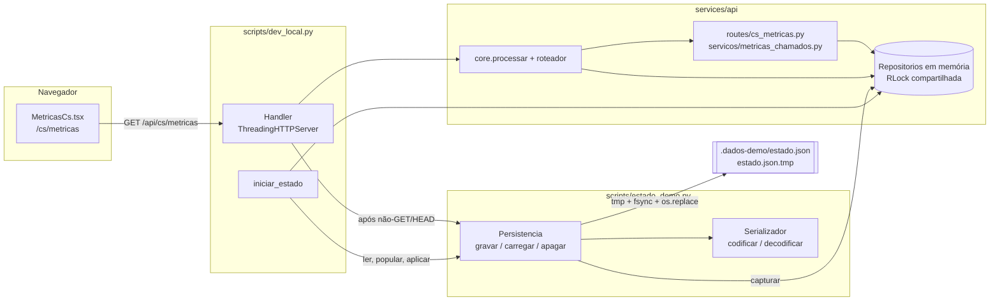
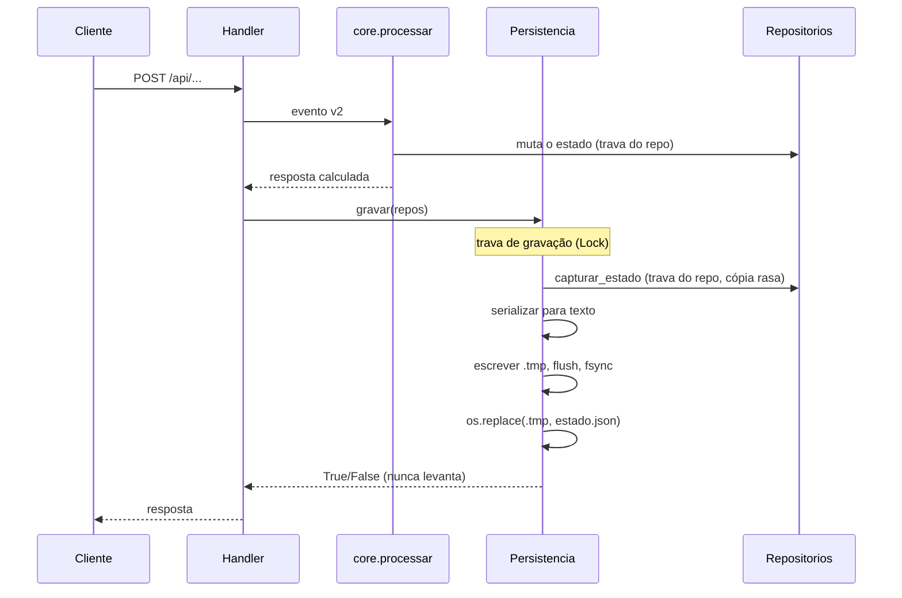
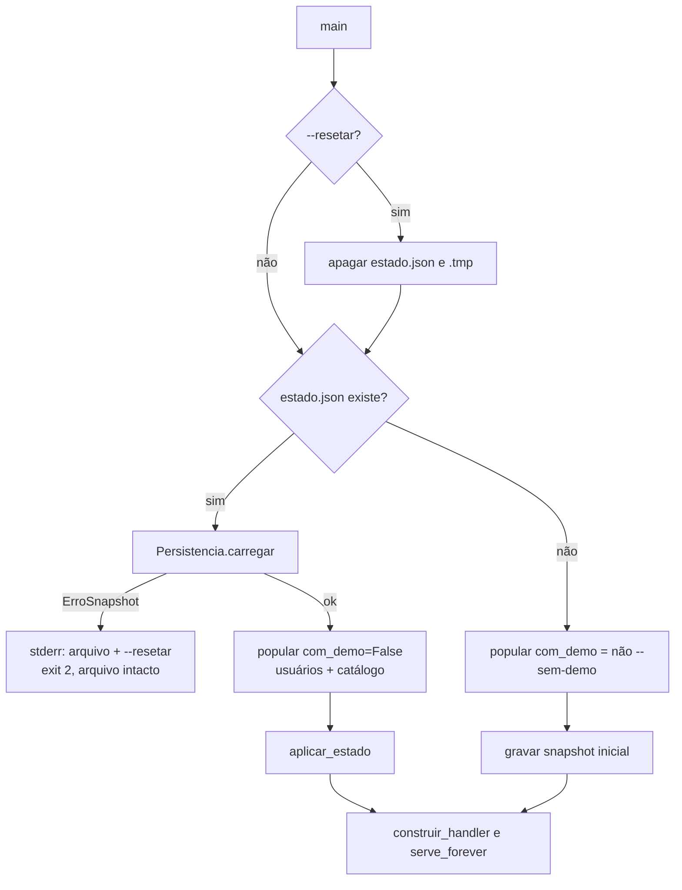

# Design Document

## Overview

Esta feature faz o servidor local de demonstração (`scripts/dev_local.py`) sobreviver a reinícios e entrega um painel mínimo de métricas para o Gestor.

A estratégia é deliberadamente pequena:

- Os repositórios em memória (`services/api/repositorios/memoria.py`) continuam sendo a fonte de verdade em tempo de execução. A interface `Repositorios` não muda, com uma única adição: `ChamadosRepo.listar_todos()`, implementada de verdade só no repositório em memória (o adaptador DynamoDB apenas a declara e levanta um erro explícito).
- A persistência é um **snapshot JSON atômico** em `.dados-demo/estado.json`, gravado pelo `Handler` depois de cada requisição diferente de GET/HEAD e antes da resposta.
- Um módulo novo, `scripts/estado_demo.py`, concentra o **Serializador** (estado ⇄ JSON) e a **Persistencia** (gravação atômica, leitura e remoção do arquivo). Ele só toca os fakes em memória, nunca a API de produção.
- `GET /api/cs/metricas` (somente Gestor) devolve contagens simples calculadas a partir dos repositórios. A tela `MetricasCs` (hoje um placeholder) passa a consumir essa rota.
- `docs/DEMO.md` e `.gitignore` são atualizados.

Fora do escopo: agente de IA, DynamoDB/AWS (nenhuma mudança em `infra/`, `dados_stack`, índices, IAM, nem Query ou Scan novos), SQLite, hashes de senha e sessões no snapshot, filtro de período, deflexão, custo, nota, ranking e configuração nas métricas.

## O que o código real já tem (e o que muda)

Achados da leitura da base que moldam o design:

| Achado | Onde | Consequência no design |
|---|---|---|
| `Repositorios` é `@dataclass(frozen=True)`; `popular()` troca o catálogo com `object.__setattr__`. | `repositorios/interfaces.py`, `scripts/dev_local.py` | O estado é restaurado **dentro** dos repositórios existentes (limpando e preenchendo `_itens`), nunca trocando a instância de `Repositorios`. |
| Todos os fakes compartilham uma única `RLock` (`_trava`) e guardam dados em `_itens` privados. | `repositorios/memoria.py` | `capturar_estado` e `aplicar_estado` seguram essa trava. O acoplamento a `_itens` fica isolado em `estado_demo.py` e é protegido por um teste que falha se surgir um repositório novo não classificado. |
| Os registros são dataclasses congeladas com `datetime` com fuso, `Decimal`, `Literal`, `tuple` e dataclasses aninhadas (`PacoteRepasse`, `JornadaEncerrada`, `EscaladaJornada`...). | `repositorios/modelos.py`, `dominio/*` | O Serializador é dirigido por `dataclasses.fields` e `typing.get_type_hints`, sem lista manual de campos por tipo. |
| O número do Chamado é aleatório (`TRES-` + 50 bits Crockford) e `criar_com_escalada` devolve `numero_em_uso`, o que faz `ServicoEscalada` sortear outro número (até 5 vezes). | `servicos/escalada.py` | O Requirement 2.9 já é garantido pelo mecanismo existente depois de restaurar os Chamados. Nada novo na geração de números; só teste. |
| `ChamadosRepo` só lista a fila (`gsi_fila`, sem encerrados). `ChamadosDynamoDB` precisa continuar satisfazendo o Protocol. | `repositorios/interfaces.py`, `repositorios/dynamodb/chamados.py`, `repositorios/erros.py` | `listar_todos` entra no Protocol e no fake em memória. O adaptador DynamoDB só declara o método e levanta `ErroIndisponivelForaDoModoLocal` (subclasse de `ErroRepositorio`), sem Query nem Scan. A implementação real fica como pendência da camada AWS. Veja "Decisões e pontos de atenção". |
| A matriz de autorização **já** classifica `("GET", "/metricas")` como `SOMENTE_GESTOR`, e o API Gateway já lista `GET /api/cs/metricas`. Não existe handler em `routes/`. | `servicos/autorizacao.py`, `infra/stacks/api_stack.py` | Falta só o módulo de rota. Nenhuma mudança na matriz nem na infra da API. |
| No front, `rotas.tsx` já registra `/cs/metricas` sob `GuardaGestor`, e `LayoutPainel` já esconde o link do Atendente. `MetricasCs.tsx` é um placeholder. | `apps/web/src/app/rotas.tsx`, `apps/web/src/cs/*` | Só o componente `MetricasCs` é substituído. O Atendente já vê `AcessoNegado` sem chamar a API. |
| `GET /api/cs/chamados/{numero}` grava `alerta_p1_visto` (efeito colateral em GET). | `routes/cs_chamados.py` | Pelo Requirement 1.2 o GET não grava o snapshot. O flag só chega ao arquivo na próxima requisição não-GET. Limitação aceita e documentada. |
| O `Chamado` de exemplo é criado a partir de `Jornada` sem `problema_id`. | `scripts/dev_local.py` | Na demo, os 3 exemplos aparecem sob `nao_informado` em "por problema". É o comportamento esperado do Requirement 9.7. |
| `MetricasCs` do `tres-autoatendimento` (tarefa 20.3) previa o Painel_Metricas completo. | `.kiro/specs/tres-autoatendimento/tasks.md` | Esta feature entrega só o recorte mínimo. O Painel_Metricas completo (período, deflexão, custo) continua fora. |

## Architecture



### Fluxo de gravação (cada requisição não-GET/HEAD)



### Fluxo de inicialização



A leitura e a validação do snapshot acontecem **antes** de `popular()`. Assim, um snapshot inválido aborta sem deixar a aplicação pela metade e sem tocar o arquivo.

## Components and Interfaces

### 1. `scripts/estado_demo.py` (novo): Serializador e Persistencia

O módulo repete o bootstrap de `sys.path` do `dev_local.py` (insere `services/api` e `packages/dominio/src`), para poder ser importado pelos testes de `scripts/tests` sem depender da ordem de import.

```python
"""Persistência da demo local: Serializador (estado <-> JSON) e gravação atômica do snapshot."""

from __future__ import annotations

import copy
import json
import math
import os
import threading
from collections.abc import Callable
from dataclasses import dataclass, field, fields, is_dataclass
from datetime import datetime
from decimal import Decimal
from enum import Enum
from pathlib import Path
from typing import Any, get_args, get_origin, get_type_hints

VERSAO_FORMATO = 1
NOME_SNAPSHOT = "estado.json"
NOME_TEMPORARIO = "estado.json.tmp"


class ErroSerializacao(ValueError):
    """Valor de tipo desconhecido ao gravar. `campo` é o caminho (ex.: 'eventos[3].dados.x')."""

    def __init__(self, campo: str, tipo: str) -> None:
        self.campo, self.tipo = campo, tipo
        super().__init__(f"campo {campo!r}: tipo não suportado {tipo!r}")


class ErroSnapshot(ValueError):
    """JSON inválido, versão diferente ou estrutura que o Serializador não reconhece."""

    def __init__(self, caminho: Path, motivo: str) -> None:
        self.caminho, self.motivo = caminho, motivo
        super().__init__(f"{caminho}: {motivo}")
```

#### Estado persistido

`EstadoPersistido` é um contêiner simples com uma lista por repositório incluído. A igualdade padrão de dataclass compara listas e registros, o que dá a propriedade de ida e volta.

```python
@dataclass
class EstadoPersistido:
    jornadas: list[Jornada] = field(default_factory=list)
    eventos: list[Evento] = field(default_factory=list)
    chamados: list[Chamado] = field(default_factory=list)
    mensagens: list[MensagemChamado] = field(default_factory=list)   # achatadas; agrupadas por `numero` ao aplicar
    dados_pessoais: list[DadosPessoaisRegistro] = field(default_factory=list)
    acessos_pii: list[AcessoPII] = field(default_factory=list)
    ordens_servico: list[OrdemServico] = field(default_factory=list)
    cache: list[RegistroCache] = field(default_factory=list)
    avaliacoes: list[Avaliacao] = field(default_factory=list)
    agregados: list[AgregadoDia] = field(default_factory=list)
    config: dict[str, Any] = field(default_factory=dict)

# Repositórios fora do snapshot (Req 4.7, 4.8) e teste de classificação:
PERSISTIDOS = frozenset({"jornadas", "eventos", "chamados", "mensagens", "dados_pessoais",
                         "acessos_pii", "ordens_servico", "cache", "avaliacoes", "agregados", "config"})
EXCLUIDOS = frozenset({"usuarios_cs", "sessoes", "catalogo"})
# test: {f.name for f in fields(Repositorios)} == PERSISTIDOS | EXCLUIDOS
```

#### Captura e aplicação (acoplamento isolado)

```python
def capturar_estado(repos: Repositorios) -> EstadoPersistido:
    """Cópia rasa e consistente (sob a RLock compartilhada). Registros são imutáveis;
    `Evento.dados`, `Config` e `fontes` do cache só são trocados, nunca alterados in place."""
    with repos.jornadas._trava:
        return EstadoPersistido(
            jornadas=list(repos.jornadas._itens.values()),
            eventos=list(repos.eventos._itens.values()),
            chamados=list(repos.chamados._itens.values()),
            mensagens=[m for lista in repos.mensagens._itens.values() for m in lista],
            dados_pessoais=list(repos.dados_pessoais._itens.values()),
            acessos_pii=[a for lista in repos.acessos_pii._itens.values() for a in lista],
            ordens_servico=list(repos.ordens_servico._itens.values()),
            cache=list(repos.cache._itens.values()),
            avaliacoes=list(repos.avaliacoes._itens.values()),
            agregados=[AgregadoDia(d, m, v) for (d, m), v in repos.agregados._itens.items()],
            config=copy.deepcopy(repos.config._itens),
        )


def aplicar_estado(repos: Repositorios, estado: EstadoPersistido) -> None:
    """Restaura direto nos `_itens`, sem chamar criar/assumir/encerrar (Req 7.5).
    Tudo ou nada: os dicionários novos são montados antes de entrar na trava."""
```

`aplicar_estado` monta todos os dicionários novos primeiro (mesmas chaves que os fakes usam: `numero`, `jornada_id`, `(jornada_id, ts_ulid)`, `os_id_de(numero)`, `chave`, `(dia, metrica)`) e só então, sob a trava, faz `clear()` + `update()` em cada `_itens`. A ordem de inserção do snapshot é a ordem restaurada, e `listar_fila`/`mensagens.listar` ordenam por chave, então a ordem observável é a mesma de antes do reinício (Req 7.6, 7.7).

#### Codec

```python
def codificar(valor: Any, campo: str = "$") -> Any:
    """Valor Python -> estrutura JSON. Levanta ErroSerializacao(campo, tipo)."""
    if isinstance(valor, Enum):  return codificar(valor.value, campo)
    if valor is None or isinstance(valor, (bool, int, str)): return valor
    if isinstance(valor, float):
        if not math.isfinite(valor): raise ErroSerializacao(campo, "float não finito")
        return valor
    if isinstance(valor, Decimal):
        if not valor.is_finite(): raise ErroSerializacao(campo, "Decimal não finito")
        return str(valor)                                   # sem passar por float (Req 4.2)
    if isinstance(valor, datetime):
        if valor.utcoffset() is None: raise ErroSerializacao(campo, "datetime sem fuso")
        return valor.isoformat()                            # preserva fuso e microssegundos (Req 4.1)
    if isinstance(valor, (list, tuple)):
        return [codificar(v, f"{campo}[{i}]") for i, v in enumerate(valor)]
    if isinstance(valor, dict):
        return {_chave(k, campo): codificar(v, f"{campo}.{k}") for k, v in valor.items()}
    if is_dataclass(valor) and not isinstance(valor, type):
        return {f.name: codificar(getattr(valor, f.name), f"{campo}.{f.name}") for f in fields(valor)}
    raise ErroSerializacao(campo, type(valor).__name__)     # Req 4.9
```

`decodificar(tipo, bruto, campo)` é dirigido pelas anotações (`get_type_hints(cls)`, com cache por classe):

| Anotação | Regra de leitura |
|---|---|
| `str`, `int`, `bool` | `isinstance` estrito (`bool` não vale como `int`) |
| `Decimal` | exige `str`; `Decimal(texto)`; rejeita não finito |
| `datetime` | exige `str`; `datetime.fromisoformat`; rejeita sem fuso |
| `Literal[...]` | o valor precisa estar em `get_args` (Req 4.3) |
| `X \| None` | `None` passa; senão decodifica `X` |
| `tuple[X, ...]` | exige lista; devolve `tuple` (Req 4.5) |
| `dict[str, V]` | exige objeto; decodifica valores como `V` |
| `Any` | só valores nativos de JSON (listas e objetos recursivos) |
| dataclass | exige objeto; chave desconhecida é erro; campo ausente usa o default ou é erro; reconstrói aninhadas com os mesmos tipos (Req 4.4) |
| outro | `ErroSnapshot` (estrutura não reconhecida) |

Campos `Any` (`Evento.dados`, `Config`, `RegistroCache.fontes`) aceitam só o que o JSON representa. Uma `tuple` dentro de `Any` volta como `list`; os geradores de teste usam valores JSON-nativos.

#### Texto e arquivo

```python
def serializar_estado(estado: EstadoPersistido) -> str:
    corpo = {"versao": VERSAO_FORMATO,
             "estado": {f.name: codificar(getattr(estado, f.name), f.name) for f in fields(estado)}}
    return json.dumps(corpo, ensure_ascii=False, indent=2, allow_nan=False) + "\n"


def ler_estado(texto: str, caminho: Path) -> EstadoPersistido:
    """Levanta ErroSnapshot (JSON inválido, versão diferente, estrutura desconhecida)."""


class Persistencia:
    def __init__(self, diretorio: Path, log: Callable[[str], None] = print) -> None:
        self.diretorio = diretorio
        self.caminho = diretorio / NOME_SNAPSHOT
        self.temporario = diretorio / NOME_TEMPORARIO
        self._log = log
        self._trava = threading.Lock()        # serializa as gravações (Req 1.6)

    def gravar(self, repos: Repositorios) -> bool:
        """Captura + serializa + grava, tudo sob a trava de gravação. Nunca levanta."""
        with self._trava:
            try:
                texto = serializar_estado(capturar_estado(repos))
                self._gravar_texto(texto)
                return True
            except Exception as erro:  # noqa: BLE001 - a demo segue sem persistir
                self._log(f"ERRO ao gravar o estado em {self.caminho}: {erro}")
                return False

    def _gravar_texto(self, texto: str) -> None:
        self.diretorio.mkdir(parents=True, exist_ok=True)               # Req 1.7
        try:
            with open(self.temporario, "w", encoding="utf-8") as arq:
                arq.write(texto); arq.flush(); os.fsync(arq.fileno())
            os.replace(self.temporario, self.caminho)                   # Req 1.3
        except BaseException:
            self.temporario.unlink(missing_ok=True)                     # Req 1.4
            raise

    def carregar(self) -> EstadoPersistido:
        """Lê e valida. OSError, UnicodeDecodeError e JSON inválido viram ErroSnapshot."""

    def apagar(self) -> None:
        """--resetar: remove estado.json e estado.json.tmp (ausentes não são erro)."""
```

Pontos de projeto:

- A serialização acontece **antes** de abrir o arquivo. Se `serializar_estado` levanta `ErroSerializacao`, o snapshot anterior fica intacto (Req 4.9).
- O temporário tem nome fixo e fica no mesmo diretório, logo no mesmo sistema de arquivos, o que garante `os.replace` atômico. A trava de gravação impede dois escritores no mesmo `.tmp`.
- A captura e a escrita ficam na **mesma** seção crítica: um snapshot mais antigo nunca sobrescreve um mais novo (Req 1.6).
- O log nunca inclui o conteúdo do estado, só o caminho e a mensagem do erro. O snapshot pode conter telefone e CEP da demo.

### 2. `scripts/dev_local.py` (alterado)

**Constantes e imports.** `DIR_DADOS_DEMO = _RAIZ / ".dados-demo"` e `METODOS_LEITURA = frozenset({"GET", "HEAD"})`. O bootstrap de `sys.path` passa a incluir `_RAIZ / "scripts"` para importar `estado_demo`.

**`construir_handler`** ganha um parâmetro opcional `persistencia: Persistencia | None = None`. O default `None` preserva a fixture atual de `test_dev_local.py`. `_api()` deixa de chamar `_responder` e passa a **devolver** `(status, cabecalhos, corpo)`. Assim o `_tratar` grava o snapshot entre o cálculo e o envio:

```python
def _tratar(self):
    caminho = urlsplit(self.path).path
    try:
        if caminho.startswith("/api/") or caminho == "/api":
            status, cabecalhos, corpo = self._api()
            if persistencia is not None and self.command not in METODOS_LEITURA:
                persistencia.gravar(app.repos)      # nunca levanta (Req 1.5)
            return self._responder(status, cabecalhos, corpo)
        if caminho.startswith("/midia/") and self.command in METODOS_LEITURA:
            return self._estatico()
        self._responder(404, [("Content-Type", "text/plain")], b"nao encontrado")
    except Exception as erro:  # noqa: BLE001
        print(f"ERRO interno: {erro!r}")
        self._responder(500, [("Content-Type", "text/plain")], b"erro interno")
```

**`iniciar_estado`** (novo), chamado por `main()`:

```python
def iniciar_estado(app, senha: str, persistencia: Persistencia, *, resetar: bool, com_demo: bool) -> str:
    """Prepara os repositórios. Devolve 'carregado', 'novo' ou 'resetado'.
    Levanta ErroSnapshot (snapshot ilegível) sem alterar arquivo algum."""
    if resetar:
        persistencia.apagar()
    if persistencia.caminho.exists():
        estado = persistencia.carregar()                   # valida tudo antes de mexer na app
        popular(app, senha, com_demo=False)                # usuários (hash da senha vigente) + catálogo do seed
        aplicar_estado(app.repos, estado)
        return "carregado"
    popular(app, senha, com_demo=com_demo)
    persistencia.gravar(app.repos)                         # snapshot inicial (Req 2.3)
    return "resetado" if resetar else "novo"
```

`popular()` não muda de assinatura, então a fixture existente continua válida. Sem snapshot, `com_demo` vem de `not args.sem_demo`; com snapshot, os exemplos nunca são recriados (Req 2.4).

**`main(argv=None, *, dir_dados=DIR_DADOS_DEMO)`**:

- Nova opção `--resetar` (`store_true`). O `help` dos argumentos e a mensagem de início mostram `<dir_dados>/estado.json` (Req 6.2).
- `dir_dados` é parâmetro só para os testes apontarem para um diretório temporário (Req 12.8).
- `ErroSnapshot` vira mensagem em `stderr` com o caminho do arquivo e a sugestão `--resetar` (apaga o estado), e `return 2` (Req 2.6). O arquivo não é tocado (Req 2.7).
- A docstring do módulo e o banner deixam de dizer "dados em memória / reinício zera tudo" e passam a dizer que o estado é salvo em `.dados-demo/estado.json` (Req 6.3).

### 3. `ChamadosRepo.listar_todos()` (novo)

A consulta existe de verdade só no Modo_Local. O Protocol a declara, o fake em memória a implementa e o adaptador DynamoDB só a declara para continuar satisfazendo o Protocol, levantando um erro explícito. Nada em `infra/`, em índices ou em IAM muda, e o modelo `Chamado` não ganha propriedades novas.

**Erro** (`repositorios/erros.py`): subclasse de `ErroRepositorio`, para que qualquer código que já trate falhas de persistência (e o `core.processar`, que responde 500 `erro_interno` genérico) continue válido sem ramo novo.

```python
MENSAGEM_INDISPONIVEL_FORA_DO_MODO_LOCAL = (
    "{operacao}: indisponível fora do modo local "
    "(pendência da camada AWS: a consulta real ainda não foi implementada)"
)


class ErroIndisponivelForaDoModoLocal(ErroRepositorio):
    """Operação que só existe no Modo_Local (repositórios em memória)."""

    def __init__(self, operacao: str) -> None:
        super().__init__(MENSAGEM_INDISPONIVEL_FORA_DO_MODO_LOCAL.format(operacao=operacao))
        self.operacao = operacao
```

**Interface** (`repositorios/interfaces.py`):

```python
def listar_todos(self) -> list[Chamado]:
    """Todos os Chamados (aberto, em_atendimento e encerrado), do mais antigo ao mais novo
    (`criado_em`, depois `numero`). Repositório vazio devolve [].
    `listar_fila` continua devolvendo só os não encerrados.
    Só o repositório em memória a implementa; o adaptador DynamoDB levanta
    ErroIndisponivelForaDoModoLocal."""
    ...
```

**Fake em memória** (`ChamadosMemoria`):

```python
def listar_todos(self) -> list[Chamado]:
    with self._trava:
        todos = list(self._itens.values())
    return sorted(todos, key=lambda c: (c.criado_em, c.numero))
```

**Adaptador DynamoDB** (`dynamodb/chamados.py`): único acréscimo na classe `ChamadosDynamoDB`. Não usa `self._t`, não faz `Query` nem `Scan` e não acessa a AWS.

```python
def listar_todos(self) -> list[Chamado]:
    """Declarado só para satisfazer o Protocol `ChamadosRepo`.

    PENDÊNCIA (camada AWS): a implementação real, que lista também os Chamados
    encerrados, fica para quando a camada AWS entrar em escopo. Hoje a consulta
    só existe no Modo_Local (repositório em memória).
    """
    raise ErroIndisponivelForaDoModoLocal("ChamadosDynamoDB.listar_todos")
```

A pendência também é registrada na docstring do módulo `dynamodb/chamados.py`, junto da lista de garantias, para que quem abrir o adaptador a veja.

**Fora de escopo (sem alteração)**: `infra/stacks/dados_stack.py`, `infra/tests/test_dados_stack.py`, `services/api/tests/_tabelas_dynamodb.py`, índices existentes e políticas de IAM (Req 8.8). Não há índice novo, `chamado_para_item` não muda e o papel `api` mantém as permissões atuais.

### 4. API de métricas

**`services/api/servicos/metricas_chamados.py`** (novo). Função pura, sem I/O, que recebe os Chamados e resolvedores. Isso permite testar com Hypothesis sem montar a API.

```python
ROTULO_NAO_INFORMADO = "nao_informado"
PRIORIDADES = ("P1", "P2", "P3")
DESFECHOS = ("falso_defeito", "defeito_real")


def calcular_metricas(
    chamados: Iterable[Chamado],
    obter_jornada: Callable[[str], Jornada | None],
    titulos_problemas: Mapping[int, str],
) -> dict[str, Any]:
    """Contagens simples. Só conta e rotula: nunca copia telefone, CEP, mensagem nem resumo."""
```

Regras:

- `totais.abertos` = Chamados com `status != "encerrado"`; `totais.encerrados` = `status == "encerrado"`.
- `por_problema`: chave `str(jornada.problema_id)`, rótulo = título do catálogo (`titulos_problemas`), ou `Problema {id}` se o catálogo não o conhece. Jornada ausente ou sem `problema_id` → `nao_informado`.
- `por_modelo`: chave e rótulo = `jornada.modelo_id`. Jornada ausente ou sem `modelo_id` → `nao_informado`.
- `por_prioridade`: sempre as três linhas `P1`, `P2`, `P3`, inclusive com zero.
- `por_desfecho`: só `status == "encerrado"`. Sempre as duas linhas `falso_defeito` e `defeito_real`, inclusive com zero. Um encerrado sem `encerramento` (estado inconsistente que a base não produz) entra numa linha extra `nao_informado`, que só aparece se for maior que zero.
- Ordem das linhas de problema e modelo: quantidade decrescente, depois rótulo crescente. Prioridade e desfecho seguem a ordem fixa acima.
- Problema e modelo listam só o que tem quantidade maior que zero (não há 13 linhas zeradas de problema).

**Forma da resposta** (`200`):

```json
{
  "totais": { "abertos": 3, "encerrados": 1 },
  "por_problema":   [ { "chave": "nao_informado", "rotulo": "nao_informado", "quantidade": 3 } ],
  "por_modelo":     [ { "chave": "tres-passione", "rotulo": "tres-passione", "quantidade": 1 } ],
  "por_prioridade": [ { "chave": "P1", "rotulo": "P1", "quantidade": 1 },
                      { "chave": "P2", "rotulo": "P2", "quantidade": 0 },
                      { "chave": "P3", "rotulo": "P3", "quantidade": 2 } ],
  "por_desfecho":   [ { "chave": "falso_defeito", "rotulo": "falso_defeito", "quantidade": 0 },
                      { "chave": "defeito_real",  "rotulo": "defeito_real",  "quantidade": 1 } ]
}
```

O conjunto de chaves é fechado: `totais`, `por_problema`, `por_modelo`, `por_prioridade`, `por_desfecho`. Não há campo de período, deflexão, custo, nota, ranking ou configuração (Req 9.13, 9.14).

**`services/api/routes/cs_metricas.py`** (novo, descoberto automaticamente por `descobrir_rotas`):

```python
@exigir_perfil("gestor")                      # defesa em profundidade além da matriz
def metricas(ctx: Contexto) -> dict[str, Any]:
    jornadas: dict[str, Jornada | None] = {}
    def jornada(jid: str) -> Jornada | None:
        if jid not in jornadas:
            jornadas[jid] = ctx.repos.jornadas.obter(jid)
        return jornadas[jid]

    try:
        titulos = {p.problema_id: p.titulo for p in ctx.repos.catalogo.listar_problemas()}
    except ErroRepositorio as exc:            # catálogo indisponível não derruba as contagens
        ctx.log.aviso("catalogo_indisponivel_metricas", erro=exc)
        titulos = {}
    return calcular_metricas(ctx.repos.chamados.listar_todos(), jornada, titulos)


ROTAS = [Rota("GET", "/metricas", metricas, escopo="cs", nome="cs_metricas")]
```

Autorização: `Rota.perfis` fica `None`, então `decidir_acesso` usa a matriz, que já tem `("GET", "/metricas") → {gestor}`. Sem sessão → 401 pelo autenticador. Atendente → 403 (Req 9.11, 9.12, 9.15). Falha de `listar_todos` (`ErroRepositorio`, que inclui `ErroIndisponivelForaDoModoLocal`) sobe e `core.processar` responde 500 `erro_interno` sem detalhes, como em todas as rotas. No Modo_Local, que é onde a rota roda, o fake em memória não levanta erro.

Custo: uma leitura de Jornada por Chamado (cache por requisição). Em memória é irrelevante. A rota depende de `listar_todos`, que hoje só funciona no Modo_Local; levar as métricas para a camada AWS depende da pendência registrada no adaptador DynamoDB.

### 5. Front-end: `apps/web/src/cs/MetricasCs.tsx` (substitui o placeholder)

Segue o padrão de `FilaCs.tsx`: `apiCs.get`, estados `carregando | erro | pronto`, ref `montado` e botão de nova tentativa. Sem atualização automática (não é pedida).

```tsx
export interface LinhaContagem { chave: string; rotulo: string; quantidade: number }
export interface RespostaMetricas {
  totais: { abertos: number; encerrados: number };
  por_problema: LinhaContagem[];
  por_modelo: LinhaContagem[];
  por_prioridade: LinhaContagem[];
  por_desfecho: LinhaContagem[];
}

type Estado = { fase: "carregando" } | { fase: "erro" } | { fase: "pronto"; dados: RespostaMetricas };
```

Estrutura renderizada:

- `<section aria-labelledby="titulo-metricas"><h1 id="titulo-metricas">Métricas</h1>` aparece em **todas** as fases. O teste existente `PainelCs.test.tsx` ("Gestor vê o link e a página de Métricas") continua achando o `h1`.
- `carregando`: `<p role="status">Carregando as métricas…</p>`.
- `erro`: `<div role="alert">` com "Não foi possível carregar as métricas." e `<button type="button">Tentar de novo</button>`.
- `pronto`: `<dl>` com "Chamados abertos" e "Chamados encerrados", seguido de quatro seções. Cada seção tem `<section aria-labelledby>` + `<h2>` ("Por problema", "Por modelo", "Por prioridade", "Por desfecho") e uma `<table aria-labelledby>` com `<th scope="col">` "Rótulo", "Quantidade" e "Proporção".
- Barras: `<td><span class="metricas__barra" style={{ width }} aria-hidden="true" /></td>`. O número fica sempre em texto na coluna "Quantidade" (Req 10.6). A largura é `quantidade / maior quantidade da dimensão`.
- Dimensão sem nenhuma linha com quantidade maior que zero: no lugar da tabela, `<p>Não há chamados para esta dimensão.</p>` (Req 10.5).
- Rótulos de exibição: `formatarRotulo` mostra `nao_informado` como "Não informado", `falso_defeito` como "Falso defeito" e `defeito_real` como "Defeito real". É só apresentação; o JSON da API segue os rótulos do glossário.
- Estilos em `metricas.css` (novo), reaproveitando `--espaco` e `--cor-borda`. Cores com contraste suficiente; a informação nunca depende só da cor.

`PainelCs.test.tsx` ganha o handler `"GET /api/cs/metricas"` no caso do Gestor (o helper `simular` lança em requisição inesperada). O caso do Atendente continua sem esse handler, o que prova que a API não é chamada (Req 10.7).

### 6. Documentação e configuração

- `.gitignore`: nova linha `.dados-demo/` no bloco de Python/demo, ao lado de `.venv-demo/`.
- `docs/DEMO.md`: reescrito nos pontos do Requirement 11.
  - Abre o fluxo do Consumidor em `http://localhost:5173/` (pesquisa de modelo) e descreve o QR `/m/tres-passione?s=DEMO001` como entrada alternativa.
  - Troca "Os dados somem ao reiniciar" por "os dados persistem em `.dados-demo/estado.json`".
  - Documenta `--resetar` (apaga o estado e recria os 3 Chamados de exemplo) ao lado de `--porta` e `--sem-demo`.
  - Informa que as sessões do Painel_CS não persistem e que é preciso entrar de novo depois de reiniciar.
  - Cita a tela de métricas do Gestor em `/cs/metricas`.
  - Remove "Reiniciou a API: os Chamados e Jornadas sumiram, abra o QR de novo".
  - Avisa que o snapshot pode conter telefone e CEP digitados na demo e que `.dados-demo/` fica fora do Git.
  - Acrescenta os comandos de teste focado.

## Data Models

### Formato do snapshot (`.dados-demo/estado.json`)

```json
{
  "versao": 1,
  "estado": {
    "jornadas": [
      {
        "jornada_id": "01JDEMO0000000000000000P1",
        "criada_em": "2025-03-10T12:00:00.123456+00:00",
        "ultima_interacao": "2025-03-10T12:00:00.123456+00:00",
        "origem": "qr", "origem_inicial": "qr", "estado": "escalada",
        "modelo_id": "tres-passione", "numero_serie": null, "problema_id": null,
        "problemas_selecionados": [],
        "risco": { "origem": "lista", "em": "2025-03-10T12:00:00+00:00" },
        "custo_ia_brl": "0.0000",
        "escalada": { "chamado_numero": "TRES-7K3M9QX2PD", "em": "...", "gatilhos": [ ... ], "decisao": { ... } },
        "encerramento": null
      }
    ],
    "eventos": [], "chamados": [], "mensagens": [], "dados_pessoais": [],
    "acessos_pii": [], "ordens_servico": [], "cache": [], "avaliacoes": [],
    "agregados": [ { "dia": "2025-03-10", "metrica": "problema_sel#6", "valor": 2 } ],
    "config": {}
  }
}
```

Regras do formato:

| Tipo Python | JSON |
|---|---|
| `datetime` com fuso | texto ISO 8601 com deslocamento e microssegundos |
| `Decimal` | texto (`"0.0450"`) |
| `Literal`/enum | o valor primitivo |
| dataclass | objeto com um campo por atributo |
| `tuple` | lista (volta como `tuple` pela anotação) |
| `None` | `null` |

Mapa repositório → coleção do snapshot → chave usada ao restaurar:

| Repositório | Coleção | Chave em `_itens` |
|---|---|---|
| `jornadas` | `jornadas` | `jornada_id` |
| `eventos` | `eventos` | `(jornada_id, ts_ulid)` |
| `chamados` | `chamados` | `numero` |
| `mensagens` | `mensagens` (achatada) | `numero` → lista, na ordem do snapshot |
| `dados_pessoais` | `dados_pessoais` | `numero` |
| `acessos_pii` | `acessos_pii` (achatada) | `numero` → lista |
| `ordens_servico` | `ordens_servico` | `os_id_de(numero)` |
| `cache` | `cache` | `chave` |
| `avaliacoes` | `avaliacoes` | `jornada_id` |
| `agregados` | `agregados` | `(dia, metrica)` → `valor` |
| `config` | `config` (objeto) | chave do config |
| `usuarios_cs`, `sessoes`, `catalogo` | **fora** | recriados por `popular()` |

A versão é `VERSAO_FORMATO = 1`. Qualquer outro valor (ou ausência) é "estrutura não reconhecida" (Req 4.11). Não há migração: esta é uma demo, e `--resetar` é a saída.

## Error Handling

| Situação | Comportamento | Req |
|---|---|---|
| Falha ao escrever o `.tmp` (disco cheio, permissão) | remove o `.tmp`, registra no console, snapshot anterior intacto, servidor continua | 1.4, 1.5 |
| Falha no `os.replace` | idem | 1.4 |
| `ErroSerializacao` ao gravar (valor de tipo desconhecido) | nada é escrito; log identifica campo e tipo; snapshot anterior intacto | 4.9 |
| Resposta da requisição após falha de gravação | enviada normalmente com o resultado já calculado | 1.5 |
| Snapshot com JSON inválido, versão diferente ou estrutura desconhecida | `ErroSnapshot` → mensagem em stderr com o caminho e `--resetar`, `exit 2`, arquivo intacto, nenhuma subida parcial | 2.6, 2.7, 4.11 |
| Snapshot ilegível (`OSError`, UTF-8 inválido) | tratado como o caso acima | 2.6 |
| `--resetar` sem snapshot | segue sem erro (`missing_ok`) | 3.4 |
| `--resetar` com snapshot corrompido | apaga e recomeça; nunca lê o arquivo antigo | 3.1 |
| Diretório `.dados-demo/` ausente | criado com `mkdir(parents=True, exist_ok=True)` na primeira gravação | 1.7 |
| Duas requisições não-GET ao mesmo tempo | gravações serializadas pela trava; cada arquivo reflete um estado consistente | 1.6 |
| `GET /api/cs/metricas` sem sessão válida | 401 sem contagens (autenticador) | 9.12 |
| `GET /api/cs/metricas` com perfil `atendente` | 403 sem contagens (matriz) | 9.11 |
| Catálogo indisponível ao montar métricas | aviso no log; rótulos de problema caem em `Problema {id}` | 9.3 |
| `listar_todos` falha | 500 `erro_interno` genérico | 9.1 |
| `ChamadosDynamoDB.listar_todos` chamado | levanta `ErroIndisponivelForaDoModoLocal` (mensagem contém "indisponível fora do modo local") sem Query, Scan nem acesso à AWS | 8.5, 8.6 |
| Tela de métricas: erro HTTP, timeout ou rede | `role="alert"` com mensagem e botão "Tentar de novo" | 10.4 |
| Atendente abre `/cs/metricas` | `GuardaGestor` mostra `AcessoNegado` sem chamar a API | 10.7 |

## Correctness Properties

*A property is a characteristic or behavior that should hold true across all valid executions of a system-essentially, a formal statement about what the system should do. Properties serve as the bridge between human-readable specifications and machine-verifiable correctness guarantees.*

As propriedades abaixo vêm da análise de cada critério de aceitação (prework). Os critérios classificados como EXAMPLE, SMOKE ou INTEGRATION (gravação após POST, GET sem gravar, concorrência, textos do `DEMO.md`, `.gitignore`, comportamento da tela e erro explícito do adaptador DynamoDB em `listar_todos`) ficam em testes por exemplo, descritos na estratégia de testes. Na reflexão, o round-trip do serializador absorveu os critérios 4.1 a 4.5; a propriedade de reinício absorveu 2.4, 7.5, 7.6, 7.7 e 9.8; e 7.2 a 7.4 viraram uma só propriedade sobre operações condicionais. Os critérios 8.5 a 8.8 (adaptador DynamoDB, pendência documentada e `infra/` intacto) são EXAMPLE/SMOKE: o adaptador sempre levanta o mesmo erro, sem variação por entrada, então um teste unitário substitui a propriedade.

### Property 1: Ida e volta do Estado_Persistido

For any Estado_Persistido válido (registros de todas as coleções com `datetime` com fuso e microssegundos, `Decimal` finitos, `Literal`, `tuple` e dataclasses aninhadas), `ler_estado(serializar_estado(e))` deve ser igual a `e`, com os mesmos tipos nos campos aninhados e `tuple` onde o campo é `tuple`, e `serializar_estado` aplicado ao resultado deve reproduzir exatamente o mesmo texto.

**Validates: Requirements 4.1, 4.2, 4.3, 4.4, 4.5, 4.6**

### Property 2: Usuários, hashes, sessões e catálogo ficam fora do snapshot

For any estado dos repositórios que contenha usuários do Painel_CS, hashes de senha, sessões e catálogo, o texto do snapshot gerado não deve conter nenhum nome de usuário de `usuarios_cs`, nenhum `hash_senha`, nenhum `token_hash`, a Senha_Demo nem os títulos do catálogo.

**Validates: Requirements 4.7, 4.8, 5.4**

### Property 3: Valor de tipo desconhecido não corrompe o snapshot

For any estado em que algum campo de tipo livre (`Evento.dados`, `Config`, `fontes` do cache) contenha um valor de tipo não suportado (conjunto, objeto arbitrário, `datetime` sem fuso, número não finito), `serializar_estado` deve levantar `ErroSerializacao` cuja mensagem identifica o caminho do campo e o nome do tipo, e `Persistencia.gravar` deve devolver `False` mantendo o conteúdo anterior do snapshot byte a byte.

**Validates: Requirements 4.9**

### Property 4: Snapshot inválido é rejeitado sem alteração

For any texto derivado de um snapshot válido por corrupção (truncamento, JSON malformado, versão diferente de 1 ou ausente, campo obrigatório removido, campo desconhecido, tipo trocado, `Literal` fora do domínio, `datetime` sem fuso), `ler_estado` deve levantar `ErroSnapshot`; e `main` apontando para um arquivo assim deve devolver código de saída diferente de zero, com mensagem contendo o caminho do arquivo e `--resetar`, deixando o arquivo byte a byte igual.

**Validates: Requirements 2.6, 2.7, 4.11**

### Property 5: Gravação atômica

For any sequência de gravações com estados quaisquer, em que cada passo pode ou não ter uma falha injetada (na escrita do temporário ou no `os.replace`), o arquivo `estado.json`, se existir, deve sempre ser igual ao texto serializado do último estado gravado com sucesso; uma falha deve deixar o snapshot anterior byte a byte igual e remover o `estado.json.tmp`; e o diretório de dados deve conter no máximo `estado.json` e `estado.json.tmp`.

**Validates: Requirements 1.3, 1.4, 5.3**

### Property 6: Reiniciar preserva o estado

For any sequência de operações da API (criar Jornada, escalar, assumir, enviar mensagem, registrar dados pessoais, encerrar Chamado) executada com persistência ligada, criar uma nova aplicação e chamar `iniciar_estado` sobre o mesmo diretório deve produzir `capturar_estado` igual ao anterior, `listar_fila` na mesma ordem, `mensagens.listar` de cada Chamado na mesma ordem, as mesmas métricas, nenhum Chamado de exemplo a mais, e a carga não deve chamar `escalar`, `assumir` nem `encerrar`.

**Validates: Requirements 2.1, 2.4, 7.5, 7.6, 7.7, 9.8**

### Property 7: `--resetar` descarta qualquer estado anterior

For any conteúdo prévio no diretório de dados (nenhum arquivo, snapshot válido, snapshot corrompido, bytes arbitrários em `estado.json` e em `estado.json.tmp`), `iniciar_estado(resetar=True)` não deve levantar erro e deve resultar no mesmo estado de uma primeira subida (Chamados de exemplo conforme `com_demo`), com um snapshot inicial válido gravado.

**Validates: Requirements 3.1, 3.2, 3.4**

### Property 8: Operações condicionais continuam valendo depois de recarregar

For any estado recarregado do snapshot, para cada Jornada com Chamado, `escalar` deve devolver o Chamado existente sem criar outro; para cada Chamado com responsável ou encerrado, `assumir` deve devolver `aplicado=False` com o responsável original; para cada Chamado sem responsável e não encerrado, `assumir` deve gravar o responsável e o status `em_atendimento`; e para cada Chamado encerrado, `encerrar` deve devolver `aplicado=False` mantendo o encerramento original.

**Validates: Requirements 7.1, 7.2, 7.3, 7.4**

### Property 9: Número novo não colide com os carregados

For any conjunto de Chamados carregados do snapshot e qualquer gerador de números que devolva primeiro um número já carregado, a escalada de uma Jornada nova deve criar um Chamado cujo número não pertence ao conjunto carregado, e os Chamados carregados devem permanecer inalterados.

**Validates: Requirements 2.9**

### Property 10: `listar_todos` devolve todos os Chamados

For any conjunto de Chamados nos três status criados no `ChamadosRepo` em memória, `listar_todos` deve devolver exatamente esse conjunto (sem perder encerrados), ordenado por `criado_em` e, em empate, por `numero`, e `listar_fila` deve ser igual a `listar_todos` sem os encerrados; para um repositório sem Chamados, `listar_todos` deve devolver lista vazia.

**Validates: Requirements 8.1, 8.2, 8.4**

### Property 11: Invariantes das contagens de métricas

For any conjunto de Chamados e Jornadas, a resposta de `calcular_metricas` deve ter `totais.abertos` igual ao número de Chamados com status diferente de `encerrado` e `totais.encerrados` igual ao número de encerrados; a soma das quantidades de `por_problema`, a de `por_modelo` e a de `por_prioridade` devem ser iguais a `abertos + encerrados`; `por_prioridade` deve conter exatamente as linhas `P1`, `P2` e `P3`; `por_desfecho` deve conter as linhas `falso_defeito` e `defeito_real`, e a soma de todas as suas linhas (incluindo `nao_informado`, se existir) deve ser igual a `encerrados`; e, sem nenhum Chamado, todos os totais e quantidades devem ser zero.

**Validates: Requirements 9.1, 9.2, 9.5, 9.6, 9.9, 9.10**

### Property 12: Agrupamento correto por Jornada

For any conjunto de Chamados e Jornadas (incluindo Jornadas sem `problema_id`, sem `modelo_id` e Jornadas inexistentes), a quantidade de cada linha de `por_problema` deve ser igual ao número de Chamados cuja Jornada tem aquele `problema_id`, com rótulo igual ao título do catálogo; a de `por_modelo` deve ser igual ao número de Chamados cuja Jornada tem aquele `modelo_id`; e todo Chamado sem valor para a dimensão deve ser contado na linha `nao_informado`.

**Validates: Requirements 9.3, 9.4, 9.7**

### Property 13: A resposta de métricas não vaza dados

For any estado em que Chamados tenham telefone, CEP, mensagens e resumo do Pacote, o corpo de `GET /api/cs/metricas` não deve conter esses valores, e o conjunto de chaves de primeiro nível deve ser exatamente `totais`, `por_problema`, `por_modelo`, `por_prioridade` e `por_desfecho`.

**Validates: Requirements 9.13, 9.14**

### Property 14: Autorização da rota de métricas

For any combinação de credencial (válida ou inválida, incluindo cookies malformados arbitrários) e perfil (`atendente` ou `gestor`), `GET /api/cs/metricas` deve responder 401 sem contagens quando a credencial é inválida, 403 sem contagens para `atendente` e 200 para `gestor`; e `perfis_permitidos("GET", "/metricas")` deve ser exatamente `{gestor}`.

**Validates: Requirements 9.11, 9.12, 9.15**

## Testing Strategy

Abordagem dupla: testes por exemplo para comportamento do servidor e da tela, e testes de propriedade (Hypothesis) para o serializador, a persistência e as métricas. Cada propriedade roda com no mínimo 100 iterações (perfil `default` do `conftest.py`, 200 no perfil `ci`) e traz a tag `Feature: persistencia-local-demo, Property N: <texto>`.

PBT não se aplica a: gravação via HTTP real, concorrência com threads, textos do `DEMO.md`, `.gitignore`, erro explícito do adaptador DynamoDB e componente React. Esses itens usam exemplos ou fumaça.

### Testes de propriedade (Python)

| Arquivo | Propriedades |
|---|---|
| `scripts/tests/test_estado_demo.py` (novo) | 1, 2, 3, 4, 5 |
| `scripts/tests/test_dev_local.py` (ampliado) | 6, 7, 8, 9 (Hypothesis sobre `processar`, sem HTTP) |
| `services/api/tests/test_repositorios_memoria.py` | 10 (Hypothesis no fake em memória) |
| `services/api/tests/test_metricas_chamados.py` (novo) | 11, 12 (função pura) |
| `services/api/tests/test_rotas_cs_chamados.py` ou `test_rotas_cs_metricas.py` (novo) | 13, 14 (rota completa) |

Geradores principais: `datetime` com `timezones()`/offsets variados e microssegundos; `Decimal` finitos com `allow_nan=False`; `Literal` via `sampled_from`; `Evento` com `evento_id` ULID válido e `dados` JSON-nativos; `Avaliacao` com nota de 1 a 5; `PacoteRepasse` com texto livre (a restauração não revalida o esquema). Para a Property 6, a sequência de operações é gerada sobre `processar` com relógio injetado.

### Testes por exemplo

- `scripts/tests/test_dev_local.py` (servidor real em thread, diretório temporário):
  - POST grava o snapshot antes da resposta (compara o arquivo com `capturar_estado`).
  - GET e HEAD não alteram os bytes nem o `mtime` do arquivo.
  - Primeira subida cria os 3 Chamados de exemplo e o snapshot inicial; `--sem-demo` não cria.
  - Segunda subida não recria exemplos.
  - `--resetar` (com e sem `--sem-demo`).
  - Snapshot inválido: `main(..., dir_dados=tmp)` devolve 2 e não altera o arquivo.
  - Falha de gravação injetada: o POST ainda responde com o status calculado.
  - Estresse com 8 threads: o arquivo final é JSON válido e igual ao estado final.
  - Login após reiniciar: cookie antigo dá 401; senha nova de `CS_SENHA_INICIAL` entra; perfis preservados.
  - O `.dados-demo/` do repositório não é tocado pelos testes.
- `test_estado_demo.py`: `{f.name for f in fields(Repositorios)} == PERSISTIDOS | EXCLUIDOS`; diretório criado com pais; `ensure_ascii=False` preserva `"instrução do manual"`.
- `test_repositorios_contrato.py` (Teste_De_Contrato_Memoria, Req 12.3): testes novos de `listar_todos` que criam o repositório com `criar_repositorios_memoria()` direto, sem a fixture parametrizada `amb`. Assim eles rodam somente contra a implementação em memória e não geram caso DynamoDB/`moto` nem teste ignorado. Cobrem: todos os status (inclusive encerrados), ordem por `criado_em` e `numero`, repositório vazio e `listar_fila` inalterado (só não encerrados). Os testes de contrato existentes seguem parametrizados como hoje.
- `services/api/tests/test_chamados_dynamodb_listar_todos.py` (novo, Req 12.4): teste unitário do adaptador, sem `moto`, sem `boto3` e sem rede. Constrói `ChamadosDynamoDB.__new__(ChamadosDynamoDB)`, uma instância sem `_t` nem recurso, de modo que qualquer tentativa de Query, Scan ou acesso à AWS falharia com `AttributeError` em vez do erro esperado. Verifica que `listar_todos()` levanta `ErroIndisponivelForaDoModoLocal`, que o erro é `ErroRepositorio`, que a mensagem contém "indisponível fora do modo local" e o nome da operação, e que a docstring do método registra a pendência da camada AWS (Req 8.7).
- Fumaça de escopo (Req 8.8): `git diff --stat -- infra services/api/tests/_tabelas_dynamodb.py` vazio ao final da feature, e `grep -rn gsi_todos infra services` sem resultados.
- `test_rotas_cs_metricas.py`: Gestor 200, Atendente 403, sem sessão 401, sem Chamados com totais zero e soma consistente.
- Front, `MetricasCs.test.tsx` (novo, Vitest + Testing Library + jest-axe): carregamento, sucesso (totais e uma tabela por dimensão com rótulo e número em texto), erro com "Tentar de novo" levando a sucesso, dimensão vazia, e axe sem violações. O Property de renderização é coberto por `it.each` com payloads variados; o projeto não tem `fast-check` e esta feature não adiciona dependência.
- `PainelCs.test.tsx`: handler `GET /api/cs/metricas` no caso do Gestor; o caso do Atendente continua sem handler.
- Fumaça de documentação: `grep` para os itens do Requirement 11 e `git check-ignore .dados-demo/estado.json`.

### Verificação (somente testes relacionados, Req 12.7)

```bash
# Python (a partir da raiz)
.venv-demo/bin/python -m pytest scripts/tests/test_dev_local.py scripts/tests/test_estado_demo.py -q
cd services/api && ../../.venv-demo/bin/python -m pytest \
  tests/test_repositorios_memoria.py tests/test_repositorios_contrato.py \
  tests/test_chamados_dynamodb_listar_todos.py \
  tests/test_servico_escalada.py tests/test_rotas_cs_chamados.py \
  tests/test_rotas_cs_metricas.py tests/test_metricas_chamados.py \
  tests/test_autenticacao_cs.py tests/test_script_criar_usuarios_cs.py -q
# Front
cd apps/web && npx vitest --run src/cs/PainelCs.test.tsx src/cs/MetricasCs.test.tsx
```


## Decisões e pontos de atenção

1. **`listar_todos` só existe de verdade no Modo_Local.** O Requirement 8 limita a consulta ao repositório em memória; DynamoDB/AWS, `infra/`, `dados_stack`, índices (incluindo `gsi_todos`) e IAM estão fora do escopo, sem Query nem Scan novos. O Protocol exige o método, então `ChamadosDynamoDB.listar_todos` existe só para satisfazê-lo e levanta `ErroIndisponivelForaDoModoLocal`. Reaproveitar `ErroRepositorio` como classe base faz o erro seguir o caminho já existente (500 genérico em `core.processar`) sem tratamento novo. Pendência registrada na docstring do método e do módulo: implementar a consulta real quando a camada AWS entrar em escopo. Consequência: a rota de métricas, que depende de `listar_todos`, só funciona no Modo_Local por enquanto.
2. **Acoplamento a `_itens`.** `estado_demo.py` lê e escreve atributos privados dos fakes. Em troca, a interface `Repositorios` não ganha método de exportação (Req 1.8). O teste de classificação de repositórios falha na hora se alguém adicionar um repositório sem decidir se ele entra no snapshot.
3. **GET com efeito colateral.** `GET /api/cs/chamados/{numero}` marca `alerta_p1_visto` em memória, mas o snapshot só é regravado na próxima requisição não-GET. Se o servidor reiniciar antes disso, o alerta P1 reaparece na fila. Gravar também em GET contradiz o Requirement 1.2. Uma gravação no encerramento limpo (Ctrl+C) fecharia a lacuna, mas não faz parte dos requisitos; fica como melhoria opcional.
4. **Dados pessoais no arquivo.** O snapshot guarda telefone e CEP digitados na demo, sem criptografia (por isso o `.gitignore` e o aviso no `DEMO.md`). Os logs nunca imprimem o conteúdo.
5. **Rótulos nas métricas.** A API devolve os rótulos do glossário (`nao_informado`, `falso_defeito`, `defeito_real`). A tela traduz para texto legível só na exibição. O rótulo de modelo é o `modelo_id`; usar o nome do catálogo seria um acréscimo simples, mas não é pedido.
6. **Escopo do Painel_Metricas.** Este `MetricasCs` é o recorte mínimo. O Painel_Metricas completo da tarefa 20.3 do `tres-autoatendimento` (período, deflexão, custo, ranking) continua pendente e, ao ser feito, vai estender ou substituir esta rota e esta tela.
