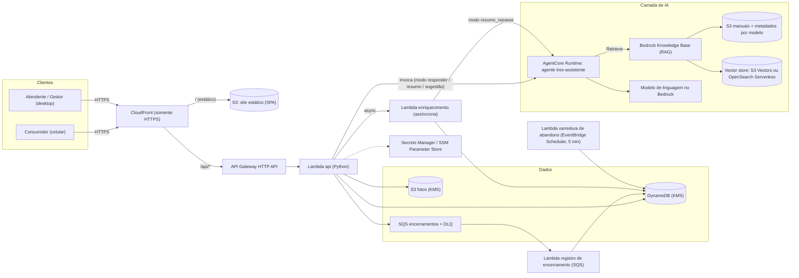
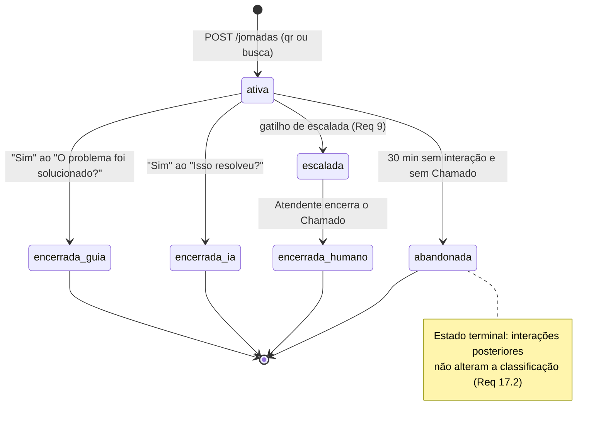
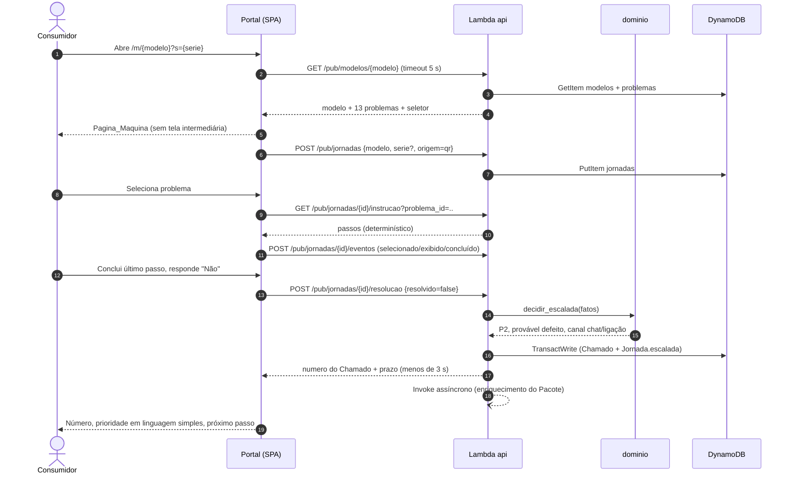
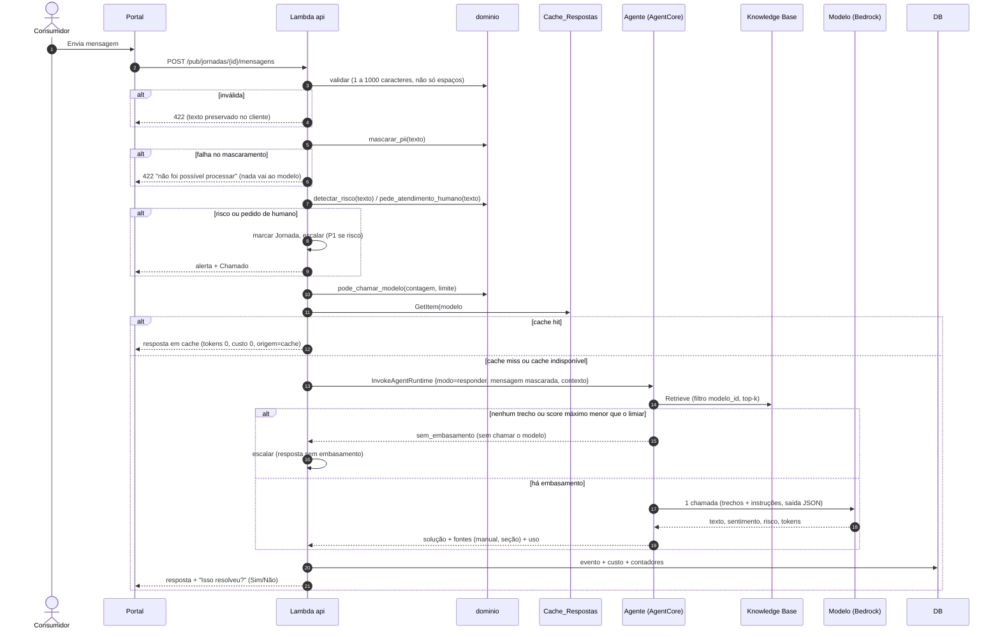
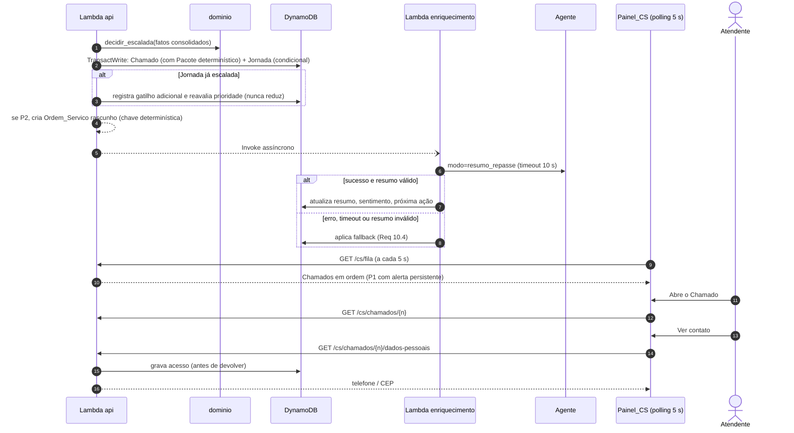
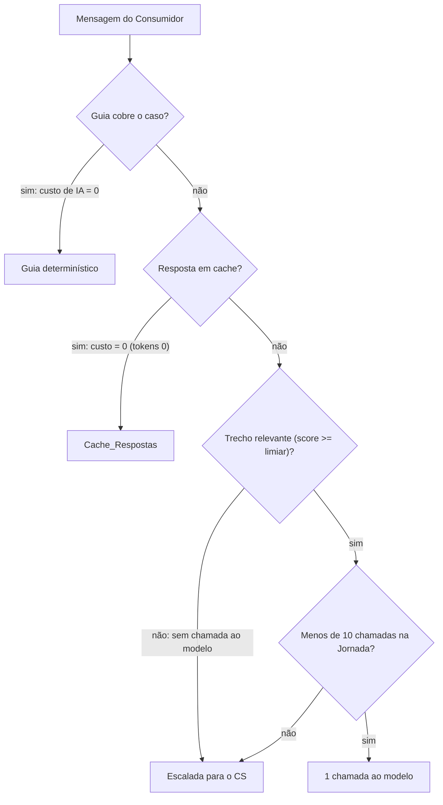

# Design Document: TRES Autoatendimento

## Overview

O TRES Autoatendimento é um canal web único para consumidores de máquinas de café TRES (3corações) resolverem sozinhos o que não é defeito e chegarem ao atendimento humano só quando necessário. Este documento descreve o design técnico (greenfield) que atende aos 20 requisitos de `requirements.md`, com foco em um **MVP demonstrável de ponta a ponta em 2 dias**:

> QR code → guia dos 13 problemas → assistente com IA (manuais) → repasse estruturado → Painel do CS → métricas.

### Objetivos de design

1. **Determinístico primeiro, IA por último.** Guia, detecção de risco, escalada, prioridade, canal, limites e cache são regras determinísticas e auditáveis. O modelo de linguagem só gera texto quando o guia não cobre o caso (Requisitos 3, 6, 7, 8, 9, 11).
2. **Simples e barato (serverless).** Um front-end estático, uma API em Lambda, DynamoDB sob demanda, um agente no Amazon Bedrock AgentCore e uma Base_Conhecimento gerenciada. Nada fica ligado sem uso.
3. **Regras de negócio como funções puras.** Todo o "cérebro" (Motor_Escalada, Detector_Risco, mascaramento de PII, normalização do cache, validação do Pacote_Repasse, agregação de métricas) vive num pacote de domínio sem I/O. Isso permite testes baseados em propriedades (PBT) rápidos e confiáveis.
4. **A Jornada é a espinha dorsal.** Tudo o que acontece (passos do guia, mensagens, soluções, risco, escalada, custo) vira evento da Jornada, preservado entre camadas (guia → IA → humano) sem o Consumidor repetir nada.
5. **Honestidade sobre o que não foi verificado.** Onde um detalhe da AWS ou do AgentCore é incerto, o design diz isso e registra a verificação como premissa ou questão em aberto (seção final).

### Decisões de arquitetura (resumo)

| # | Decisão | Alternativa descartada | Motivo |
|---|---------|------------------------|--------|
| D1 | Backend serverless: API Gateway HTTP API + 1 Lambda "api" em Python 3.12 (roteador único) | Vários microsserviços; contêineres | Menos infraestrutura para montar em 2 dias, custo ocioso zero. O agente já é Python (Strands). |
| D2 | Banco: **DynamoDB** sob demanda, criptografado com KMS | Aurora Serverless v2 (Postgres) | Sem VPC, sem custo ocioso, chaves condicionais cobrem as garantias de unicidade. Agregações de métricas são feitas na Lambda com volume de demo. Aurora fica como evolução se relatórios ad hoc forem necessários. |
| D3 | Regras de negócio **no servidor**, em pacote Python puro (`dominio`) | Regras duplicadas em TypeScript | Uma única linguagem para PBT (Hypothesis). O front-end só renderiza. |
| D4 | Assistente_IA = **pipeline "recuperar primeiro"** dentro de um agente no AgentCore Runtime: recupera trechos, aplica o Limiar_Relevancia em código e só então faz **uma** chamada ao modelo | Agente que decide sozinho quando buscar | Corta custo, torna o Requisito 6.4 determinístico e evita resposta sem embasamento. |
| D5 | Filtros de entrada ficam **na API, antes do agente**: validação, mascaramento de PII, risco, pedido de humano, limite de mensagens e cache | Confiar no prompt do agente | Requisitos 8.1 e 18.3 exigem que o texto original não chegue ao modelo e que risco seja marcado antes dele. |
| D6 | Autenticação do Painel_CS **própria** (usuários em DynamoDB, hash forte, sessão opaca com expiração deslizante) | Amazon Cognito | Os Requisitos 13.5 (30 min de inatividade) e 13.8 (5 falhas em 15 min, bloqueio de 15 min) têm semântica exata. Cognito não permite configurar esses valores de forma equivalente (a verificar, ver Q9). |
| D7 | Tempo quase real por **polling** (a cada 5 s) | WebSocket / AppSync | Requisitos 14.2 e 15.4/15.5 pedem até 10 s. Polling atende e é bem mais simples. |
| D8 | Texto livre do Consumidor é **persistido somente já mascarado** | Guardar o original | Minimização de dados (Requisito 18). Ver Q6. |
| D9 | CloudFront na frente de tudo, mesma origem para site e `/api/*` | Domínios separados | HTTPS obrigatório (Requisito 18.7), sem CORS, cookie de sessão `HttpOnly` + `SameSite=Strict`. |
| D10 | Base_Conhecimento: **Bedrock Knowledge Base** sobre S3 com S3 Vectors como armazenamento vetorial (preferência), OpenSearch Serverless como alternativa | Vector store próprio | S3 Vectors tem integração documentada com Knowledge Bases e custo ocioso baixo. Disponibilidade na região escolhida e score de relevância a verificar (Q1, Q2). |

### Escopo: MVP vs. evolução

| Marcação | Significado |
|----------|-------------|
| **[MVP]** | Entra na demo dos 2 dias, completo. |
| **[MVP-s]** | Entra na demo em versão reduzida (descrita abaixo). A versão completa fica para a fase 4. |
| **[Depois]** | Fora do MVP (ver "Fora do escopo do MVP" no `requirements.md`). |

| Área | MVP | Versão reduzida no MVP [MVP-s] | Depois |
|------|-----|-------------------------------|--------|
| Req 1 e 2 (QR, busca) | QR com `modelo_id`, busca por nome, grade com foto | Catálogo com 2 a 3 modelos | Identificação por foto com IA |
| Req 3 e 5 (guia, "Resolveu?") | 13 problemas, instruções por passos, escalada P2 | Instruções completas só para o modelo da demo; mídia = ilustração estática + texto | Animações para todos os modelos |
| Req 4 (Seletor_Visual) | Não | Mapeamento para o modelo da demo | Demais modelos |
| Req 6 (Assistente_IA) | Chat, RAG com citação, 2 soluções, escalada | Sem streaming | Streaming, memória de longo prazo |
| Req 7 (cache e custo) | Cache por chave normalizada exata, limite de 10, custo por chamada | Cache alimentado só pelo fechamento do Chamado | Cache semântico |
| Req 8 a 12 (risco, escalada, repasse) | Completo | Telefonia = registro no Chamado | Discagem/URA reais |
| Req 13 a 16 (Painel_CS) | Login, fila, card, assumir, mensagem, encerrar, cache | Sugestão de resposta da IA pode cair no fallback | Notificações ativas |
| Req 17 (métricas) | Todos os indicadores | Período personalizado pode ficar para o dia 2 | Dashboards históricos em BI |
| Req 18 (LGPD) | Mascaramento, consentimento, log de acesso, KMS | Política de retenção fica com o jurídico | Exclusão sob demanda |
| Req 19 (acessibilidade) | Contraste, foco, alvos de toque, movimento reduzido | Sem auditoria WCAG formal | Auditoria com tecnologias assistivas |
| Req 20 (AWS) | Tudo | IaC pode ser parcialmente manual no console nos 2 dias | Pipeline CI/CD completo |

### Estrutura do repositório (fase 3: Git)

```text
/apps/web              # React + Vite + TypeScript (Portal_TRES e Painel_CS)
/services/api          # Lambda Python (rotas públicas /api/pub e do CS /api/cs)
/services/agente       # Agente Strands para o AgentCore Runtime
/packages/dominio      # Funções puras (sem I/O): motor, risco, pii, cache, pacote, métricas
/infra                 # CDK (Python): tabelas, buckets, API, CloudFront, KB, filas
/seed                  # catálogo, 13 problemas, instruções, manuais (fonte da carga)
/scripts               # carga idempotente (Requisito 20.3)
/docs                  # roteiro de demo, runbook
```

## Architecture

### Visão geral



### Camadas e responsabilidades

| Camada | Responsabilidade | Observação |
|--------|------------------|-----------|
| **Portal_TRES (SPA)** | Telas do Consumidor, fila de eventos pendentes com reenvio (Req 3.12, 5.7), tratamento de erros e acessibilidade | Sem regra de negócio. Guarda `jornada_id` em `sessionStorage` para sobreviver a recarga (Req 19.9). |
| **Painel_CS (SPA, rotas `/cs/*`)** | Login, fila, card, ações, Painel_Metricas | Mesma aplicação, rotas protegidas. |
| **API (Lambda)** | Roteamento, validação, autenticação/autorização, orquestração do pipeline do Assistente_IA, persistência | Chama funções de `dominio` e adaptadores de I/O. |
| **dominio (Python puro)** | Regras determinísticas | Cobertura principal de PBT. |
| **Agente (AgentCore Runtime)** | Recuperação na Base_Conhecimento, geração, classificação de sentimento/risco, resumo do repasse, sugestão para o Atendente | Sem acesso de escrita ao banco. Só devolve JSON. |
| **Servico_Metricas** | Registro de encerramentos (fila SQS), agregados diários, cálculo dos indicadores | O cálculo é função pura. |

### Máquina de estados da Jornada

Cada Jornada encerrada tem exatamente uma camada de resolução (Req 17.1).



Regras de transição: toda transição para um estado terminal é um `UpdateItem` condicional (`estado IN (ativa, escalada)`), o que garante "exatamente uma camada" mesmo com requisições concorrentes.

### Fluxo 1: QR → guia → "Não" → escalada → Chamado



### Fluxo 2: mensagem ao Assistente_IA (pipeline)



### Fluxo 3: escalada, Pacote_Repasse e Painel_CS



### Segurança e LGPD

**Autenticação e autorização do Painel_CS (Req 13)**

- Usuários em `usuarios_cs` com senha em hash **Argon2id** (ou scrypt, conforme biblioteca disponível no runtime Lambda; a verificar). Nenhuma senha em texto puro, nem em log.
- Login: o contador de falhas guarda os horários das últimas falhas. 5 falhas em 15 min bloqueiam o usuário por 15 min (Req 13.8). A mensagem de erro é a mesma para usuário inexistente ou senha errada (Req 13.7). O tempo de resposta é equalizado fazendo o hash mesmo para usuário inexistente.
- Sessão: token opaco de 256 bits, guardado só como hash SHA-256 em `sessoes_cs`, com `ultima_atividade`. Cada requisição valida e renova. Mais de 30 min sem atividade encerra a sessão (Req 13.5). O cookie é `HttpOnly; Secure; SameSite=Strict`, e mutações exigem o cabeçalho `X-Requested-With` (defesa em profundidade contra CSRF).
- Autorização: middleware único. Sem credencial válida → 401, sem corpo com dados (Req 13.2). Perfil `atendente` em rota de métricas → 403 sem dados (Req 13.3). `gestor` acessa métricas (Req 13.4).

**Consumidor (sem login)**

- A capacidade de agir numa Jornada é o `jornada_id` (ULID/UUIDv4 de 128 bits, não adivinhável). O acompanhamento usa o número do Chamado, gerado de forma **não sequencial** (10 caracteres Crockford base32, cerca de 50 bits) e limitado por taxa. A resposta pública do acompanhamento **nunca** devolve telefone nem CEP (apenas status, mensagens do Atendente, agendamento).
- Limitação de taxa por rota no API Gateway (throttling). AWS WAF fica como evolução (Q12).

**LGPD (Req 18)**

- Minimização: nenhum campo de Dados_Pessoais é obrigatório até o contato com o Atendente (Req 18.1). Telefone/CEP são pedidos conforme a prioridade (Req 12.4), com finalidade exibida e caixa de consentimento **desmarcada** (Req 12.5).
- Texto livre passa por `mascarar_pii` **antes** de qualquer outro uso, inclusive persistência. Se o mascaramento falhar, nada é enviado ao modelo nem gravado (Req 18.3, 18.8).
- Criptografia em repouso: todas as tabelas e buckets com chave KMS gerenciada pelo cliente. Telefone e CEP ficam numa tabela própria (`dados_pessoais`), com política IAM restrita ao papel que atende o endpoint de dados pessoais. Criptografia em nível de campo (envelope) é evolução (Q7).
- Acesso do Atendente a Dados_Pessoais: endpoint separado que **primeiro** grava o registro de acesso (atendente, Chamado, data/hora em segundos) e só então responde. Se a gravação falhar, responde 403 sem os dados (Req 18.6, 18.9).
- Painel_Metricas só recebe agregados (Req 18.4). Logs estruturados sem PII (mensagens só mascaradas, nunca telefone/CEP).
- HTTPS: a distribuição do CloudFront redireciona HTTP para HTTPS e adiciona HSTS (Req 18.7). O API Gateway só é alcançável pelo CloudFront. O redirecionamento ocorre antes de qualquer processamento do corpo da requisição.
- Aviso de privacidade em `/privacidade`, com link visível em toda tela que pede Dados_Pessoais (Req 18.5). O texto jurídico é responsabilidade da 3corações.

**Segredos (Req 20.5)**

- Nenhum segredo no repositório. Segredos e parâmetros sensíveis ficam no Secrets Manager ou SSM Parameter Store; a Lambda lê em tempo de execução com permissão mínima. O `.gitignore` bloqueia `.env`, e um varredor de segredos (por exemplo gitleaks) roda em pré-commit e no CI.
- Usuários iniciais do Painel_CS são criados por script que lê a senha inicial de variável de ambiente local e força troca no primeiro acesso. Nada de senha fixa no seed.

**Superfície de IA**

- Injeção de prompt: o agente só tem a ferramenta de leitura da Base_Conhecimento, nenhuma ferramenta com efeito colateral e nenhuma credencial de escrita. A saída do modelo é tratada como texto não confiável (renderizada como texto, nunca como HTML). As fontes citadas vêm dos metadados dos trechos recuperados, não do texto do modelo.
- Cabeçalhos de segurança (CSP restritiva, `X-Content-Type-Options`, `Referrer-Policy`) via política de resposta do CloudFront.

**Fotos (Req 12.7, 12.10)**

- Upload por URL pré-assinada (POST pré-assinado com condições de tamanho máximo de 5 MB e tipo `image/jpeg` ou `image/png`). Na confirmação, a API confere os bytes iniciais (assinatura JPEG/PNG) e rejeita só a foto inválida. O Atendente vê a foto por URL pré-assinada de curta duração.

### Modelo de custo ("IA sustentável")

**Princípio:** cada camada só é usada quando a anterior não resolve, e cada chamada ao modelo tem custo registrado.



**Alavancas de custo no design**

| Alavanca | Efeito | Requisito |
|----------|--------|-----------|
| Guia determinístico (13 problemas) | Cerca de 70% dos chamados são falsos defeitos conhecidos, custo de IA zero | 3, 5 |
| Cache por chave normalizada, alimentado só por respostas aprovadas | Perguntas repetidas custam zero | 7, 16 |
| Limiar de relevância aplicado em código | Sem trecho útil, não há chamada ao modelo | 6.4 |
| Limite de 10 chamadas ao modelo por Jornada | Teto de custo por Jornada | 7.4, 7.5 |
| Uma única chamada por resposta, saída em JSON, `max_tokens` limitado, histórico limitado às últimas N interações | Reduz tokens de entrada e saída | 7.3 |
| Modelo pequeno/rápido da família disponível no Bedrock (a escolher e validar, ver Q3) | Menor custo e latência | 6.8 |

**Fórmula registrada em cada chamada** (Req 7.3, 4 casas decimais em BRL):

```text
custo_chamada_brl = ( tokens_entrada × preco_entrada_por_1M + tokens_saida × preco_saida_por_1M ) / 1.000.000 × cotacao_usd_brl
```

Preços por 1M de tokens e cotação ficam na tabela `config` (editáveis pelo Gestor), nunca no código. **Os valores não estão definidos neste documento**, porque não foram verificados. Antes da demo, preencher com os preços vigentes do modelo escolhido, conferidos na página de preços do Amazon Bedrock.

**Custo fixo a vigiar:** o vector store. Opções com custo ocioso alto (por exemplo OpenSearch Serverless com capacidade mínima) podem pesar mais que todo o uso de IA no hackathon. Por isso a preferência por S3 Vectors, sujeita à verificação da Q1.

**Métricas de custo (Req 17.6):** guia = 0; ia = soma do custo de tokens da Jornada; humano = minutos de atendimento × custo por minuto configurável (0,00 a 999,99). Observação: com essa definição, o custo de IA gasto em Jornadas que depois escalaram não aparece em nenhuma camada. Sugestão de indicador extra, "custo total de IA por período", registrada na Q10.

## Components and Interfaces

### 1. Portal_TRES (SPA)

Tecnologia: React + Vite + TypeScript, `react-router`, divisão de código por rota, alvo de bundle inicial pequeno (alvo: abaixo de 150 KB comprimido; a medir) para atender ao Req 19.2.

| Rota | Conteúdo | Requisitos |
|------|----------|-----------|
| `/` | Busca por nome (máx. 50 caracteres, filtro local sem acento/caixa a partir de 2 caracteres) e grade com foto, em ordem alfabética | 2 |
| `/m/:modeloId?s=` | Pagina_Maquina: Seletor_Visual (quando mapeado), 13 problemas, "Meu problema não está na lista", painel do Assistente_IA na mesma página | 1, 3, 4, 6 |
| `/m/:modeloId/p/:problemaId` | Instrução em passos com mídia, alternativa textual e "O problema foi solucionado?" | 3, 5, 19 |
| `/chamado/:numero` | Acompanhamento: status, mensagens, agendamento, avaliação, dados de contato, fotos | 12, 15, 16 |
| `/privacidade` | Aviso de privacidade | 18.5 |

Comportamentos transversais:

- **Fila de eventos com reenvio:** eventos do guia e avaliações vão para uma fila local; em falha, 3 novas tentativas a cada 5 s, sem interromper o fluxo (Req 3.12, 5.7). Cada evento tem `evento_id` (ULID) para idempotência no servidor.
- **Bloco de alerta de risco:** `role="alert"`, no topo, visível em todas as telas enquanto a Jornada estiver marcada (Req 8.3). O estado de risco vem do servidor e não pode ser removido pelo cliente.
- **Botão "Falar com uma pessoa":** fixo e visível sem rolagem em qualquer tela do assistente, mínimo 44×44 px (Req 9.6). Continua funcionando se o agente cair (Req 20.4).
- **Acessibilidade:** tamanho mínimo de fonte 16 px, contraste 4,5:1, foco visível, navegação por teclado, `prefers-reduced-motion` troca animação por imagem estática (Req 19).
- **Linguagem:** conteúdo em pt-BR, frases curtas, sem siglas. As prioridades P1/P2/P3 nunca aparecem ao Consumidor (Req 12.1), apenas rótulos como "Atendimento urgente".
- **Polling:** o acompanhamento consulta o Chamado a cada 5 s enquanto a página está visível.

### 2. API (Lambda) — contrato HTTP

Convenções: JSON UTF-8, erro padronizado `{ "erro": { "codigo": "...", "mensagem": "pt-BR", "campos": [{ "campo": "...", "motivo": "..." }] } }`. Mutações aceitam `Idempotency-Key` (ou `evento_id`).

**Rotas públicas (`/api/pub`)**

| Método e rota | Função | Req |
|---------------|--------|-----|
| `GET /modelos` | Catálogo (cache de borda curto) | 2 |
| `GET /modelos/{modelo_id}` | Modelo, 13 problemas, mapa do Seletor_Visual | 1, 3, 4 |
| `POST /jornadas` | Cria Jornada `{modelo_id?, numero_serie?, origem}`. Série inválida é descartada em silêncio | 1.2 a 1.6 |
| `PUT /jornadas/{id}/modelo` | Associa modelo escolhido na busca (`origem` vira `busca`) | 2.4 |
| `GET /jornadas/{id}/instrucao?problema_id=&variante=` | Passos determinísticos | 3.3, 3.6, 3.10, 3.11 |
| `POST /jornadas/{id}/vazamento` | `{tipo: externo\|interno}`. Interno marca risco e escala | 3.7, 3.8, 8.7 |
| `POST /jornadas/{id}/seletor/resolver` | `{area, estado}` → único, múltiplos ou nenhum | 4 |
| `POST /jornadas/{id}/eventos` | Eventos do guia (idempotente por `evento_id`) | 3.9 |
| `POST /jornadas/{id}/resolucao` | "Sim/Não" do guia | 5.1 a 5.3 |
| `POST /jornadas/{id}/mensagens` | Pipeline do Assistente_IA | 6, 7, 8, 9, 18 |
| `POST /jornadas/{id}/solucoes/{sid}/resposta` | "Isso resolveu?" Sim/Não | 6.6, 6.7, 6.10 |
| `POST /jornadas/{id}/escalar` | Botão "Falar com uma pessoa" | 9.3 |
| `POST /jornadas/{id}/avaliacao` | Nota 1 a 5 e comentário (até 500). 1 por Jornada | 5.2, 5.5 |
| `POST /chamados/{numero}/contato` | Telefone/CEP com consentimento | 12.2 a 12.6 |
| `POST /chamados/{numero}/anexos` (+ confirmação) | Foto por URL pré-assinada | 12.7, 12.10 |
| `GET /chamados/{numero}` | Status, mensagens e agendamento. Sem Dados_Pessoais | 12.8, 12.11, 15.4, 15.6 |
| `POST /chamados/{numero}/mensagens` | Resposta do Consumidor (1 a 2000) | 15.5 |

**Rotas do CS (`/api/cs`, autenticadas)**

| Método e rota | Perfil | Função | Req |
|---------------|--------|--------|-----|
| `POST /login`, `POST /logout` | — | Sessão | 13 |
| `GET /fila` | atendente, gestor | Fila ordenada, com alerta P1 | 14.1, 14.2, 14.7 |
| `GET /chamados/{n}` | atendente, gestor | Card (resumo no topo, histórico, anexos) | 14.3, 14.4 |
| `POST /chamados/{n}/assumir` | atendente, gestor | Assume (condicional) | 14.5, 14.6 |
| `GET /chamados/{n}/dados-pessoais` | atendente, gestor | Grava acesso e devolve telefone/CEP | 18.6, 18.9 |
| `GET /chamados/{n}/anexos/{i}` | atendente, gestor | URL pré-assinada curta | 14.4 |
| `GET /chamados/{n}/sugestao` | atendente, gestor | Sugestão da IA (10 s) | 15.2, 15.7 |
| `POST /chamados/{n}/mensagens` | atendente, gestor | Envia mensagem confirmada | 15.3, 15.8 |
| `POST /chamados/{n}/ordem-servico` | atendente, gestor | Confirmar/recriar rascunho (idempotente) | 11.4, 11.8, 15.1 |
| `POST /chamados/{n}/agendamento` | atendente, gestor | Agendar ligação | 15.6, 15.9 |
| `POST /chamados/{n}/encerrar` | atendente, gestor | Desfecho + solução | 16.1, 16.6 |
| `POST /cache` | atendente, gestor | Adicionar ao Cache_Respostas | 16.2, 16.3, 16.7, 16.8 |
| `GET /metricas?periodo=` | **gestor** | Indicadores agregados | 17 |
| `PUT /config` | **gestor** | Custo por minuto, limiar, termos | 17.6 |

### 3. Pacote `dominio` (funções puras)

Nenhuma função faz I/O, usa relógio global ou aleatoriedade implícita (relógio e dados entram por parâmetro). Interfaces em Python (assinaturas de design, não código final):

```python
# --- Cache (Req 7, 16)
def normalizar_pergunta(texto: str) -> str: ...
def chave_cache(modelo_id: str, pergunta: str) -> str: ...        # f"{modelo_id}#{sha256(normalizar_pergunta(pergunta))}"
def aceitar_insercao_cache(entrada: EntradaCache, aprovador_id: str | None, existente: EntradaCache | None) -> ResultadoInsercao: ...

# --- Privacidade (Req 18)
def mascarar_pii(texto: str) -> str: ...                          # levanta ErroMascaramento
# --- Risco e pedidos (Req 8, 9)
def detectar_risco(texto: str, termos: Sequence[str]) -> bool: ...
def pede_atendimento_humano(texto: str, expressoes: Sequence[str]) -> bool: ...

# --- Escalada (Req 9, 11)
def decidir_escalada(fatos: FatosJornada) -> DecisaoEscalada: ...
def reavaliar_prioridade(atual: DecisaoEscalada, fatos: FatosJornada) -> DecisaoEscalada: ...   # nunca reduz
def pode_chamar_modelo(msgs_modelo: int, limite: int) -> bool: ...
def proximo_estado_frustracao(seq_alta: int, nivel: Nivel) -> int: ...

# --- Pacote_Repasse (Req 10)
def validar_pacote(obj: Mapping) -> list[ErroCampo]: ...
def pacote_para_json(p: PacoteRepasse) -> str: ...                # UTF-8, ensure_ascii=False
def pacote_de_json(s: str) -> PacoteRepasse: ...
def pacote_fallback(det: CamposDeterministicos) -> PacoteRepasse: ...

# --- Entradas do Consumidor (Req 12)
def validar_telefone(s: str) -> bool: ...
def validar_cep(s: str) -> bool: ...
def validar_foto(mime: str, bytes_: int, ja_anexadas: int) -> ResultadoFoto: ...

# --- Guia e Seletor (Req 3, 4)
def resolver_instrucao(catalogo, modelo_id, problema_id, variante) -> Instrucao | None: ...
def resolver_seletor(mapa: MapaSeletor, area: str, estado: str) -> ResolucaoSeletor: ...

# --- Painel e métricas (Req 14, 17)
def ordenar_fila(chamados: Iterable[ChamadoFila]) -> list[ChamadoFila]: ...
def agregar_metricas(jornadas, chamados, avaliacoes, agregados_dia, periodo, cfg) -> Metricas: ...
def custo_chamada_brl(tin: int, tout: int, precos: Precos, cotacao: Decimal) -> Decimal: ...
```

#### 3.1 Detector_Risco

- Entrada normalizada (minúsculas, sem acentos, pontuação virando espaço). Casamento por **termo inteiro ou expressão** (limites de palavra), para não acionar por pedaços de outras palavras.
- Negação **não** desativa a detecção: "não sai fumaça" também marca risco (Req 8.1). Isso é intencional e prioriza segurança.
- Termos iniciais: `queimado`, `cheiro de queimado`, `fumaca`, `choque`, `faisca`, `vazamento interno` e sinônimos em `config.termos_risco` (editável). A lista final de sinônimos precisa de validação com a 3corações (Q11).
- Origens da marcação: `lista` (mensagem), `ia` (classificação do agente), `guia` (vazamento interno). A marcação é monotônica: depois de marcada, nunca é removida (Req 8.4).
- Efeitos da marcação: grava `risco {origem, em}`, aciona o Motor_Escalada (P1) uma única vez por Jornada e faz o Portal exibir o alerta.

#### 3.2 Motor_Escalada

Entrada `FatosJornada`:

```python
@dataclass(frozen=True)
class FatosJornada:
    risco_seguranca: bool          # Detector_Risco, em qualquer origem
    guia_respondeu_nao: bool       # "Não" após concluir a instrução de ao menos 1 Problema_Catalogado
    # Os campos abaixo NÃO influenciam prioridade, classificação nem canal (Req 11.5):
    gatilhos: frozenset[Gatilho]
    sentimento: Nivel | None
    problema_id: str | None
```

Tabela de decisão (única fonte de verdade, avaliada **uma vez** sobre os fatos consolidados, Req 11.6):

| Critério | Condição | Prioridade | Classificação | Canal recomendado |
|----------|----------|-----------|---------------|-------------------|
| 1 | `risco_seguranca` | P1 | provável defeito | ligação imediata |
| 2 | não risco e `guia_respondeu_nao` | P2 | provável defeito | chat ou ligação, à escolha do Consumidor |
| 3 | demais casos | P3 | provável uso | chat assíncrono |

Gatilhos reconhecidos (Req 9.7): `risco_seguranca`, `duas_negativas_ia`, `pedido_humano`, `sem_embasamento`, `frustracao_alta`, `limite_mensagens`, `instrucao_sem_solucao`.

Procedimento de escalada na API (`escalar(jornada_id, gatilho)`):

1. Leitura consistente da Jornada e consolidação dos fatos.
2. Registro do gatilho como evento. Se o registro falhar, a escalada **continua** e o gatilho é marcado "não registrado" no Pacote (Req 9.10).
3. `decidir_escalada(fatos)`.
4. `TransactWriteItems`: `Put` do Chamado (condição `attribute_not_exists`) com Pacote determinístico **e** `Update` da Jornada (condição `attribute_not_exists(chamado_numero)`), gravando decisão, critério (1/2/3) e horário (Req 11.7).
5. Se a condição falhar (Jornada já escalada): **não** cria Chamado nem Pacote (Req 9.9). Registra o gatilho adicional e chama `reavaliar_prioridade`. Se os fatos novos elevam a prioridade (por exemplo risco detectado depois de um P3), atualiza prioridade/classificação/canal no mesmo Chamado e reposiciona na fila. A prioridade **nunca diminui**. Isso concilia 8.5, 9.9 e 11.6 (ver Q4).
6. Se prioridade P2: cria a Ordem_Servico rascunho em até 5 s, com chave determinística `OS#<numero>` (idempotente, Req 11.4, 11.8).
7. Dispara a Lambda de enriquecimento (assíncrona) para resumo, sentimento e próxima ação.

Gatilhos específicos:

- `duas_negativas_ia`: contador `ia_nao_count` na Jornada (incremento atômico). Ao chegar a 2, escala. Respostas "Não" do guia não entram (Req 9.2).
- `frustracao_alta`: contador `frustracao_alta_seq`. Mensagem classificada "alta" soma 1, qualquer outro nível zera. Ao chegar a 2, escala (Req 9.5).
- `limite_mensagens`: contador `msgs_modelo_count` incrementado com condição `< limite`. A 10ª chamada é permitida; ao atingi-la a Jornada escala e bloqueia novas chamadas ao modelo (Req 7.4, 7.5).

#### 3.3 Guia_Diagnostico

- **Dados, não código:** `problemas` (13, na ordem do Req 3.1) e `instrucoes` por `(modelo_id, problema_id, variante)`. A mesma entrada gera sempre os mesmos passos (Req 3.6). O servidor nunca chama o Assistente_IA no guia.
- Validações na carga: título ≤ 40 caracteres, ≤ 10 passos, ≤ 140 caracteres de texto por passo, `alt` ≤ 125 caracteres, texto equivalente presente (Req 3.3, 3.4, 19.5).
- Vazamento: pergunta externo/interno antes de qualquer passo. Interno → risco `guia` e escalada, sem passos (Req 3.7, 3.8). Externo → variante `externo` (Req 3.11).
- Combinação sem instrução → resposta 404 funcional com opções (abrir assistente, voltar), Jornada intacta (Req 3.10).
- Mídia: ilustração/GIF/vídeo curto servido pelo CloudFront. O front mostra texto e alternativa se a mídia não carregar em 5 s, sem bloquear o avanço (Req 3.4). Com `prefers-reduced-motion`, usa a imagem estática (Req 19.7).
- Contagem de toques (Req 3.5): selecionar o problema já abre o primeiro passo (1 toque, o segundo é opcional). Vazamento: selecionar + responder externo/interno (2 toques, dentro do limite de 3).

#### 3.4 Seletor_Visual [MVP-s]

- Mapa por modelo (`modelos.seletor`): imagem, áreas (retângulos/polígonos em porcentagem, um componente físico por área, sem sobreposição), estados aplicáveis por área (2 a 5) e regras `(area, estado) → [problema_id]`.
- `resolver_seletor` devolve `unico` (abre a instrução), `multiplos` (até 5 opções) ou `nenhum` (vai ao Assistente_IA com área/estado registrados). A validação de não sobreposição e de cobertura de estados ocorre na carga.
- Cada área é um botão real (`<button>` sobre a imagem) com rótulo acessível, mínimo 44×44 px, acionável por teclado (Req 4.5). Sem mapa ou com imagem que não carrega em 5 s: mensagem e acesso ao assistente (Req 4.7).

#### 3.5 Assistente_IA (AgentCore Runtime + Base_Conhecimento)

**Responsabilidade dividida**

| Quem | Faz |
|------|-----|
| API (Lambda) | Validação, mascaramento, risco, pedido humano, limite, cache, orquestração, registro de custo, escalada |
| Agente (AgentCore) | Recuperação por modelo, aplicação do limiar, uma chamada ao modelo, classificação de sentimento e risco, resumo do repasse, sugestão ao Atendente |

**Contrato de invocação (JSON)**

```json
{
  "modo": "responder | resumo_repasse | sugestao_atendente",
  "jornada_id": "01J...",
  "modelo_id": "tres-modelo-x",
  "numero_serie": "ABC123 | null",
  "passos_registrados": [{ "camada": "guia", "passo": "Problema 7, passo 2", "resultado": "não" }],
  "historico": [{ "papel": "consumidor | assistente", "texto": "..." }],
  "mensagem": "texto JÁ MASCARADO",
  "solucoes_anteriores": [{ "id": "s1", "resumo": "..." }],
  "limiar_relevancia": 0.5,
  "problemas_catalogados": [{ "id": 7, "titulo": "Bebida aguada" }]
}
```

Resposta no modo `responder`:

```json
{
  "resultado": "solucao | sem_embasamento | problema_catalogado | risco",
  "texto": "...",
  "fontes": [{ "manual": "Manual Modelo X", "secao": "4.2 Limpeza", "score": 0.78 }],
  "problema_id": 7,
  "risco_seguranca": false,
  "sentimento": "baixa | média | alta | null",
  "uso": { "tokens_entrada": 0, "tokens_saida": 0, "modelo": "id-do-modelo" },
  "score_maximo": 0.78
}
```

**Pipeline dentro do agente (modo `responder`)**

1. `Retrieve` na Knowledge Base com **filtro de metadados `modelo_id`** (nunca trechos de outros modelos, Req 6.2) e top-k pequeno.
2. Se não há trechos ou `score_maximo < limiar`: devolve `sem_embasamento` **sem chamar o modelo** (tokens 0). A API escala.
3. Caso contrário, **uma** chamada ao modelo com os trechos numerados, o histórico recente e a lista dos 13 problemas. O modelo devolve JSON com: índices dos trechos usados, texto, `problema_id` (ou null), `risco_seguranca`, `sentimento`.
4. Validação determinística da saída: índices devem existir entre os trechos recuperados. As **fontes** (manual e seção) vêm dos metadados dos trechos. Saída inválida vira `sem_embasamento`.
5. Se `problema_id` ≠ null: resultado `problema_catalogado`, e a API oferece a instrução do guia com a fonte (Req 6.5).

**Segunda solução (Req 6.10):** após o primeiro "Não", a API invoca o agente de novo com `solucoes_anteriores` para uma alternativa. Esta chamada conta no limite de 10 (premissa conservadora, ver Q5). Após o segundo "Não", escala com gatilho `duas_negativas_ia`.

**Base_Conhecimento (RAG)**

- Manuais oficiais em S3, um prefixo por modelo, com arquivo de metadados por documento (`modelo_id`, `manual`). A seção é derivada da estrutura do documento no chunking. Se o chunking padrão não preservar o nome da seção, a pré-processar o manual com marcações de seção antes da ingestão (a verificar, Q2).
- Modelo de embeddings multilíngue com bom desempenho em português (a escolher e validar, Q3).
- Carga e reindexação feitas pelo script de carga (Req 20.3).

**Padrões que NÃO entram no MVP:** AgentCore Memory (o histórico já está na Jornada), AgentCore Gateway (não há ferramentas externas), streaming.

**Uso do AgentCore (premissas a verificar com a power `aws-agentcore` durante a implementação)**

- Fluxo esperado: `agentcore create` → desenvolvimento local com `agentcore dev` → `agentcore configure` e `agentcore launch`. O guia da power descreve esse ciclo; as ferramentas MCP da power não estavam disponíveis na criação deste design, então nada de comportamento fino foi confirmado (Q13).
- Pontos incertos: nome exato da operação de invocação a partir da Lambda (SDK `bedrock-agentcore`), autenticação (IAM vs. JWT), tempo de partida a frio do runtime (impacta o p90 de 10 s do Req 6.8), duração da sessão ociosa e limites de payload.

#### 3.6 Cache_Respostas

- Chave: `modelo_id#sha256(normalizar_pergunta(pergunta))`. Normalização (Req 7.1): minúsculas, remoção de acentos, remoção de pontuação, espaços repetidos viram um só, remoção das pontas. Idempotente: `normalizar(normalizar(x)) == normalizar(x)`.
- Leitura com timeout de 2 s. Falha ou timeout = miss (Req 7.8).
- Gravação **só** pelo endpoint do CS com `aprovador_id` obrigatório (Req 7.6). Tentativa sem aprovação é rejeitada, o conteúdo existente não muda e a rejeição é registrada na Jornada (Req 7.7). Chave já existente → mantém a entrada e avisa (Put condicional, Req 16.8).
- Disponível para consulta em até 10 s depois de confirmada (leitura direta, sem camada extra de cache, consistência de leitura forte opcional).
- Registro na Jornada: origem `cache`, tokens 0, custo 0,0000 (Req 7.2).

#### 3.7 Sistema de repasse e Pacote_Repasse

O Pacote nasce na criação do Chamado com todos os campos determinísticos preenchidos (Req 10.2) e **valores provisórios** para os três campos de IA (resumo "Resumo indisponível — ver histórico da Jornada", sentimento "neutro", próxima ação "Revisar o histórico da Jornada"), marcados no Chamado com `pacote_ia_status = pendente`. A Lambda de enriquecimento tenta substituí-los em até 10 s (status `ok`). Em erro, timeout ou resumo vazio/maior que 300, mantém o fallback (status `fallback`, Req 10.4). Assim o Chamado e o número saem em menos de 3 s (Req 12.1) e o Pacote fica disponível ao Painel em menos de 15 s (Req 10.8), mesmo sem IA.

**JSON Schema (versão 1)**

```json
{
  "$schema": "https://json-schema.org/draft/2020-12/schema",
  "$id": "pacote-repasse/1",
  "type": "object",
  "additionalProperties": false,
  "required": [
    "schema_version", "numero_chamado", "modelo", "numero_serie", "origem",
    "categoria", "resumo", "ja_tentado", "classificacao", "prioridade",
    "canal_recomendado", "sentimento", "anexos", "proxima_acao"
  ],
  "properties": {
    "schema_version": { "const": 1 },
    "numero_chamado": { "type": "string", "pattern": "^TRES-[0-9A-HJKMNP-TV-Z]{10}$" },
    "modelo": { "type": "string", "minLength": 1, "maxLength": 80 },
    "numero_serie": { "type": "string", "pattern": "^([A-Za-z0-9]{1,30}|não informado)$" },
    "origem": { "enum": ["qr", "busca"] },
    "categoria": {
      "enum": [
        "nao_liga", "luz_vermelha_fixa", "alerta_vermelho_piscando", "teclas_e_sensor_vermelho_piscando",
        "luz_amarela", "nao_extrai", "bebida_aguada", "bebida_fria", "alavanca_travada",
        "vazamento", "nao_puxa_agua", "bico_entupido", "alavanca_nao_fecha_com_capsula", "outro"
      ]
    },
    "resumo": { "type": "string", "minLength": 1, "maxLength": 300 },
    "ja_tentado": {
      "type": "array",
      "items": {
        "type": "object",
        "additionalProperties": false,
        "required": ["passo", "camada", "resultado"],
        "properties": {
          "passo": { "type": "string", "minLength": 1, "maxLength": 200 },
          "camada": { "enum": ["guia", "ia"] },
          "resultado": { "enum": ["sim", "não", "sem resposta"] }
        }
      }
    },
    "classificacao": { "enum": ["provável defeito", "provável uso"] },
    "prioridade": { "enum": ["P1", "P2", "P3"] },
    "canal_recomendado": {
      "enum": ["ligação imediata", "chat ou ligação, à escolha do Consumidor", "chat assíncrono"]
    },
    "sentimento": { "enum": ["neutro", "frustração moderada", "frustração alta"] },
    "anexos": {
      "type": "array", "maxItems": 3,
      "items": {
        "type": "object", "additionalProperties": false,
        "required": ["chave", "mime"],
        "properties": {
          "chave": { "type": "string", "minLength": 1 },
          "mime": { "enum": ["image/jpeg", "image/png"] }
        }
      }
    },
    "proxima_acao": { "type": "string", "minLength": 1, "maxLength": 200 }
  }
}
```

Notas: o JSON é gravado em UTF-8 com `ensure_ascii=False` (acentos preservados, Req 10.6). A ordem de `ja_tentado` é cronológica e preservada. O marcador "não registrado" do Req 9.10 vai no registro do Chamado, fora do Pacote, para não alterar o esquema. `schema_version` desconhecida é rejeitada (Req 10.7). A validação usa a biblioteca `jsonschema` (não escrever validador próprio).

Rejeição (Req 10.7): `validar_pacote` devolve a lista completa de `{campo, motivo}`. A rota do CS que recebe o pacote responde 422 e **não cria nem altera** Chamado.

#### 3.8 Painel_CS

- **Fila** (`gsi_fila`): índice esparso com chave de partição constante `ABERTO` e chave de ordenação `"{prioridade}#{criado_em_iso}#{numero}"`. Uma consulta ascendente devolve exatamente a ordem do Req 14.1 (prioridade, horário, número). Ao encerrar, o atributo é removido.
- **P1 em até 10 s:** polling de 5 s. O Chamado P1 aparece no topo com alerta que só some quando algum Atendente abre o Chamado (`alerta_p1_visto`).
- **Card:** topo com resumo, "já tentado", classificação, prioridade e canal. Abaixo, o histórico completo cronológico e as fotos. Dados_Pessoais só aparecem após a ação "Ver contato", que passa pelo log de acesso.
- **Assumir:** `UpdateItem` condicional (`attribute_not_exists(responsavel)`). Se falhar, devolve o nome do responsável (Req 14.6).
- **Ações de 1 clique:** "Abrir Ordem_Servico" (confirma o rascunho), "Enviar instrução do manual" (insere o texto da instrução do guia ou o trecho da fonte no campo de resposta, para confirmação) e "Agendar ligação" (data/hora futura, fuso de Brasília, até 30 dias).
- **Sugestão da IA:** chamada ao agente (`sugestao_atendente`) com timeout de 10 s. Falha → campo vazio e editável (Req 15.7). Nada é enviado antes da confirmação explícita (Req 15.3).
- **Encerramento:** exige Desfecho e solução (1 a 500 caracteres). Para "falso defeito resolvido com instrução do manual", oferece "Adicionar ao Cache_Respostas" com pergunta e resposta editáveis e sem PII (Req 16).

#### 3.9 Servico_Metricas e Painel_Metricas

- **Encerramento:** a API enfileira um evento de encerramento no SQS. A Lambda consumidora grava `encerramento {camada, em, tempo_s, custo_brl, problema_id}` na Jornada. Falha → nova tentativa, até 3 vezes, com cerca de 10 s entre elas (tempo de visibilidade da fila), depois vai para a DLQ. A presença de mensagens na DLQ é exibida ao Gestor como falha de registro (Req 17.12). O fluxo do Consumidor não espera por isso. O espaçamento exato de 10 s via visibilidade de fila precisa ser conferido (Q8).
- **Abandono:** a Lambda de varredura roda a cada 5 min (EventBridge Scheduler), consulta o índice esparso de Jornadas ativas sem Chamado e com `ultima_interacao` anterior a 30 min e marca `abandonada` por atualização condicional. Terminal (Req 17.2). A tolerância é de até 5 min sobre os 30 min.
- **Agregados diários** (`agregados_dia`): contadores atômicos (`ADD`) para respostas da IA por origem (cache/modelo) e para "Jornadas que selecionaram o problema X" (incremento só na primeira seleção por Jornada). Servem à taxa de acerto do cache e ao ranking (Req 17.7, 17.8).
- **Cálculo:** a Lambda consulta o índice esparso `gsi_encerradas` no intervalo do período, junto com Chamados encerrados, avaliações e agregados, e chama `agregar_metricas` (função pura). Faixa de 90 dias é o máximo (Req 17.10). Denominador zero → `"sem dados"` (Req 17.11). Percentuais com 1 casa, custos com 2 casas, tempos em "min:seg".
- **Privacidade:** a resposta contém apenas agregados por camada, modelo e período (Req 18.4).
- **Falha:** erro único e ação "Tentar novamente", sem valores parciais (Req 17.13).

#### 3.10 Script de carga (Req 20.3, 20.7)

- Leitura de `/seed` (catálogo, 13 problemas, instruções, mapa do seletor, manuais).
- **Fase 1 – validar tudo em memória** (limites de texto, 13 problemas, áreas sem sobreposição, manuais presentes). Qualquer erro: aborta indicando item e motivo, sem escrever.
- **Fase 2 – escrever** cada grupo (catálogo, problemas, instruções) em um `TransactWriteItems` (limite de 100 itens por transação; os grupos do MVP cabem). Falha → nenhum registro parcial do grupo. Manuais: upload para S3 e sincronização da Knowledge Base; em falha, remove os objetos enviados naquela execução.
- Idempotente: chaves determinísticas (`modelo_id`, `problema_id`, `modelo_id#problema_id#variante`) e `Put` que sobrescreve com o mesmo conteúdo. Duas execuções dão o mesmo conjunto de registros.

## Data Models

Convenções: tempos em ISO-8601 UTC, identificadores de Jornada em ULID, dinheiro como `Decimal` (BRL, 4 casas ao registrar, 2 ao exibir). Todas as tabelas em modo sob demanda, SSE-KMS com chave do cliente.

### Tabelas

| Tabela | Chave (PK / SK) | Atributos principais | Índices |
|--------|-----------------|----------------------|---------|
| `modelos` | `modelo_id` | `nome`, `nome_normalizado`, `foto_url`, `voltagens[]`, `manuais[]`, `seletor` (mapa, opcional), `ativo` | — |
| `problemas` | `problema_id` (1 a 13) | `ordem`, `slug`, `titulo` (≤40), `icone`, `icone_alt` | — |
| `instrucoes` | `modelo_id` / `problema_id#variante` (`padrao` ou `externo`) | `passos[]` {`n`, `texto` ≤140, `midia_url`, `midia_tipo`, `alt` ≤125, `texto_equivalente`} | — |
| `jornadas` | `jornada_id` | ver abaixo | `gsi_ativas` (esparso), `gsi_encerradas` (esparso) |
| `eventos` | `jornada_id` / `ts#ulid` | `tipo`, `dados` (map). Texto de mensagens sempre mascarado | — |
| `chamados` | `numero` | ver abaixo | `gsi_fila` (esparso) |
| `mensagens_chamado` | `numero` / `ts#ulid` | `autor` (`atendente`\|`consumidor`), `texto`, `lida` | — |
| `dados_pessoais` | `numero` | `telefone`, `cep`, `consentimento {em, versao_finalidade}` | — |
| `acessos_pii` | `numero` / `ts#ulid` | `atendente_id`, `em` (segundos) | — |
| `ordens_servico` | `os_id` (= `OS#<numero>`) | `numero`, `status` (`rascunho`\|`aberta`), `modelo`, `numero_serie`, `categoria`, `ja_tentado[]` | — |
| `cache_respostas` | `chave` (= `modelo_id#hash`) | `pergunta_normalizada`, `pergunta` (sem PII), `resposta`, `fontes[]`, `aprovador_id`, `aprovado_em`, `hits` | — |
| `avaliacoes` | `jornada_id` | `nota` (1 a 5), `comentario` (≤500), `camada`, `em` | — |
| `agregados_dia` | `dia` / `metrica` | `valor` (contador). Métricas: `ia_cache`, `ia_modelo`, `problema_sel#<id>` | — |
| `usuarios_cs` | `usuario` | `hash_senha`, `perfil` (`atendente`\|`gestor`), `falhas[]`, `bloqueado_ate`, `deve_trocar_senha` | — |
| `sessoes_cs` | `token_hash` | `usuario`, `perfil`, `ultima_atividade`, `ttl` | — |
| `config` | `chave` | `limiar_relevancia` (0,5), `custo_minuto_brl`, `limite_msgs_modelo` (10), `termos_risco[]`, `expressoes_humano[]`, `precos_modelo`, `cotacao_usd_brl` | — |

### `jornadas` (detalhe)

```json
{
  "jornada_id": "01J...",
  "criada_em": "2025-01-01T12:00:00Z",
  "ultima_interacao": "2025-01-01T12:05:10Z",
  "estado": "ativa | escalada | encerrada",
  "modelo_id": "tres-modelo-x | null",
  "numero_serie": "ABC123 | null",
  "origem": "qr | busca",
  "origem_inicial": "qr | busca",
  "problema_id": 7,
  "problemas_selecionados": [7],
  "seletor": { "area": "luz_1", "estado": "piscando" },
  "risco": { "marcado": true, "origem": "lista | ia | guia", "em": "..." },
  "fatos": { "guia_respondeu_nao": false },
  "contadores": { "msgs_modelo": 2, "ia_nao": 1, "frustracao_alta_seq": 0 },
  "custo_ia_brl": "0.0123",
  "escalada": {
    "chamado_numero": "TRES-7K3M9QX2PD",
    "em": "...",
    "gatilhos": [{ "tipo": "pedido_humano", "em": "...", "registrado": true }],
    "decisao": { "prioridade": "P2", "classificacao": "provável defeito", "canal": "...", "criterio": 2, "em": "..." }
  },
  "encerramento": { "camada": "guia | ia | humano | abandonada", "em": "...", "tempo_s": 312, "custo_brl": "0.00", "desfecho": "falso_defeito | defeito_real | null" },
  "ativa_pk": "ATIVA",
  "encerrada_pk": "ENC"
}
```

- `gsi_ativas`: PK `ativa_pk`, SK `ultima_interacao`. O atributo `ativa_pk` existe só enquanto a Jornada está `ativa` e sem Chamado (varredura de abandono).
- `gsi_encerradas`: PK `encerrada_pk`, SK `encerramento.em`. Consulta por intervalo de datas para métricas. A chave de partição constante é aceitável no volume de hackathon e vira ponto de atenção em produção (particionar por dia).
- `fatos.guia_respondeu_nao` e os contadores são alterados somente por `UpdateItem` atômico (`ADD`/`SET` com condição).

### `chamados` (detalhe)

```json
{
  "numero": "TRES-7K3M9QX2PD",
  "jornada_id": "01J...",
  "status": "aberto | em_atendimento | encerrado",
  "criado_em": "...",
  "prioridade": "P1 | P2 | P3",
  "classificacao": "provável defeito | provável uso",
  "canal": "...",
  "decisao_criterio": 1,
  "pacote": { "schema_version": 1, "...": "ver JSON Schema" },
  "pacote_ia_status": "pendente | ok | fallback",
  "gatilho_nao_registrado": false,
  "responsavel": { "usuario": "bruno", "nome": "Bruno", "inicio": "..." },
  "alerta_p1_visto": false,
  "resposta_nao_lida": false,
  "os_status": "ok | falha | nao_aplicavel",
  "agendamento": { "data_hora": "2025-01-02T14:00:00-03:00" },
  "anexos": [{ "chave": "fotos/TRES-.../1.jpg", "mime": "image/jpeg", "bytes": 120345 }],
  "encerramento": { "desfecho": "falso_defeito | defeito_real", "solucao_tipo": "instrução do manual | outra", "solucao": "...", "em": "...", "por": "bruno" },
  "fila_pk": "ABERTO",
  "fila_sk": "P2#2025-01-01T12:05:11Z#TRES-7K3M9QX2PD"
}
```

- `fila_pk` e `fila_sk` só existem enquanto o Chamado não está encerrado (`gsi_fila`).
- `numero`: `TRES-` + 10 caracteres Crockford base32 aleatórios. Em colisão (condição de `Put` falha), gera outro.
- Estado de avaliação: uma avaliação por Jornada, `Put` condicional em `avaliacoes` (Req 5.5).

### Garantias por escrita condicional

| Garantia | Mecanismo | Req |
|----------|-----------|-----|
| Um Chamado por Jornada | `Update` da Jornada com `attribute_not_exists(escalada.chamado_numero)` na mesma transação do `Put` do Chamado | 9.9 |
| Um responsável por Chamado | `Update` com `attribute_not_exists(responsavel)` | 14.6 |
| Uma avaliação por Jornada | `Put` com `attribute_not_exists(jornada_id)` | 5.5 |
| Uma camada de resolução | `Update` de `encerramento` com `estado <> encerrada` | 17.1 |
| Sem entrada duplicada no cache | `Put` com `attribute_not_exists(chave)` | 16.8 |
| Uma Ordem_Servico por Chamado | Chave determinística `OS#<numero>` com `Put` condicional | 11.8 |
| Limite de 10 chamadas ao modelo | `Update` do contador com condição `msgs_modelo < limite` | 7.4 |
| Eventos do cliente sem duplicar | `Put` condicional por `evento_id` | 3.12 |

### Estruturas de domínio (tipos)

```python
Prioridade = Literal["P1", "P2", "P3"]
Classificacao = Literal["provável defeito", "provável uso"]
Camada = Literal["guia", "ia", "humano", "abandonada"]
Nivel = Literal["baixa", "média", "alta"]
Gatilho = Literal["risco_seguranca", "duas_negativas_ia", "pedido_humano",
                  "sem_embasamento", "frustracao_alta", "limite_mensagens",
                  "instrucao_sem_solucao"]

@dataclass(frozen=True)
class DecisaoEscalada:
    prioridade: Prioridade
    classificacao: Classificacao
    canal: str
    criterio: Literal[1, 2, 3]

@dataclass(frozen=True)
class JornadaEncerrada:
    jornada_id: str
    camada: Camada
    encerrada_em: datetime
    tempo_s: int
    custo_brl: Decimal
    problema_id: int | None
    desfecho: str | None

@dataclass(frozen=True)
class EntradaCache:
    modelo_id: str
    pergunta: str
    resposta: str
    aprovador_id: str | None
    aprovado_em: datetime | None
```

## Correctness Properties

*A property is a characteristic or behavior that should hold true across all valid executions of a system-essentially, a formal statement about what the system should do. Properties serve as the bridge between human-readable specifications and machine-verifiable correctness guarantees.*

*Uma propriedade é uma característica que deve valer em todas as execuções válidas do sistema: uma afirmação formal sobre o que o sistema deve fazer. As propriedades ligam os requisitos legíveis por pessoas às garantias verificáveis por máquina.*

Cada propriedade começa com "Para qualquer" (*For any*), é implementada por **um único** teste baseado em propriedades sobre o pacote `dominio` (funções puras e repositórios em memória) e traz a marcação de escopo: **[MVP]** (implementar nos 2 dias) ou **[Depois]** (fase 4).

**Reflexão sobre redundância.** Critérios que descrevem a mesma regra foram consolidados: 11.1, 11.2, 11.3 e 11.6 viram a tabela de decisão (Propriedade 2). 7.4 e 7.5 viram uma só (Propriedade 7). 6.10, 9.2 e 9.5 compartilham a mesma máquina de contagem (Propriedade 6). 10.5 está contida em 10.6 (Propriedade 8). 7.6, 7.7, 16.3 e 16.8 viram o modelo único do cache (Propriedade 15). 17.1 e 17.2 viram a Propriedade 11, e 17.9 é separada (Propriedade 12) por ser o invariante central das métricas. Critérios de UI, desempenho, infraestrutura e integração com o modelo de linguagem ficam fora de PBT (ver Testing Strategy).

### Motor_Escalada, risco e escalada

### Property 1: Decisão do Motor_Escalada é determinística e invariante a fatores irrelevantes [MVP]

*Para qualquer* par de `FatosJornada` que tenham os mesmos valores de `risco_seguranca` e `guia_respondeu_nao`, e *para qualquer* variação de horário, sentimento, problema, conjunto e ordem dos gatilhos, `decidir_escalada` devolve exatamente a mesma prioridade, classificação, canal e critério.

**Validates: Requirements 11.5**

### Property 2: Tabela de decisão e precedência P1 > P2 > P3 [MVP]

*Para qualquer* `FatosJornada`: se `risco_seguranca` é verdadeiro, a decisão é P1, "provável defeito", "ligação imediata", critério 1, mesmo que `guia_respondeu_nao` também seja verdadeiro. Se não há risco e `guia_respondeu_nao` é verdadeiro, é P2, "provável defeito", "chat ou ligação, à escolha do Consumidor", critério 2. Nos demais casos é P3, "provável uso", "chat assíncrono", critério 3. A prioridade resultante é a mais alta entre os critérios atendidos.

**Validates: Requirements 11.1, 11.2, 11.3, 11.6, 5.3**

### Property 3: Detector_Risco encontra qualquer termo de risco, com qualquer caixa, acento ou negação [MVP]

*Para qualquer* texto que contenha, como palavra ou expressão inteira, um termo da lista de risco (com caixa e acentuação arbitrárias, cercado por qualquer outro texto e precedido ou não de negação), `detectar_risco` devolve verdadeiro. *Para qualquer* texto sem termo da lista, devolve falso.

**Validates: Requirements 8.1**

### Property 4: Mensagem de risco resulta em um Chamado P1 sem chegar ao modelo [MVP]

*Para qualquer* sequência de mensagens do Consumidor em uma Jornada (pipeline completo com repositórios em memória e agente falso), se ao menos uma mensagem contém termo de risco, então essa mensagem nunca é entregue ao agente, a Jornada fica marcada com risco e existe exatamente um Chamado com prioridade P1, classificação "provável defeito" e canal "ligação imediata", inclusive quando a Jornada já havia sido escalada antes como P2 ou P3.

**Validates: Requirements 8.1, 8.5, 9.1, 11.1**

### Property 5: Escalada é idempotente, o risco é permanente e a prioridade nunca diminui [MVP]

*Para qualquer* sequência de gatilhos de escalada e de marcações de risco aplicada a uma Jornada, existe no máximo um Chamado e um Pacote_Repasse, todos os gatilhos ficam registrados, a marcação de risco, depois de verdadeira, nunca volta a falsa e, a cada passo, a prioridade (ordem P1 > P2 > P3) é igual ou mais alta que a anterior.

**Validates: Requirements 8.4, 8.5, 9.9**

### Property 6: Gatilhos baseados em contagem disparam exatamente no ponto correto [MVP]

*Para qualquer* sequência de respostas "Sim/Não" a soluções do Assistente_IA intercaladas com respostas "Não" do guia, a escalada por `duas_negativas_ia` ocorre exatamente na segunda resposta "Não" do assistente, as respostas "Não" do guia não contam e a segunda solução só é oferecida após a primeira "Não". *Para qualquer* sequência de níveis de sentimento, a escalada por `frustracao_alta` ocorre na primeira ocasião em que há duas mensagens "alta" consecutivas, e qualquer nível diferente de "alta" reinicia a contagem.

**Validates: Requirements 6.10, 9.2, 9.5**

### Property 7: Limite de chamadas ao modelo por Jornada [MVP]

*Para qualquer* sequência de mensagens, cada uma servida pelo cache ou pelo modelo, o número de chamadas ao modelo aceitas nunca ultrapassa o limite configurado (10), respostas do cache nunca entram na contagem, e após atingir o limite a Jornada é escalada com o gatilho `limite_mensagens` e toda nova chamada ao modelo é recusada.

**Validates: Requirements 7.4, 7.5**

### Pacote_Repasse

### Property 8: Ida e volta do Pacote_Repasse [MVP]

*Para qualquer* Pacote_Repasse válido (incluindo número de série "não informado", lista de anexos vazia, lista "já tentado" vazia ou longa e textos com acentos e emojis), `pacote_de_json(pacote_para_json(p))` é igual a `p` em todos os campos, com os itens de "já tentado" na mesma ordem, e `pacote_para_json(p)` é UTF-8 válido, aceito por `validar_pacote` e contém a versão do esquema.

**Validates: Requirements 10.1, 10.5, 10.6, 10.9**

### Property 9: Pacote fora do esquema é rejeitado com a lista dos campos inválidos [MVP]

*Para qualquer* Pacote_Repasse válido ao qual se aplica uma mutação que o torna inválido (campo obrigatório removido, valor fora do domínio, resumo com mais de 300 caracteres, mais de 3 anexos, versão desconhecida), `validar_pacote` devolve ao menos um erro que identifica o campo afetado, e o fluxo de recebimento não cria nem altera nenhum Chamado.

**Validates: Requirements 10.7**

### Property 10: Pacote com falha do assistente continua válido [MVP]

*Para qualquer* Jornada e decisão de escalada, e *para qualquer* saída do assistente (erro, tempo esgotado, resumo vazio, resumo com mais de 300 caracteres ou saída válida), o Pacote_Repasse montado é válido e seus campos determinísticos refletem a Jornada e a decisão. O fallback (resumo "Resumo indisponível — ver histórico da Jornada", sentimento "neutro", próxima ação "Revisar o histórico da Jornada") é aplicado se, e somente se, a saída do assistente é inválida.

**Validates: Requirements 10.2, 10.4**

### Métricas

### Property 11: Cada Jornada tem no máximo uma camada de resolução, e ela é permanente [MVP]

*Para qualquer* sequência de eventos de uma Jornada (resolução no guia, resolução na IA, encerramento do Chamado, varredura de abandono, interações posteriores), existe no máximo um registro de encerramento, e depois de definido a camada e o horário de encerramento nunca mudam. Uma Jornada marcada como "abandonada" permanece "abandonada" mesmo com interações posteriores.

**Validates: Requirements 17.1, 17.2**

### Property 12: A soma das camadas é igual ao total de Jornadas encerradas no período [MVP]

*Para qualquer* conjunto de Jornadas (encerradas e não encerradas) e *para qualquer* período, a soma das contagens por camada (guia, ia, humano, abandonada) é igual ao total de Jornadas encerradas no período, Jornadas não encerradas ou fora do período nunca são contadas, e com total zero as taxas são "sem dados".

**Validates: Requirements 17.9, 17.11**

### Property 13: Fórmulas dos indicadores [MVP]

*Para qualquer* conjunto de Jornadas, Chamados, avaliações e contadores, cada taxa (deflexão por camada, precisão da escalada, acerto do cache) é a razão correta entre as contagens, fica entre 0 e 100 e é arredondada a 1 casa; o tempo médio por camada ignora as abandonadas e fica entre o mínimo e o máximo dos tempos; o custo médio é 0 no guia, a média do custo de tokens na IA e minutos × custo por minuto no humano; o ranking tem no máximo 10 itens em ordem decrescente, com desempate alfabético por título.

**Validates: Requirements 17.3, 17.4, 17.5, 17.6, 17.7, 17.8**

### Cache, privacidade e custo

### Property 14: Normalização da pergunta é idempotente e unifica variações [MVP]

*Para qualquer* texto `x`, `normalizar_pergunta(normalizar_pergunta(x)) == normalizar_pergunta(x)`. *Para qualquer* texto e *para qualquer* variação do mesmo que mude apenas a caixa, os acentos, a pontuação ou a quantidade de espaços (inclusive nas pontas), a pergunta normalizada e a `chave_cache` para o mesmo modelo são idênticas, e uma consulta feita com a variação encontra a entrada inserida com o texto original.

**Validates: Requirements 7.1, 7.2**

### Property 15: O cache só guarda respostas aprovadas e nunca altera entradas existentes [MVP]

*Para qualquer* sequência de tentativas de inserção no Cache_Respostas (com ou sem aprovador, com chaves repetidas), apenas as tentativas com aprovador e chave inexistente são aceitas, cada entrada aceita guarda modelo, aprovador e data de aprovação, tentativas sem aprovador são rejeitadas e registradas, e uma entrada já existente permanece com o conteúdo original.

**Validates: Requirements 7.6, 7.7, 16.3, 16.8**

### Property 16: Mascaramento remove toda PII [MVP]

*Para qualquer* texto no qual se inserem telefones, CPFs, e-mails e CEPs em formatos variados (com e sem pontuação, parênteses, hífen, espaços e prefixo +55), a saída de `mascarar_pii` não contém nenhum dos valores inseridos, contém um marcador do tipo correspondente no lugar de cada um, e preserva o texto que não é PII. Além disso, `mascarar_pii(mascarar_pii(x)) == mascarar_pii(x)`.

**Validates: Requirements 18.3**

### Property 17: Custo da chamada ao modelo [MVP]

*Para qualquer* par de quantidades de tokens inteiras e não negativas, preços não negativos e cotação positiva, `custo_chamada_brl` é a soma das parcelas de entrada e saída, é não negativo, tem 4 casas decimais e não diminui quando os tokens de entrada ou de saída aumentam. Com tokens zero (resposta do cache), o custo é 0,0000.

**Validates: Requirements 7.2, 7.3**

### Property 18: Limiar de relevância e fontes da resposta [MVP]

*Para qualquer* lista de trechos recuperados (com Pontuacao_Relevancia, modelo, manual e seção) e *para qualquer* Limiar_Relevancia, o resultado é `sem_embasamento` (sem chamada ao modelo e sem instrução) se, e somente se, a lista é vazia ou a maior pontuação é menor que o limiar. Caso contrário, só são usados trechos do modelo da Jornada, e as fontes da resposta são exatamente o manual e a seção dos trechos referenciados, sem nenhuma fonte inventada.

**Validates: Requirements 6.2, 6.3, 6.4**

### Guia e entradas do Consumidor

### Property 19: O guia é determinístico [MVP]

*Para qualquer* catálogo, modelo, Problema_Catalogado e variante, duas chamadas a `resolver_instrucao` devolvem a mesma sequência de passos, e o resultado não depende de horário, ordem de chamadas anteriores nem de nenhum componente de IA.

**Validates: Requirements 3.6**

### Property 20: Validador de instruções do seed [MVP]

*Para qualquer* instrução gerada, `validar_instrucao` a aceita se, e somente se, tem de 1 a 10 passos numerados a partir de 1, cada texto com no máximo 140 caracteres, cada alternativa textual com no máximo 125 caracteres e texto equivalente presente. O título do problema tem no máximo 40 caracteres.

**Validates: Requirements 3.1, 3.3, 3.4, 19.5**

### Property 21: Validação de telefone e CEP [MVP]

*Para qualquer* string, `validar_telefone` aceita se, e somente se, só contém dígitos, espaços, parênteses e hífen e tem 10 ou 11 dígitos; `validar_cep` aceita se, e somente se, só contém esses caracteres e tem exatamente 8 dígitos.

**Validates: Requirements 12.6**

### Property 22: Validação de fotos [Depois]

*Para qualquer* combinação de tipo, tamanho em bytes e quantidade de fotos já anexadas, `validar_foto` aceita se, e somente se, o tipo é JPEG ou PNG, o tamanho é de no máximo 5 MB e a quantidade anexada é menor que 3. A rejeição de uma foto não altera o conjunto de fotos já anexadas.

**Validates: Requirements 12.7, 12.10**

### Property 23: Dados pessoais solicitados dependem só da prioridade e do que falta [MVP]

*Para qualquer* prioridade e *para qualquer* subconjunto de dados já informados, o conjunto de Dados_Pessoais solicitados é o exigido pela prioridade (P1: telefone; P2: telefone e CEP; P3: nenhum) menos o que já foi informado, sem nunca pedir de novo um dado já informado.

**Validates: Requirements 12.2, 12.3, 12.4**

### Property 24: Validação da mensagem do Consumidor [MVP]

*Para qualquer* string, a mensagem é aceita se, e somente se, tem de 1 a 1000 caracteres e não é composta só de espaços em branco. Mensagens rejeitadas não geram evento na Jornada.

**Validates: Requirements 6.11**

### Property 25: Interpretação da URL do QR [MVP]

*Para qualquer* URL, `interpretar_qr` extrai o identificador de modelo somente se ele casa com o padrão válido e, nesse caso, devolve o número de série somente quando ele tem de 1 a 30 caracteres alfanuméricos. Série inválida é descartada sem invalidar o modelo. URL sem identificador legível devolve "não legível", e nunca lança exceção.

**Validates: Requirements 1.2, 1.5, 1.6**

### Painel_CS e segurança

### Property 26: Ordenação da fila [MVP]

*Para qualquer* conjunto de Chamados abertos, `ordenar_fila` devolve uma permutação do conjunto ordenada por prioridade (P1, P2, P3), depois por horário de criação crescente, depois por número do Chamado crescente, e essa ordem é igual à ordem da chave de ordenação `fila_sk` do índice.

**Validates: Requirements 14.1**

### Property 27: Matriz de autorização perfil × rota [MVP]

*Para qualquer* rota do Painel_CS e *para qualquer* estado de credencial (ausente, malformada, expirada, sessão encerrada, perfil atendente, perfil gestor), a resposta é 401 sem corpo com dados quando a credencial é inválida, 403 sem dados de métricas quando o perfil atendente acessa rota de métricas ou de configuração, e permitida nos demais casos.

**Validates: Requirements 13.2, 13.3, 13.4**

### Property 28: Expiração de sessão e bloqueio de login [Depois]

*Para quaisquer* dois instantes, a sessão é válida se, e somente se, o intervalo desde a última atividade é de no máximo 30 minutos, e cada requisição válida renova a atividade. *Para qualquer* sequência de horários de falhas de login de um usuário, o usuário fica bloqueado se, e somente se, há 5 falhas dentro de uma janela de 15 minutos, e o bloqueio dura 15 minutos.

**Validates: Requirements 13.5, 13.8**

### Outras propriedades

### Property 29: Resolução do Seletor_Visual [Depois]

*Para qualquer* mapa de seletor válido, área e estado, `resolver_seletor` devolve `unico` quando exatamente um Problema_Catalogado corresponde, `multiplos` (com até 5 itens) quando há mais de um e `nenhum` quando não há correspondência, e o mesmo par sempre dá o mesmo resultado. *Para qualquer* mapa gerado, o validador de mapa aceita se, e somente se, as áreas não se sobrepõem e cada área tem de 2 a 5 estados.

**Validates: Requirements 4.1, 4.3, 4.4, 4.6**

### Property 30: Filtro da busca por modelo [Depois]

*Para qualquer* lista de modelos e texto digitado, se o texto (sem espaços nas pontas) tem menos de 2 caracteres o resultado é a lista completa. Caso contrário, o resultado contém exatamente os modelos cujo nome normalizado (sem acentos e caixa) contém o texto normalizado. Esta propriedade roda no front-end com `fast-check`.

**Validates: Requirements 2.2, 2.3**

### Property 31: A carga é idempotente e atômica [Depois]

*Para qualquer* conjunto de seed válido, executar a carga uma ou duas vezes sobre um repositório em memória resulta no mesmo conjunto de registros, sem duplicatas. *Para qualquer* ponto de falha injetado durante a carga de um grupo, nenhum registro parcial desse grupo permanece.

**Validates: Requirements 20.3, 20.7**

### Property 32: Validação de agendamento de ligação [Depois]

*Para qualquer* data e hora e *para qualquer* instante "agora", o agendamento é aceito se, e somente se, está completo, é futuro e ocorre em até 30 dias a partir de "agora", interpretado no fuso de Brasília.

**Validates: Requirements 15.6, 15.9**

### Property 33: Validadores do Atendente e da avaliação [Depois]

*Para qualquer* nota e comentário, a avaliação é aceita se, e somente se, a nota é inteira entre 1 e 5 e o comentário tem no máximo 500 caracteres, e uma segunda avaliação da mesma Jornada é recusada. *Para qualquer* texto de mensagem ao Consumidor, o envio é aceito se, e somente se, houve confirmação explícita e o texto tem de 1 a 2000 caracteres. *Para qualquer* combinação de Desfecho e descrição de solução, o encerramento é aceito se, e somente se, há Desfecho e a descrição tem de 1 a 500 caracteres.

**Validates: Requirements 5.5, 15.3, 16.1, 16.6**

## Error Handling

### Convenções

- **Envelope de erro:** `{ "erro": { "codigo", "mensagem" (pt-BR), "campos": [{ "campo", "motivo" }] } }`. Códigos HTTP: 400/422 validação, 401 sem credencial, 403 sem permissão, 404 não encontrado, 409 conflito (por exemplo Chamado já assumido), 429 limite de taxa, 502/504 dependência indisponível.
- **Idempotência:** mutações do Consumidor carregam `Idempotency-Key` ou `evento_id`. Repetir a mesma requisição não duplica efeitos.
- **Orçamento de tempo:** o API Gateway HTTP API tem limite de integração de cerca de 30 s (a confirmar, Q18). Por isso a chamada ao agente tem timeout de 25 s, o que garante que o aviso de falha do Req 6.12 aparece antes de 30 s. Consulta ao cache: 2 s. Consulta ao catálogo: 5 s. Escrita no DynamoDB: no máximo 10 s no total (cliente com timeout de leitura/conexão curto e poucas tentativas, Req 20.6). Enriquecimento do Pacote: 10 s.
- **Preservação de dados:** o cliente nunca descarta o que o usuário digitou em caso de erro (texto da mensagem, formulários, notas). Servidor e cliente nunca "confirmam sucesso" antes da gravação.
- **Logs:** estruturados, com `jornada_id`/`numero` e sem PII.

### Falhas e comportamento esperado

| Situação | Comportamento | Req |
|----------|---------------|-----|
| Catálogo não responde em 5 s (QR) | Mensagem de indisponibilidade e "tentar novamente". Jornada não é criada | 1.7 |
| QR com modelo inexistente / URL ilegível | Busca com mensagem. Jornada `qr` sem modelo (inexistente) ou sem Jornada (ilegível) | 1.4, 1.6 |
| Série inválida | Descartada em silêncio | 1.5 |
| Catálogo não carrega na busca | Mensagem, botão de nova tentativa, campo de busca desabilitado | 2.7 |
| Foto de modelo quebrada | Imagem substituta, modelo continua selecionável | 2.6 |
| Sem instrução para modelo e problema | Mensagem com opções (assistente, voltar). Jornada intacta | 3.10 |
| Mídia do passo não carrega em 5 s | Texto e alternativa no lugar. Avanço liberado | 3.4 |
| Falha ao registrar evento do guia | Passo exibido, 3 novas tentativas a cada 5 s, sem aviso ao Consumidor | 3.12 |
| Seletor sem mapa ou imagem lenta | Mensagem e acesso ao assistente | 4.7 |
| Falha do Motor_Escalada após "Não" | Jornada preservada, erro, "Tentar novamente" (até 3) e "Prefiro descrever ao assistente" | 5.6 |
| Falha ao registrar avaliação | Retém nota e comentário, 3 tentativas, depois aviso sem reabrir a Jornada | 5.7 |
| Mensagem inválida | 422 com motivo. Texto mantido no campo. Nada é gravado | 6.11 |
| Agente indisponível ou sem resposta em 25 s | Aviso, mensagem e histórico preservados, "Tentar novamente" e "Falar com uma pessoa". Falha registrada na Jornada. Não conta no limite | 6.12, 7.9, 20.4 |
| Cache indisponível ou acima de 2 s | Tratado como miss. Chama o modelo. Origem `modelo` | 7.8 |
| Inserção não aprovada no cache | Rejeitada, conteúdo intacto, rejeição registrada | 7.7 |
| Falha no mascaramento de PII | Nada vai ao modelo nem é gravado. Mensagem de erro. Texto preservado | 18.8 |
| Repasse com risco não confirmado em 10 s | Orientação continua visível, aviso de que o contato não foi registrado, "Tentar novamente", Jornada intacta | 8.6 |
| Falha ao registrar o gatilho | A escalada continua. Gatilho marcado "não registrado" | 9.10 |
| Escalada em Jornada já escalada | Mantém Chamado e Pacote. Registra o gatilho. Reavalia a prioridade sem diminuir | 9.9 |
| Agente falha ao gerar o resumo do Pacote | Fallback do Req 10.4. Chamado e número saem normalmente | 10.4 |
| Pacote inválido recebido pelo Painel | 422 com lista de campos. Nenhum Chamado criado ou alterado | 10.7 |
| Falha na criação da Ordem_Servico | Chamado mantido, indicação ao Atendente, nova tentativa idempotente | 11.8 |
| Telefone, CEP ou foto inválidos | Rejeita só o item inválido, mantém os demais dados, mensagem junto ao campo | 12.6, 12.10 |
| Sem telefone, CEP ou consentimento | Chamado fica registrado, número visível, aviso de que o prazo não é garantido, dado pode ser enviado depois | 12.9 |
| Número de Chamado inexistente | Erro "não encontrado" sem dados | 12.11 |
| Credencial inválida / sessão expirada | 401 sem dados e redirecionamento ao login | 13.2, 13.5 |
| 5 falhas de login em 15 min | Bloqueio de 15 min e mensagem | 13.8 |
| Falha ao carregar fila ou card | Erro, "Tentar novamente" e última fila exibida | 14.8 |
| Assumir Chamado já assumido | 409 com o nome do responsável | 14.6 |
| Sugestão da IA falha em 10 s | Indicação de indisponível. Campo vazio e editável | 15.7 |
| Envio de mensagem falha ou texto inválido | Texto mantido, motivo exibido, não aparece como enviada | 15.8 |
| Agendamento inválido | Rejeitado com o campo inválido, valores preservados | 15.9 |
| Encerramento sem Desfecho ou solução inválida | Recusado, Chamado aberto, erro no campo, dados preservados | 16.6 |
| Falha ao adicionar ao cache | Chamado continua encerrado, nada armazenado, erro e textos preservados | 16.7 |
| Entrada já existente no cache | Mantém a existente e avisa | 16.8 |
| Falha ao registrar encerramento | Até 3 tentativas via fila, depois DLQ e aviso ao Gestor. Fluxo do Consumidor intacto | 17.12 |
| Falha ao carregar métricas | Erro e "Tentar novamente", sem valores parciais | 17.13 |
| Falha no log de acesso a Dados_Pessoais | 403, dados não exibidos | 18.9 |
| HTTP sem TLS | Redirecionamento do CloudFront para HTTPS, sem processar o corpo | 18.7 |
| Falha de gravação no banco (acima de 10 s ou erro) | Erro ao usuário, sem confirmar sucesso, dados preservados, nova tentativa sem reiniciar a Jornada | 20.6 |
| Falha da carga | Interrompe, informa item e motivo, sem registros parciais do item | 20.7 |
| Página principal não carrega em 10 s | Mensagem em pt-BR e "tentar novamente" que recarrega sem perder dados | 19.9 |

### Degradação graciosa

Se a camada de IA cair por completo (agente, Knowledge Base ou modelo), continuam funcionando: busca de modelo, QR, os 13 problemas do guia, o botão "Falar com uma pessoa", a escalada determinística, a criação do Chamado (com Pacote em fallback) e o Painel_CS. Esse é o plano B para a demo ao vivo.

## Testing Strategy

### Abordagem dupla

- **Testes de propriedade (PBT):** verificam as propriedades universais da seção Correctness Properties sobre o pacote `dominio`, em memória, sem rede.
- **Testes de unidade e exemplo:** casos concretos, bordas e condições de erro (tabelas de Error Handling), pontos de integração entre componentes.
- Os dois são complementares: o PBT cobre o espaço grande de entradas, e os exemplos fixam comportamentos específicos. Evitar excesso de testes de exemplo onde uma propriedade já cobre.

### Aplicabilidade do PBT

| Área | Abordagem |
|------|-----------|
| Regras do `dominio` (Motor, risco, PII, cache, Pacote, métricas, validadores) | **PBT** (Hypothesis) |
| Guia e carga (dados) | PBT sobre validadores e resolução; validação do seed em exemplo |
| Front-end (renderização, layout, acessibilidade) | **Sem PBT.** Testes de componente, snapshots, axe, Playwright. Exceção: Propriedade 30 com `fast-check` |
| Infraestrutura (CDK, KMS, HTTPS, filas) | **Sem PBT.** Testes de asserção/snapshot do CDK e testes de fumaça |
| Agente e modelo de linguagem | **Sem PBT para a saída do modelo.** Conjunto dourado avaliado offline e testes de integração com 1 a 3 exemplos. O limiar, as fontes e o fallback são testados por PBT porque são código determinístico |
| Operações de I/O com DynamoDB, S3, SQS | Integração com `moto` ou DynamoDB Local, 1 a 3 exemplos por fluxo |
| Desempenho (Req 1.1, 6.8, 10.8, 14.2, 19.2) | Medição com ferramentas de carga/latência e Lighthouse com throttling 4G, não PBT |

### Configuração do PBT

- Biblioteca: **Hypothesis** (Python). Para a Propriedade 30, **fast-check**. Não implementar PBT do zero.
- Mínimo de **100 iterações** por propriedade (`settings(max_examples=100)`; CI com 200).
- **Um teste de propriedade por propriedade**, com comentário de rastreio no formato:

  `# Feature: tres-autoatendimento, Property 8: Ida e volta do Pacote_Repasse`

- Geradores dedicados e compartilhados: textos com acentos e emojis, `FatosJornada`, Pacotes válidos, sequências de eventos de Jornada, janelas de tempo e conjuntos de Jornadas. Validar esquema do Pacote com a biblioteca `jsonschema`.
- Repositórios em memória (fakes) implementam as mesmas interfaces dos adaptadores DynamoDB. Isso permite testar pipelines (Propriedades 4, 5, 7 e 11) sem rede. Os mesmos testes de contrato rodam depois contra DynamoDB Local para garantir que o fake e o real se comportam igual, em especial as condições de escrita.
- Casos que o gerador precisa cobrir: texto vazio, só espaços, acentos combinados, negação de termos de risco, números de telefone colados a outros números, conjuntos vazios de Jornadas, períodos de exatamente 90 e 91 dias.

### Testes de unidade e exemplo (foco)

- Mapeamento prioridade → rótulo em linguagem simples e prazo (P1, P2, P3), sem exibir siglas.
- Pipeline do Assistente_IA com agente falso: cada ramo (inválida, falha de PII, risco, pedido humano, limite, hit de cache, miss, sem embasamento, solução, erro do agente).
- Escalada com falha injetada no registro do gatilho, na Ordem_Servico e no enriquecimento.
- Autenticação: mensagem igual para usuário inexistente e senha errada, bloqueio por tentativas, hash de senha.
- Acesso a Dados_Pessoais: a gravação do log acontece antes da resposta, e falha no log devolve 403.
- Mascaramento: exemplos reais de PII brasileira (CPF com e sem pontos, telefone com +55, CEP com hífen).

### Integração e fumaça

- **Agente real (AgentCore):** 1 a 3 invocações de fumaça por modo (`responder`, `resumo_repasse`, `sugestao_atendente`), medindo tempo de partida a frio e p90 do Req 6.8 antes da demo.
- **Knowledge Base:** consultas com 2 modelos de exemplo para provar que o filtro `modelo_id` isola os trechos (Req 6.2).
- **Conjunto dourado de IA (offline):** cerca de 20 perguntas: dentro do manual, fora do manual, os 13 problemas em texto livre, perguntas com risco de segurança, perguntas com PII e tentativas de injeção de prompt. Avaliado manualmente nos primeiros ciclos. Não é PBT.
- **CDK:** asserções de que tabelas e buckets usam KMS, CloudFront redireciona HTTP para HTTPS, a DLQ existe e os papéis IAM têm o mínimo necessário.
- **Segredos:** varredura com gitleaks no CI e em pré-commit.

### Front-end e acessibilidade

- Vitest + Testing Library para componentes, `jest-axe` para regras automáticas.
- Playwright para o caminho feliz da demo: QR → problema → "Não" → Chamado → Painel_CS (fila, assumir, responder, encerrar) → Painel_Metricas, e para viewports de 360 a 1280 px com zoom de 200%.
- Lighthouse com throttling 4G para o Req 19.2.
- A conformidade completa com WCAG exige testes manuais com tecnologias assistivas e revisão especializada. Os testes automáticos não substituem isso.

### Ordem sugerida para os 2 dias (guia de prioridade, não tarefas)

1. **Dia 1:** `dominio` com Propriedades 1 a 3, 14, 16 e 24; tabelas, API do guia, seed e Portal até o Chamado; agente no AgentCore com a Knowledge Base e um manual.
2. **Dia 2:** pipeline do Assistente_IA e cache; escalada, Pacote e enriquecimento; Painel_CS; Painel_Metricas; Propriedades 4 a 13; ensaio da demo e plano B sem IA.

## Premissas e Questões em Aberto

Nada abaixo foi verificado contra a conta AWS do hackathon. Os itens marcados como "a verificar" devem ser confirmados com a power `aws-agentcore` e o console antes de implementar. Ao criar este design, as ferramentas MCP da power (busca de documentação, runtime, memória e gateway) não estavam disponíveis; só o guia de uso estava acessível.

| # | Item | Tipo | Impacto se estiver errado |
|---|------|------|---------------------------|
| Q1 | S3 Vectors como armazenamento vetorial da Knowledge Base: disponibilidade na região escolhida, suporte a filtros de metadados e estabilidade do recurso. Se indisponível, usar OpenSearch Serverless e revisar o custo ocioso | A verificar | Custo e prazo de configuração |
| Q2 | Semântica da pontuação de relevância retornada pela consulta (`Retrieve`): se é comparável ao Limiar_Relevancia 0,5 em todas as configurações (busca híbrida, reranking). Como obter o nome da seção do manual nos metadados dos trechos | A verificar | Req 6.3 e 6.4 podem exigir calibragem do limiar e pré-processamento dos manuais |
| Q3 | Modelo de linguagem e modelo de embeddings: disponibilidade na região, qualidade em português, preços vigentes e acesso liberado na conta | A verificar | Custo (Req 7), latência (Req 6.8) e qualidade |
| Q4 | Reavaliação de prioridade após a escalada (P3 → P1 quando risco aparece depois) atualiza o mesmo Chamado, sem novo Pacote. Os requisitos 8.5, 9.9 e 11.6 admitem essa leitura, mas não a dizem de forma explícita | Decisão a confirmar | Comportamento da fila e do alerta P1 |
| Q5 | A chamada ao agente disparada pelo "Não" à primeira solução conta no limite de 10 (leitura conservadora de "mensagens do Consumidor processadas pelo modelo") | Decisão a confirmar | Custo e momento da escalada por limite |
| Q6 | Persistir somente o texto já mascarado: o Atendente não vê o original do Consumidor (por exemplo, se o telefone estiver no texto, ele vê o marcador). O contato correto vem do formulário de Dados_Pessoais | Decisão a confirmar | Utilidade do histórico para o CS |
| Q7 | Criptografia em repouso via KMS no nível de tabela e bucket atende ao Req 18.2. Criptografia em nível de campo (envelope) para telefone e CEP é opcional e fica para depois | Decisão a confirmar | Interpretação do "não legível no armazenamento" |
| Q8 | Espaçamento de cerca de 10 s entre as 3 tentativas de registro de encerramento usando o tempo de visibilidade do SQS e a DLQ: confirmar o comportamento exato com a Lambda consumidora | A verificar | Req 17.12 |
| Q9 | Autenticação própria em vez de Cognito por causa de 13.5 e 13.8. Confirmar se o Cognito consegue 30 min de inatividade deslizante e bloqueio de 5 falhas/15 min/15 min; se sim, trocar reduz código de segurança próprio | A verificar | Superfície de segurança e esforço |
| Q10 | Custo de IA gasto em Jornadas que depois escalam não aparece em nenhuma camada pela definição do Req 17.6. Sugestão: indicador extra "custo total de IA no período" | Sugestão de requisito | Leitura da métrica de custo |
| Q11 | Lista de termos e sinônimos de risco (e a lista de expressões de pedido humano) precisa de validação da 3corações | Dependência externa | Segurança e recall do Detector_Risco |
| Q12 | AWS WAF e proteção contra abuso do canal público: fora do MVP, apenas throttling por rota | Fora do MVP | Abuso e custo de IA em produção |
| Q13 | Detalhes do AgentCore: operação e SDK para invocar o runtime a partir da Lambda, autenticação (IAM ou JWT), partida a frio e duração de sessão ociosa, limites de payload, observabilidade de tokens | A verificar | Latência, p90 de 10 s e integração |
| Q14 | Disponibilidade de Argon2id (ou scrypt) no runtime Python da Lambda e empacotamento da dependência | A verificar | Autenticação do Painel_CS |
| Q15 | Formato definitivo da URL do QR (`/m/{modelo_id}?s={serie}`), domínio, e geração dos QR codes de demonstração | Decisão a confirmar | Req 1 |
| Q16 | O acompanhamento do Chamado usa apenas o número como credencial (Req 12.8). Número não sequencial e limitação de taxa mitigam, mas um segundo fator (por exemplo, últimos 4 dígitos do telefone) é recomendável para produção | Risco aceito no MVP | Exposição de mensagens do Chamado |
| Q17 | Quando a Jornada nasce de QR sem modelo reconhecido e o Consumidor escolhe na busca, a origem final passa a "busca" e `origem_inicial` guarda "qr" | Decisão a confirmar | Req 1.4 e 2.4 |
| Q18 | Limite de tempo de integração do API Gateway HTTP API (cerca de 30 s) e da Lambda; se o limite for menor que o assumido, o timeout do agente (25 s) deve cair | A verificar | Req 6.12 |
| Q19 | IaC: CDK para todos os recursos, com `agentcore` CLI para o runtime do agente. Em caso de falta de tempo, parte pode ser criada no console e registrada em `/docs` | Decisão a confirmar | Reprodutibilidade (fase 3) |
| Q20 | Conteúdo: instruções dos 13 problemas, mídia e manuais de ao menos 1 modelo precisam ser fornecidos ou redigidos para a demo. É o maior risco de prazo fora da engenharia | Dependência externa | Demo |
