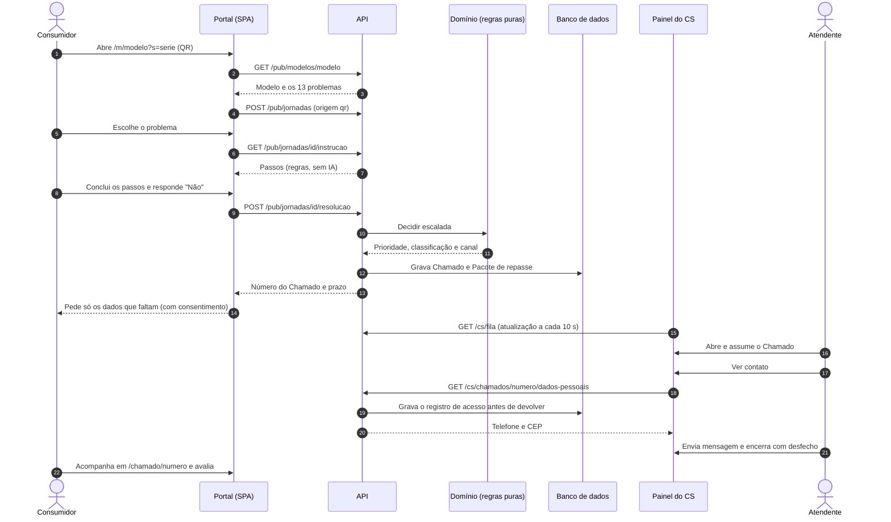
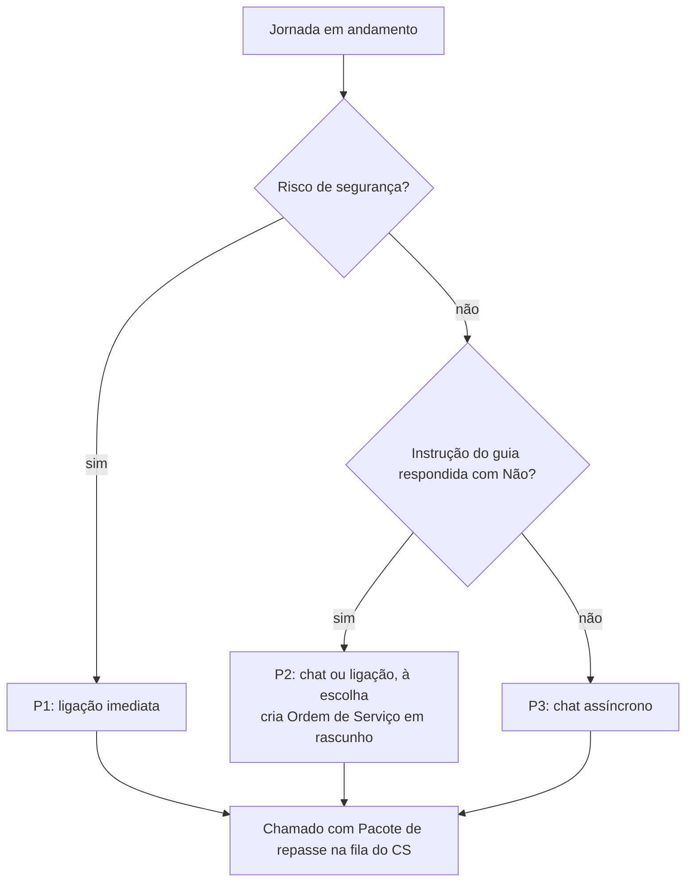
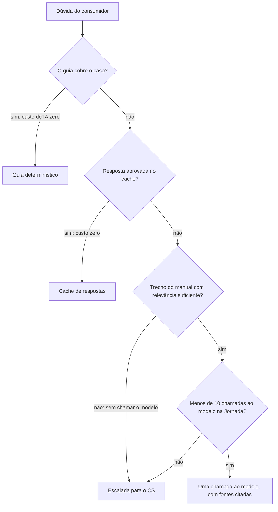
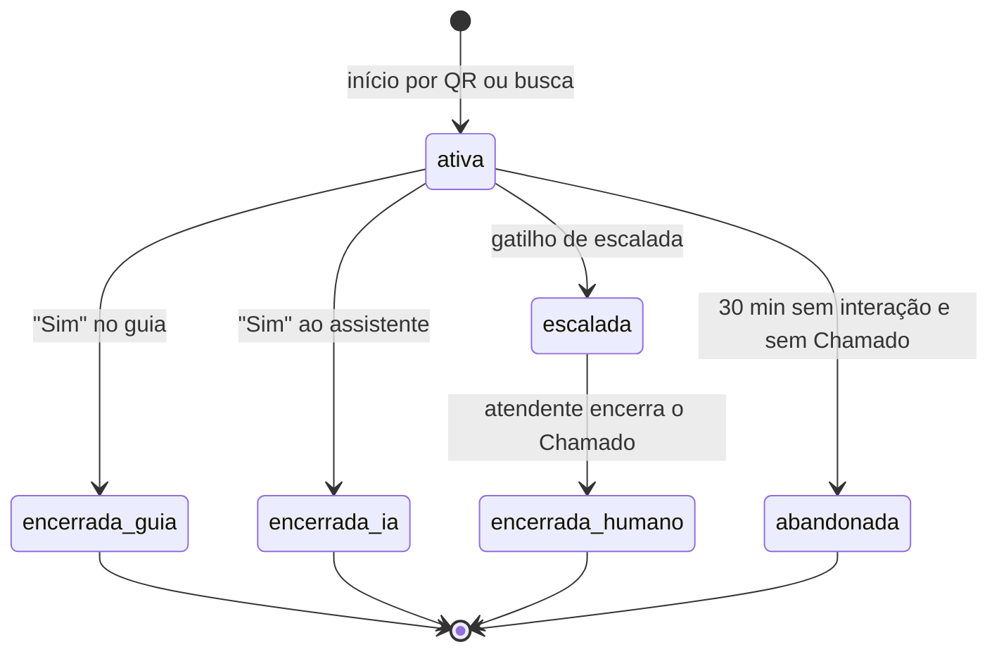
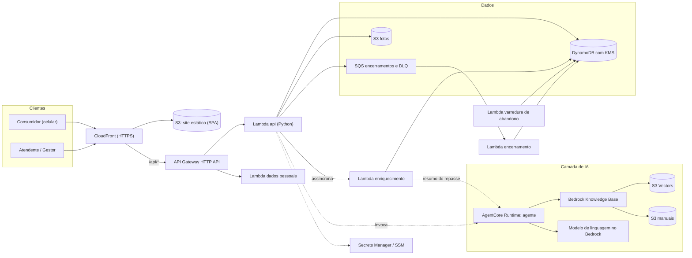

# 🛠️ Facilita: TRES Autoatendimento

Canal web único para consumidores de máquinas de café TRES (3corações) resolverem sozinhos o que não é defeito e chegarem ao atendimento humano só quando realmente precisam. O repasse ao CS vai pronto: com prioridade, canal e histórico do que já foi tentado.

> Protótipo de hackathon. O que está pronto, o que roda só em modo local e o que ainda está planejado está descrito em [Status do projeto](#-status-do-projeto).

## 📑 Sumário

- [Proposta do desafio](#-proposta-do-desafio)
- [Nossa solução](#-nossa-solução)
- [Fluxo da aplicação](#-fluxo-da-aplicação)
- [Arquitetura](#-arquitetura)
- [Tecnologias utilizadas](#-tecnologias-utilizadas)
- [Estrutura de pastas](#-estrutura-de-pastas)
- [Pré-requisitos](#-pré-requisitos)
- [Configuração (variáveis de ambiente)](#-configuração-variáveis-de-ambiente)
- [Instalação e execução local](#-instalação-e-execução-local)
- [Popular dados (seed e scripts)](#-popular-dados-seed-e-scripts)
- [Testes](#-testes)
- [Deploy na AWS](#-deploy-na-aws)
- [Segurança e privacidade](#-segurança-e-privacidade)
- [CI](#-ci)
- [Status do projeto](#-status-do-projeto)
- [Documentação complementar](#-documentação-complementar)
- [Equipe](#-equipe)
- [Licença](#-licença)

## 🎯 Proposta do desafio

**Problema.** Segundo os requisitos do projeto, mais de 70% dos chamados técnicos de máquinas TRES são falsos defeitos: limpeza simples ou dúvida de uso. Cada um deles ocupa o CS e deixa o consumidor esperando por algo que ele mesmo poderia resolver em poucos passos.

**O que o desafio pede.** Um canal padronizado que:

- identifique a máquina sem esforço do consumidor;
- resolva os casos comuns sozinho;
- escale para uma pessoa só quando necessário, sem fazer o consumidor repetir informações;
- meça o resultado (deflexão por camada, precisão da escalada, tempo e custo).

**Contexto do hackathon.** 2 dias de duração, protótipo demonstrado ao vivo, banco de dados real na AWS e agente de IA construído com Amazon Bedrock AgentCore (conforme `.kiro/specs/tres-autoatendimento/requirements.md`).

<!-- TODO: confirmar o enunciado oficial do desafio (nome do desafio/organizador) e ajustar esta seção, se necessário. -->

## 💡 Nossa solução

O **TRES Autoatendimento** (nome do repositório: Facilita) organiza o atendimento em camadas. Cada camada só entra quando a anterior não resolve, e o contexto da **Jornada** do consumidor é preservado entre elas.

| Camada | O que faz | Situação no código |
|--------|-----------|--------------------|
| 1. Encontra o modelo | QR code colado na máquina (`/m/<modelo>?s=<serie>`) ou busca por nome/foto | Implementado |
| 2. Resolve o comum | Guia determinístico com os 13 problemas mais comuns, instruções passo a passo | Implementado |
| 3. Pergunta à IA | Assistente com IA (Amazon Bedrock AgentCore) que responde só com base nos manuais | Parcial: peças do agente existem, o fluxo ponta a ponta ainda não |
| 4. Fala com alguém | Repasse ao CS com pacote estruturado, prioridade e canal definidos por regras | Implementado |
| 5. Mede o resultado | Dashboard, métricas e insights de satisfação para o gestor | Implementado em modo local |

**Princípio de "IA sustentável".** A IA entra só quando o guia determinístico não cobre o caso. Perguntas repetidas são reaproveitadas por cache (alimentado só por respostas aprovadas por um atendente) e o custo de cada chamada ao modelo é registrado.

### Perfis de usuário

| Perfil | Onde acessa | O que faz |
|--------|-------------|-----------|
| Consumidor | Portal (`/`, `/m/<modelo>`, `/chamado/<numero>`) | Escolhe a máquina, segue o guia, abre e acompanha o Chamado, avalia o atendimento. Não precisa de login |
| Atendente | Painel do CS (`/cs`) | Vê o Dashboard e a fila por prioridade, assume Chamados, conversa com o consumidor, agenda ligação, encerra com desfecho |
| Gestor | Painel do CS (`/cs`) | Tudo do atendente, mais Métricas (`/cs/metricas`) e Insights (`/cs/insights`) |

### Funcionalidades

- **Acesso e busca:** QR code ou busca por nome, com grade de fotos dos modelos.
- **Guia dos 13 problemas:** instruções em passos numerados, com texto alternativo para cada passo. A seleção é por regras, então a mesma entrada gera sempre a mesma instrução.
- **Confirmação "Resolveu?":** "Sim" encerra a Jornada e pede avaliação de 1 a 5 estrelas. "Não" abre um Chamado.
- **Detecção de risco de segurança:** termos como queimado, fumaça, choque e faísca, ou vazamento interno informado no guia, marcam a Jornada com risco. O portal exibe o alerta fixo "Desligue a máquina da tomada e não a utilize" e o Chamado sai como P1.
- **Prioridade e canal por regras determinísticas:**

  | Situação | Prioridade | Canal recomendado | Prazo mostrado ao consumidor |
  |----------|-----------|-------------------|------------------------------|
  | Risco de segurança | P1 | Ligação imediata | Ligação em até 15 min |
  | Instrução do guia respondida com "Não" | P2 | Chat ou ligação, à escolha | Contato em até 4 horas úteis |
  | Demais casos | P3 | Chat assíncrono | Resposta em até 1 dia útil |

- **Pacote de repasse:** JSON versionado, validado por esquema, com modelo, série, categoria do sintoma, lista "já tentado", classificação, prioridade, canal, anexos (até 3 fotos) e sugestão de próxima ação.
- **Abertura e acompanhamento do Chamado:** número legível, dados pessoais pedidos só conforme a prioridade e com consentimento explícito, fotos por URL pré-assinada, mensagens do atendente na página de acompanhamento.
- **Painel do CS:** login com perfis, Dashboard com visão geral e "Chamados em foco", fila ordenada, card do Chamado com resumo no topo, ações do atendente, encerramento com desfecho (falso defeito ou defeito real) e solução.
- **Retroalimentação:** o atendente pode adicionar a solução ao cache de respostas ao encerrar um Chamado.
- **Insights do gestor:** nota média e distribuição, comentários recentes (com dados pessoais mascarados), tempo até assumir e até encerrar, P1 de risco, falso defeito x defeito real, problemas mais frequentes e funil da Jornada.
- **Acessibilidade e mobile-first:** foco por teclado, alvos de toque de 44x44 px, respeito a movimento reduzido, textos em português do Brasil (requisitos de acessibilidade na spec; sem auditoria WCAG formal).

## 🔄 Fluxo da aplicação

### Caminho principal: QR, guia, "Não", Chamado e atendimento



### Decisão de escalada



Outros gatilhos de escalada previstos na spec: pedido de atendimento humano, duas negativas ao assistente, resposta sem embasamento, frustração alta e limite de 10 mensagens processadas pelo modelo. A prioridade só depende dos fatos registrados na Jornada, nunca de horário ou saída do modelo.

### Modelo de camadas e custo de IA (desenho da spec)



> Este último fluxo é o desenho da spec. O pipeline da IA na API ainda não foi implementado (veja [Status do projeto](#-status-do-projeto)).

### Estados da Jornada



## 🏗️ Arquitetura

Serverless na AWS, definida em CDK (Python). Um único domínio CloudFront serve o site e a API (`/api/*`), o que evita CORS e permite cookie de sessão `HttpOnly`.



As linhas tracejadas indicam integrações com o agente: o CDK só concede a permissão de invocação quando o contexto `agente_runtime_arn` é informado, e o runtime do agente ainda não é implantável (veja [Status](#-status-do-projeto)).

### Serviços AWS (stacks do CDK)

| Stack | Arquivo | Recursos |
|-------|---------|----------|
| `<prefixo>-dados` | `infra/stacks/dados_stack.py` | Chave KMS, tabelas DynamoDB sob demanda (catálogo, Jornadas, Chamados, dados pessoais, cache de respostas, avaliações, usuários e sessões do CS, config, entre outras) |
| `<prefixo>-armazenamento` | `infra/stacks/armazenamento_stack.py` | Buckets S3 (site, fotos, manuais), fila SQS de encerramentos com DLQ, segredo e parâmetros SSM |
| `<prefixo>-conhecimento` | `infra/stacks/conhecimento_stack.py` | Bedrock Knowledge Base sobre S3 Vectors, data source S3 no prefixo `secoes/` |
| `<prefixo>-api` | `infra/stacks/api_stack.py` | Lambdas Python 3.12 (`api`, `dados_pessoais`, `enriquecimento`, `encerramento`, `varredura`), autorizador de origem, HTTP API, EventBridge Scheduler da varredura de abandono |
| `<prefixo>-borda` | `infra/stacks/borda_stack.py` | Distribuição CloudFront (site e `/api/*`), políticas de cache e de cabeçalhos de segurança |

O prefixo padrão é `tres` (contexto `prefixo` em `infra/cdk.json`).

## 🧰 Tecnologias utilizadas

Versões extraídas de `apps/web/package.json` e dos `pyproject.toml` de cada módulo.

| Camada | Tecnologia | Versão |
|--------|------------|--------|
| Frontend | React / React DOM | 19.3.0 |
| Frontend | React Router | 8.4.0 |
| Frontend | Recharts (gráficos do Insights) | 3.10.1 |
| Frontend | TypeScript | 6.0.3 |
| Frontend | Vite (build e servidor de desenvolvimento) | 8.3.4 |
| Frontend | Vitest, Testing Library, jest-axe, jsdom | 5.0.4, 16.3.3, 11.0.0, 30.1.2 |
| Frontend | ESLint, typescript-eslint | 10.12.0, 8.71.2 |
| Backend | Python | 3.12 ou superior |
| Backend | boto3 | 1.43.112 |
| Backend | AWS Lambda (roteador único), API Gateway HTTP API | n/d |
| Backend | argon2-cffi (hash de senha do Painel do CS) | 25.1.0 |
| Backend | jsonschema (validação do Pacote de repasse) | 4.26.0 |
| IA e agente | Strands Agents (agente em `services/agente`) | 1.60.0 |
| IA e agente | Amazon Bedrock AgentCore Runtime, Bedrock Knowledge Base (RAG) | n/d |
| IA e agente | Modelo de linguagem padrão e embeddings, definidos em `services/agente/premissas.py` | ver arquivo |
| Dados | Amazon DynamoDB (sob demanda), Amazon S3, Amazon SQS | n/d |
| Dados | Amazon S3 Vectors (armazenamento vetorial da Knowledge Base) | n/d |
| Infra | AWS CDK (Python): `aws-cdk-lib`, `constructs` | 2.273.0, 10.8.1 |
| Infra | CloudFront, KMS, Secrets Manager, SSM Parameter Store, EventBridge Scheduler | n/d |
| Qualidade | pytest, Hypothesis (testes baseados em propriedades) | 9.1.1, 6.169.0 |
| Qualidade | moto (simula AWS nos testes) | 5.2.4 |
| Qualidade | ruff (lint Python) | 0.17.0 |
| Segurança | gitleaks (pre-commit e CI) | v8.18.4 |
| Segurança | pre-commit | n/d |
| Utilitários | segno (geração de QR codes) | 1.6.6 |
| CI | GitHub Actions | n/d |

## 📁 Estrutura de pastas

```text
.
├── apps/
│   └── web/                 # SPA React + Vite + TypeScript (Portal do consumidor e Painel do CS)
│       ├── src/paginas/     #   telas do consumidor (início, máquina, instrução, chamado)
│       ├── src/cs/          #   Painel do CS (login, dashboard, fila, chamado, métricas, insights)
│       ├── src/api/         #   clientes HTTP e fila de eventos pendentes
│       └── scripts/         #   verificar-chunks.mjs (confere o empacotamento dos gráficos)
├── services/
│   ├── api/                 # API Python (Lambda): core, routes, servicos, repositorios, handlers, tests
│   └── agente/              # Agente Strands para o AgentCore (config, contratos, recuperação, privacidade)
├── packages/
│   └── dominio/             # Regras de negócio puras, sem I/O: escalada, risco, PII, cache, pacote, métricas
├── infra/                   # AWS CDK em Python: app.py, stacks/, lambdas/ e tests/
├── scripts/                 # Carga do seed, usuários do CS, QR codes, deploy e servidor local de demo
├── seed/                    # Catálogo, 13 problemas, instruções, mapa do seletor, manuais e mídia de exemplo
├── docs/
│   └── DEMO.md              # Roteiro e instruções da demo local (sem AWS)
├── .kiro/specs/             # Especificações: requisitos, design e tarefas de cada feature
├── .agents/tasks/           # Relatórios de apoio (ex.: precificação em nuvem)
├── .github/workflows/       # Pipeline de CI
├── .env.example             # Nomes das variáveis de ambiente (sem valores)
├── .pre-commit-config.yaml  # Hook do gitleaks
└── .gitleaks.toml           # Regras de varredura de segredos
```

O pacote `dominio` concentra as regras determinísticas (Motor de escalada, detector de risco, mascaramento de dados pessoais, normalização do cache, validação do pacote, agregação de métricas). Assim, as regras são testadas com Hypothesis sem depender de rede ou banco.

## ✅ Pré-requisitos

| Para | Precisa de |
|------|------------|
| Demo local | Python 3.12 ou superior, Node.js (o CI usa a versão 20) e npm |
| Deploy na AWS | Conta AWS com credenciais configuradas, AWS CLI, AWS CDK CLI (`npm i -g aws-cdk`), `npm` e Python 3 |
| Hooks de segredos | `pip install pre-commit` |

<!-- TODO: confirmar a versão mínima do Node.js para desenvolvimento local; só o CI (Node 20) a fixa. -->

## 🔐 Configuração (variáveis de ambiente)

Copie `.env.example` para `.env` (ignorado pelo Git) e preencha localmente. O arquivo de exemplo traz apenas nomes. **Nunca versione valores.**

```bash
cp .env.example .env
```

| Variável | Uso |
|----------|-----|
| `AWS_PROFILE` | Perfil das credenciais AWS |
| `AWS_REGION` | Região usada pelos scripts e pelo agente |
| `CDK_DEFAULT_ACCOUNT` | Conta usada pelo CDK |
| `CDK_DEFAULT_REGION` | Região usada pelo CDK |
| `CS_SENHA_INICIAL` | Senha inicial dos usuários do Painel do CS (mínimo de 12 caracteres, troca forçada no primeiro acesso). Lida por `scripts/criar_usuarios_cs.py` |
| `TRES_PREFIXO_TABELAS` | Prefixo das tabelas DynamoDB usado pelos scripts (padrão `tres`) |
| `AGENTCORE_RUNTIME_ARN` | Runtime do agente no AgentCore |
| `BEDROCK_MODEL_ID` | Modelo de linguagem do Bedrock |
| `KNOWLEDGE_BASE_ID` | Knowledge Base dos manuais |

Os scripts e o agente também leem, quando existem, `TRES_BUCKET_MANUAIS`, `TRES_KNOWLEDGE_BASE_ID`, `TRES_DATA_SOURCE_ID`, `TRES_URL_BASE` e `TRES_PREFIXO` (o deploy usa este último). Veja o cabeçalho de cada script.

<!-- TODO: confirmar a divergência de nomes entre .env.example (AGENTCORE_RUNTIME_ARN, BEDROCK_MODEL_ID, KNOWLEDGE_BASE_ID) e o que o código lê (TRES_KNOWLEDGE_BASE_ID e a variável definida em premissas.MODELO_LLM_ENV). Alinhar um dos lados. -->

## 🚀 Instalação e execução local

A demo local roda a API real (`services/api`) com repositórios em memória e o front-end Vite, **sem AWS e sem IA**. É o plano B da demo: pesquisa de modelo, guia, Chamado e Painel do CS. O guia completo está em [`docs/DEMO.md`](docs/DEMO.md).

**1. Preparar (uma vez), na raiz do repositório:**

```bash
python3 -m venv .venv-demo
.venv-demo/bin/pip install -e packages/dominio argon2-cffi jsonschema boto3
cd apps/web && npm install && cd ..
```

**2. Subir, em dois terminais:**

```bash
# Terminal 1: API local em http://127.0.0.1:8000
.venv-demo/bin/python scripts/dev_local.py
```

```bash
# Terminal 2: front-end em http://localhost:5173 (o Vite repassa /api e /midia para a porta 8000)
cd apps/web && npm run dev
```

Opções do servidor local (`scripts/dev_local.py`):

| Opção | Efeito |
|-------|--------|
| `--porta 8000` | Porta da API |
| `--sem-demo` | Não cria os Chamados de exemplo nem a semente de dados do Insights |
| `--resetar` | **Apaga** o estado salvo em `.dados-demo/estado.json` e recomeça do zero |

**3. Acessar:**

| O quê | URL |
|-------|-----|
| Pesquisa de modelo | `http://localhost:5173/` |
| Entrada por QR (exemplo) | `http://localhost:5173/m/tres-passione?s=DEMO001` |
| Painel do CS | `http://localhost:5173/cs/login` |

Usuários de demonstração: `atendente` e `gestor`. A senha vem de `CS_SENHA_INICIAL` ou, se vazia, do valor de demonstração descrito em `docs/DEMO.md`.

> Somente para demo. O cookie de sessão perde o atributo `Secure` para funcionar em `http://localhost`. Não exponha a porta da API na rede. O estado salvo em `.dados-demo/` pode conter telefone e CEP digitados; use apenas dados fictícios e não compartilhe o arquivo.

O estado da demo é persistido em `.dados-demo/estado.json` (ignorado pelo Git) e sobrevive a reinícios da API. As sessões do Painel do CS não persistem. As telas de Dashboard, Métricas e Insights dependem da listagem de Chamados que só existe no modo local.

## 🌱 Popular dados (seed e scripts)

O diretório `seed/` é a fonte da carga idempotente. **Todo o conteúdo é de exemplo** (3 modelos, com `tres-passione` como modelo da demo) até a 3corações fornecer instruções, mídia e manuais oficiais. Detalhes em [`seed/README.md`](seed/README.md).

| Script | Para que serve | Exemplo |
|--------|----------------|---------|
| `scripts/carregar_seed.py` | Valida e carrega catálogo, 13 problemas, instruções e manuais (DynamoDB e S3). Duas execuções geram o mesmo conjunto de registros | `python scripts/carregar_seed.py --validar-apenas` (valida sem acessar a AWS) |
| `scripts/carregar_seed.py` | Carga real | `python scripts/carregar_seed.py --bucket-manuais <bucket> --prefixo tres` |
| `scripts/criar_usuarios_cs.py` | Cria os usuários iniciais do Painel do CS na AWS (`atendente` e `gestor`, ou os informados em `--usuario nome:perfil`) | `CS_SENHA_INICIAL=<senha> python scripts/criar_usuarios_cs.py` |
| `scripts/gerar_qrcodes.py` | Gera um QR code por modelo do catálogo (`svg`, `png` ou `ambos`), em `scripts/saida/` | `python scripts/gerar_qrcodes.py --url-base <https://dominio> --formato ambos` |
| `scripts/preprocessar_manuais.py` | Divide um manual em Markdown em uma seção por arquivo, com metadados | `python scripts/preprocessar_manuais.py <manual.md> --modelo-id <id>` |
| `scripts/sincronizar_conhecimento.py` | Envia as seções à Knowledge Base e roda a ingestão | `python scripts/sincronizar_conhecimento.py --bucket-manuais <bucket> --knowledge-base-id <id>` |
| `scripts/semente_demo.py` | Semente fictícia de Jornadas, Chamados e avaliações para o Insights (usada pelo servidor local) | via `scripts/dev_local.py` |
| `scripts/estado_demo.py` | Persistência do estado da demo local em JSON | via `scripts/dev_local.py` |

A carga também aceita `--sincronizar-conhecimento` para enviar os manuais à Knowledge Base logo depois (veja `scripts/carregar_seed.py --help`).

## 🧪 Testes

Cada módulo tem sua própria configuração de pytest e instala as dependências de desenvolvimento pelo extra `dev`.

```bash
# Domínio (regras puras + propriedades com Hypothesis)
pip install -e "packages/dominio[dev]"
cd packages/dominio && pytest

# API
pip install -e "packages/dominio[dev]" -e "services/api[dev]"
cd services/api && pytest

# Infra (CDK)
pip install -e "infra[dev]"
cd infra && pytest

# Scripts
pip install -e "scripts[dev]"
cd scripts && pytest

# Agente
pip install -e "services/agente[dev]"
cd services/agente && pytest
```

O Hypothesis roda 100 exemplos por propriedade por padrão. Para o perfil do CI (200 exemplos), use `HYPOTHESIS_PROFILE=ci` ou `pytest --hypothesis-profile=ci`.

Front-end (a partir de `apps/web`):

```bash
npm ci
npm run lint        # ESLint + verificação de tipos
npm run typecheck   # tsc --noEmit
npm test            # Vitest em execução única
npm run build       # tsc --noEmit + vite build
```

Outros testes focados e a conferência do empacotamento (`node scripts/verificar-chunks.mjs`, depois de `npm run build -- --manifest`) estão descritos no final de [`docs/DEMO.md`](docs/DEMO.md).

<!-- TODO: confirmar que a suíte completa de cada módulo passa hoje. O CI roda apenas domínio, API e front-end; infra, scripts e agente têm testes, mas não entram no workflow. -->

## ☁️ Deploy na AWS

O script `scripts/deploy.sh` executa, em ordem: `cdk deploy --all`, build do front-end, sync do site no S3, invalidação do CloudFront e carga do seed. Ele usa a cadeia padrão de credenciais da AWS e não lê nada do repositório.

```bash
scripts/deploy.sh                 # fluxo completo
scripts/deploy.sh --sem-cdk       # pula o cdk deploy
scripts/deploy.sh --sem-carga     # pula a carga do seed
```

Depois do deploy, crie os usuários do Painel do CS:

```bash
CS_SENHA_INICIAL=<senha> python scripts/criar_usuarios_cs.py
```

Contextos opcionais do CDK (`-c chave=valor` ou `infra/cdk.json`): `prefixo`, `destruir_ao_remover` (padrão `false`, os dados são retidos), `agente_runtime_arn`, `origens_cors_fotos` e `empacotar_dependencias`. Para implantar só a infraestrutura (sem build do site nem carga do seed):

```bash
cd infra && cdk deploy --all -c prefixo=tres
```

<!-- TODO: confirmar que o deploy de ponta a ponta já foi executado em uma conta AWS. O relatório .agents/tasks/precificacao-nuvem.md indica que não havia evidência de deploy quando foi escrito. -->

Estimativas de custo mensal por cenário estão em [`.agents/tasks/precificacao-nuvem.md`](.agents/tasks/precificacao-nuvem.md). Pelo relatório, o custo ocioso é baixo e a IA domina a conta em produção.

## 🔒 Segurança e privacidade

**Segredos fora do repositório.**

- `.gitignore` bloqueia `.env`, `.env.*` (exceto `.env.example`), `*.pem` e `*.key`.
- Hook de pre-commit com **gitleaks** (`.pre-commit-config.yaml`). Instalação local: `pip install pre-commit && pre-commit install`.
- `.gitleaks.toml` mantém as regras padrão e adiciona uma regra para valores atribuídos a `CS_SENHA_INICIAL`, `AWS_SECRET_ACCESS_KEY` e `AWS_SESSION_TOKEN`.
- O job `segredos` do CI varre o histórico completo e bloqueia os demais jobs se encontrar algo.

**Painel do CS (conforme o design).**

- Login próprio, com senha em hash Argon2id.
- Sessão por token opaco, guardado só como hash, com expiração por inatividade (30 minutos).
- Bloqueio temporário após 5 tentativas de login com falha em 15 minutos.
- Perfis `atendente` e `gestor` com autorização por rota. Métricas e Insights são exclusivos do gestor.

**LGPD e dados pessoais (conforme a spec).**

- Nenhum dado pessoal é obrigatório até o contato com o atendente. Telefone e CEP são pedidos conforme a prioridade, com finalidade exibida e consentimento explícito (caixa que começa desmarcada).
- Texto livre do consumidor passa por mascaramento de telefone, CPF, e-mail e CEP antes de qualquer outro uso.
- Telefone e CEP ficam em tabela própria, com criptografia em repouso (KMS).
- O acesso do atendente aos dados pessoais é registrado **antes** de os dados serem exibidos. Se o registro falhar, os dados não são exibidos.
- Métricas e Insights mostram apenas valores agregados.
- HTTPS obrigatório e cabeçalhos de segurança via CloudFront.
- A política formal de retenção e exclusão de dados pessoais ficou fora do MVP e deve ser definida com o jurídico da 3corações.

<!-- TODO: confirmar com o time o texto do aviso de privacidade em /privacidade; a spec indica que o texto jurídico é responsabilidade da 3corações. -->

## 🔁 CI

O workflow `.github/workflows/ci.yml` roda em push na `main` e em pull requests:

| Job | O que faz |
|-----|-----------|
| `segredos` | Varredura de segredos com gitleaks no histórico completo. Os demais jobs dependem dele |
| `dominio` | Testes do domínio com pytest e Hypothesis (perfil `ci`) |
| `api` | Testes da API |
| `frontend` | `npm ci`, lint e testes do Vitest |

Para o merge ser de fato bloqueado por segredos, configure o status check obrigatório "Varredura de segredos" na proteção da branch `main` (instrução no próprio `ci.yml`).

## 📌 Status do projeto

Fonte: caixas de seleção em `.kiro/specs/*/tasks.md` e leitura do código. Os `tasks.md` podem estar atrás do código em alguns itens (por exemplo, rotas do guia e do Painel do CS existem, mas as tarefas-mãe 11 a 15 continuam abertas).

| Spec | Escopo | Situação |
|------|--------|----------|
| `tres-autoatendimento` | Domínio, infra CDK, persistência, seed, API, Portal e Painel do CS, IA, métricas, seletor visual, deploy | Parcial. Marcadas: 84 concluídas e 41 pendentes (contagem de itens e subtarefas) |
| `insights-gestor` | Insights, Dashboard e navegação do Painel do CS | Concluída. As 50 pendências são testes opcionais (marcados com `*`) |
| `persistencia-local-demo` | Persistência do estado da demo local e métricas simples | Concluída, exceto o item 11 (verificação final), cujos subitens estão marcados |

### Limitações conhecidas

- **Assistente de IA ainda não funciona ponta a ponta.** Existem a porta do agente na API, o esqueleto do agente (`config`, `contratos`, `modelo`, `recuperação`, `privacidade`), a Knowledge Base e o script de sincronização. Faltam o agente Strands completo, o deploy no AgentCore, o pipeline de mensagens na API (cache, limite de chamadas, custo) e o painel do assistente no front-end (tarefas 17 a 19).
- **Seletor visual de sintoma** (tarefa 21): o mapa existe em `seed/seletor/`, mas não há componente no front-end.
- **Dashboard, Métricas e Insights só funcionam no modo local.** No adaptador DynamoDB, `listar_todos` levanta `ErroIndisponivelForaDoModoLocal`. A versão com AWS (tarefa 20) está pendente.
- **Conteúdo de exemplo.** Instruções, mídia e manuais do seed são de espaço reservado, e só o modelo `tres-passione` tem instruções.
- **Telefonia e integrações legadas** (CRM, ERP, assistência técnica real) estão fora do MVP: "ligação imediata" e "agendar ligação" são registros no Chamado, e a Ordem de Serviço é um registro interno.
- **Fora do escopo do MVP, segundo a spec:** WhatsApp, cache semântico, identificação da máquina por foto com IA, vídeo como anexo, notificações ativas, login do consumidor, SSO e MFA no Painel do CS, auditoria formal de acessibilidade e outros idiomas.
- **Custos e proteção contra abuso.** O relatório de precificação aponta ausência de WAF, de limite por cliente e de alarmes de custo, além de uma restrição de região para o runtime do agente.

### Próximos passos

Seguem as tarefas abertas da spec principal:

1. Implementar e implantar o agente (Strands + AgentCore) e o conjunto dourado de avaliação (tarefa 17).
2. Implementar o pipeline do assistente na API e o painel do assistente no Portal (tarefas 18 e 19).
3. Implementar a API e a tela de métricas sobre a AWS (tarefa 20).
4. Implementar o componente do seletor visual (tarefa 21).
5. Deploy e verificação de ponta a ponta, com testes do caminho da demo (tarefa 22).

## 📚 Documentação complementar

| Documento | Conteúdo |
|-----------|----------|
| [`docs/DEMO.md`](docs/DEMO.md) | Roteiro da demo local, persistência, solução de problemas e testes focados |
| [`seed/README.md`](seed/README.md) | Convenções do seed, manuais e Knowledge Base |
| `.kiro/specs/tres-autoatendimento/` | Requisitos, design (arquitetura, fluxos, modelo de dados, propriedades) e tarefas do produto |
| `.kiro/specs/insights-gestor/` | Spec de Insights e do Dashboard |
| `.kiro/specs/persistencia-local-demo/` | Spec da persistência da demo local |
| [`.agents/tasks/precificacao-nuvem.md`](.agents/tasks/precificacao-nuvem.md) | Estimativa de custo na AWS por cenário |

## 👥 Equipe

<!-- preencher integrantes -->

| Nome | Papel |
|------|-------|
| <!-- preencher --> | <!-- preencher --> |

## 📄 Licença

<!-- TODO: definir a licença do projeto. Ainda não há arquivo LICENSE no repositório. -->

Licença ainda não definida.
